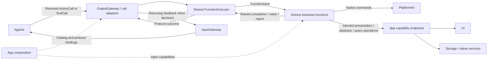
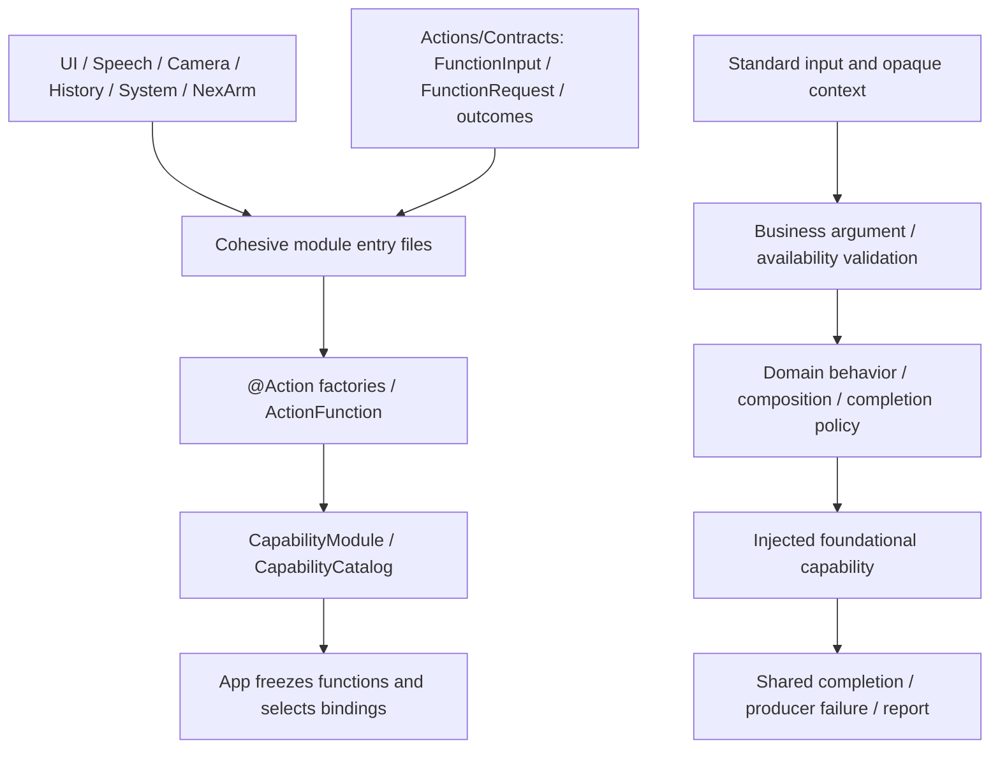

# Actions — Protocol-Neutral Business Functions

Actions implements callable business operations, queries and composition. Agents choose what to do; Gateway controls how calls are authorized and executed. Each function receives standard input and returns a shared outcome without knowing whether it was invoked through ActionCall or ToolCall.

Design goals: cohesive directory/module/function ownership, injected capabilities, intrinsic resource/budget constraints and independence from calling protocols.

## Upstream and downstream

Arrows show runtime execution; dashed arrows show assembly or injection, not imports. Agent calls always cross OutputGateway.

Endpoint completion means the function's declared acceptance or completion, not necessarily animation, inference or physical arrival. Completion-only native calls do not manufacture ToolResult feedback.

## Internal structure

Solid arrows below show catalog construction and function processing. Contracts is independently compiled as FunctionContracts; business sources cannot import execution or calling SDKs.

## Design principles and core mechanisms

**One implementation, explicit exposure.** A canonical `Domain.Module.function` identifies business behavior, not a scheduling lane or model alias. `@Action` generates ActionFunction metadata; it neither registers a call protocol nor grants permission. App freezes the catalog and selects bindings; Agents expose permitted aliases separately. This lets human and model entry points share implementation, validation and outcomes.

**Constraints belong to the function.** Resource requirements, serialization keys, completion kind and budget are intrinsic metadata. Both protocol views resolve the canonical function from the same FunctionRegistry, so a binding cannot replace its handler or weaken its resource/budget constraints. Channel/wait policy stays outside FunctionRequest.

| Standard contract | Function responsibility |
| --- | --- |
| FunctionRequest | Canonical address and string parameters; ActionArguments validates keys, required values, ranges and sizes |
| FunctionInput | Request, execution ID, opaque correlation context and injected FunctionReporting sink; no protocol branching |
| ActionCompletion | Finite completion/value/report, state acceptance or explicit activity start/stop identity, matching the declared kind |
| Producer failure | Neutral code/message from the owning domain; protocol conversion and user-facing wording belong to consumers |

A composed function retains leaf outcomes rather than hiding partial failure in a summary. The shared executor prefers an explicit returned report; for finite functions, a stored report takes precedence over an ordinary value and can retain failure evidence. Dynamic execution budget overrides constant timeout and runtime fallback; queue time is separate. Functions cooperate with cancellation, while the executor joins cleanup. A completed durable mutation cannot be rolled back merely because later presentation or feedback fails.

## Ownership and boundaries

- `Contracts/`: standard input/output, callable metadata, argument validation and neutral producer failures; no Channel or protocol discriminator.
- `UI/`, `Speech/`, `Camera/`, `History/`, `System/`, `NexArm/`: functions and domain catalogs, with canonical addresses `Domain.Module.function`.
- `@Action` declares intrinsic constraints only. App owns protocol profiles; Agent JSON/code owns grants. One function can be explicitly bound to either or both protocols.
- `Actions` depends on FunctionContracts, PlatformKit, StorageChat and the compile-time BehaviorDefinitions plugin. It cannot import Gateway, AgentCore, ExecutionRuntime or CallRuntime.
- Shared execution lives in [Gateway/Runtime](../Gateway/Runtime/README.md); registration and adapters live in [Gateway/Output](../Gateway/Output/README.md). Actions owns recipes, gestures, motion shaping and completion policy.

## Implementation status

✅ Six canonical domain catalogs, protocol-neutral factories/handlers and shared outcomes. Actions/Runtime, @Tool and business Tool aliases are removed; source/dependency checks enforce the boundary.

❌ Additional application capabilities, complete feature Signal routing and physical acceptance remain separate work. `System.Runtime.runtimeInfo` returns fixed information, not live diagnostics.

See [Contracts](Contracts/README.md), [Agent-driven architecture](../Agent-Driven-App.md) and [host profiles](../App/Composition/Behaviors/README.md).

✅ Every function preserves its business completion policy independently of call protocol. On invocation failure, preserve bounded child outcomes and producer causes; Gateway normalizes and dispatches the common result without stopping unrelated work. Explicit cancellation still joins cleanup.
