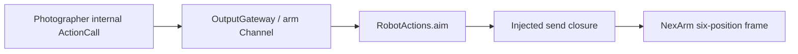

# Robot Actions

Purpose: send one non-settling aim to the arm that carries the phone. Design goals: validate logical radians in this module, complete when the injected sender accepts the angles, and keep PlatformKit out of the Actions target. See [ADR 0091](../../../docs/adr/0091-photographer-aim.md).

✅ `RobotActions.aim` accepts finite `base` and `pitch` strings within four turns and forwards them. Completion means the closure returned. It does not wait for a joint to reach the target and does not call the production NexArm controller.

✅ `Support/RobotActionModule` registers that finite Action. `ActionModules.builtIn` requires the sender beside the NexArm gesture and base closures. The camera session passes a closure that throws `notConnected` and does not open a socket.

❌ Wi-Fi, measured joint travel and wrist-travel recovery are not implemented. Production home and gestures stay on `PlatformKit/Connectivity/NexArm`.
