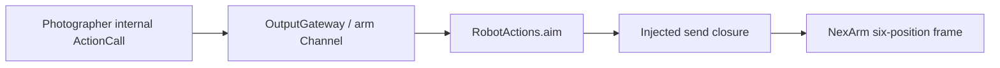

# Robot Actions

Purpose: send one non-settling aim to the arm that carries the phone. Design goals: validate logical radians in this module, complete when the injected sender accepts the angles, and keep PlatformKit out of the Actions target. See [ADR 0070](../../../docs/adr/0070-photographer-aim.md).

✅ `RobotActions.aim` accepts finite `base` and `pitch` strings within four turns and forwards them. Completion means the closure returned, which for NexArm means the transport accepted one six-position frame. It does not wait for a joint to reach the target.

✅ `RobotActionModule` registers that finite Action. `ActionModules.builtIn` requires the sender. The camera session passes a closure that throws `notConnected` and does not open a socket.

❌ Wi-Fi, measured joint travel, wrist-travel recovery and a hardware home pose are not implemented. `home()` on the controller still refuses the provisional raw-2048 table.
