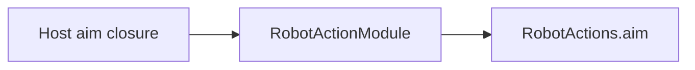

# Robot Action Support

Purpose: keep the aim registration out of the callable entry file. Design goals: one explicit module, an injected sender, and no device construction.

✅ `RobotActionModule` registers finite `Robot.aim` with display name 瞄准. The host supplies the sender. This directory adds no queue.

❌ The registration does not open Wi-Fi or call the production NexArm controller.
