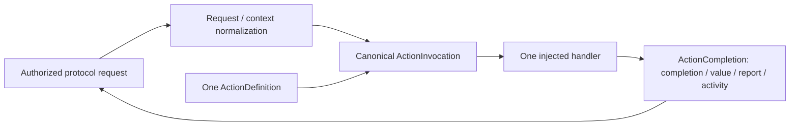

# Executable Contracts

Purpose: own implementation metadata, requests, opaque context and shared completion values. Design goals: one canonical contract, bounded values and no dependency on AgentCore or business libraries.

✅ ActionIdentifier carries domain/module/function. ActionDefinition owns canonical ActionInvocation handler, kind/completion, serializationKey, protocol availability, execution policy, resources and budgets. ToolDefinition/ToolResource are aliases, not separate definitions. Both macro factory families use the same definition.

✅ Protocol request/context views remain adapters. Direct requests normalize into ActionInvocation without Channel/wait membership; ToolInvocation is a typed endpoint view of that invocation. Context contains opaque source/session/input/sequence/turn identifiers, not permissions or a lease.

✅ Outcome values are capped at64 KiB UTF-8; reports have bounded entries/details. ToolResponse preserves typed completion in addition to its native string representation. Definitions retain parameter-resolved resources, constant/dynamic budgets and explicit result policy through projection. Empty/malformed metadata fails registration.

❌ These contracts grant no Agent permission, resource lease or hardware guarantee. Cross-process codecs and durable replay are outside this module.

✅ Composition freezes CapabilityCatalog once before projection: at most32 domains/256 canonical definitions, shared metadata validation before filtering, and duplicate addresses rejected across protocols. The same handler/metadata snapshot feeds both registries; invalid unexposed definitions cannot disappear silently.
