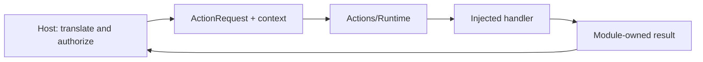

# Actions Contracts

Purpose: define the public inputs, metadata, capabilities and results owned by Actions. Design goals: independent execution, explicit host context and bounded values.

✅ `ActionRequest`, `ActionExecutionContext` and `ActionResource` belong to this module. Context contains opaque source/session/input/correlation identifiers and sequence; it carries no Agent input, output envelope, permissions or resource lease. The host validates identity and acquires resources before execution.

✅ Definitions describe explicitly registered handlers; attached macro declarations belong to the concrete Actions target. Arguments are decoded locally. ActionCompletion and ActionReport preserve bounded child failures; budgets compose by sum for sequences and maximum for parallel groups.

✅ No dependency on AgentCore, Gateway, App, UI or the other behavior module. These contracts compile inside `ActionRuntime` and contain no concrete behavior. Platform/model capabilities may be consumed by implementations when needed.

❌ Cross-process serialization and durable execution replay are not provided.

✅ ADR0098: Execution values and services are imported from independent ActionRuntime; concrete Action domains and macro declarations remain in Actions. Published paths, parameters, bounds and completion behavior are unchanged.

✅ ActionReport executionFailure.cancelled makes the report cancelled even when retained child results succeeded. Other execution failures retain partial-success details. ❌ No effect rollback.

✅ recordingFailure retains existing child entries and adds the reported execution failure, cancellation, first failed reported child code or mapped exception code. A successful stored prefix cannot erase a later thrown failure. ❌ Report retention does not establish physical rollback.

✅ Function-defined timeout takes precedence over Runtime defaults: Action keeps request-dependent budget resolvers (including NexArm); Tool stores optional Duration in its definition/registry and @Tool factories. Unspecified Actions/Tools use30 seconds; invalid explicit declarations fail without fallback. ❌ Deadlines cannot forcibly interrupt uncooperative cleanup.

✅ ActionReport.Entry carries immutable producer-owned details: at most16 nonempty keys (64 UTF-8 bytes) and512 UTF-8 bytes per value; invalid programmer values fail a precondition without dropping data. Dedicated motor/target/observed fields are removed. ❌ Business detail schemas remain producer-owned.

✅ ADR0122: Runtime resource values contain no camera constants. ActionFailure and ActionReport.Entry.Code are bounded opaque identifiers (1–64 UTF-8 bytes); Runtime provides generic execution codes only. NexArm owns its result vocabulary, Actions-owned NexArmExecutionError owns its execution failure-to-report mapping, and Gateway preserves producer identifiers. Existing device failure/report identifiers and presentation are unchanged.

❌ Runtime must not classify pose, foreground, control-readiness or device-feedback failures. Producers provide actionReportCode through ActionExecutionFailureProviding; the generic default handles invalid arguments/resource unavailability and otherwise reports handlerFailed. CancellationError remains cancellation.

✅ ADR0131: ActionReport carries an optional bounded512-character producer failureDescription. recordingFailure preserves child outcomes, classification and original captured reason; Runtime has no SDK error dependency. ❌ Persistence/remote validation remains pending.

✅ ADR0132: Independent producer codes, timeout root/child causes, App worker provenance and native-only recovery evidence have regression coverage. ❌ Physical acceptance and persistent error history remain pending.
