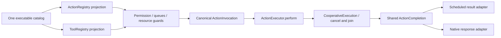

# Action Runtime

Purpose: validate canonical executable definitions and run one handler under shared completion/deadline/cancellation semantics. Design goals: independent Foundation-only execution, bounded metadata/results and protocol adapters without business policy.

## Registration

✅ ActionDefinition is the implementation contract. ToolDefinition aliases it; ToolResource aliases ActionResource. CapabilityModule owns one definitions catalog; protocol projections filter explicit availability. ActionRegistry bounds scheduled catalogs to32 modules/256 definitions; ToolRegistry bounds direct/native catalogs to32 modules/128 definitions. Duplicate/invalid entries fail atomically. Each address segment is1–64 ASCII identifier bytes; names, completion prose, resource sets and budgets are bounded. Scheduled native definitions require both implementation projections and a valid default native Channel.

✅ Definition-owned serializationKey is independent of address/Channel and defaults to path.module for isolated definitions. Production explicitly retains UI/Speech/NexArm keys. Registries validate it; parameters cannot override it. Resource resolvers and budget resolvers are retained when projecting either protocol. Direct Tool admission evaluates parameter-resolved resources before Gateway coordination.

## Shared execution and outcomes

✅ ActionExecutor.perform owns deadline, stored/returned report precedence and completion-kind validation for both protocols. ToolExecutor is a response adapter. Deadlines cancel and join cleanup; caller cancellation propagates. Dynamic estimates override constant timeouts, which override each caller's Runtime fallback. Queue time is outside execution budgets.

✅ ActionCompletion includes completed, bounded value, report and activity identities. Values above64 KiB UTF-8 fail explicitly. Reports retain their bounded child entries/details and execution-level failures. ToolResponse retains the typed completion; Gateway adapts it to the same AgentActionCompletion in ToolResult. Returning Tools receive feedback through InputGateway; completion-only effects retain no-feedback success and explicit failure responses. Delivery failure remains separate from executed effects.

✅ Gateway owns Channel/wait scheduling, leases, lifecycle cancellation and feedback delivery. SDK executor calls alone acquire no resource ownership. Runtime knows no Agent, model, UI, device or App implementation.

❌ Durable replay, generic progress subscriptions, arbitrary effect rollback and physical stop proof are not implemented.

✅ Scheduled native calls use one bounded child scope and receipt in Gateway; direct projections retain parameter-resolved resources and shared completion semantics. Runtime registries use one ActionDefinition.validate implementation.

✅ Composition freezes CapabilityCatalog once before projection: at most32 domains/256 canonical definitions, shared metadata validation before filtering, and duplicate addresses rejected across protocols. The same handler/metadata snapshot feeds both registries; invalid unexposed definitions cannot disappear silently.
