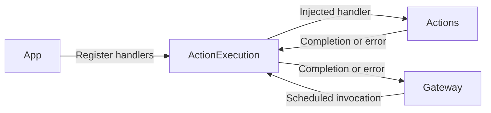
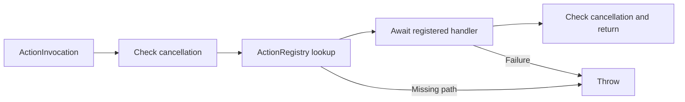

# Actions/Runtime — Action Registration and Execution

Maps resolved Action paths to App-supplied handlers. The goal is explicit handler selection and awaited execution; Gateway owns scheduling. These files compile in Actions alongside the behavior implementations; their source-level dependencies remain AgentCore contracts.

## Directory structure

```text
Runtime/
├── ActionRegistry.swift        # Immutable path-to-handler allowlist
├── ActionExecutor.swift        # Lookup, cancellation checks and awaited execution
├── ActionInvocation.swift      # Resolved call with trusted output context
├── ActionExecutionError.swift  # Admission and execution errors
└── README.md                   # Module contract and status
```

## Upstream and downstream

Arrows show runtime calls; Runtime and behavior files share the Actions target. App still supplies explicit handlers; execution does not discover behavior by reflection.



## Internal flow



The immutable registry is shared safely across tasks. Execution creates no queue or detached work. A handler must await its promised effect and cooperate with cancellation. Failure propagates to Gateway; already completed effects are not rolled back. [Channel scheduling](../../Gateway/Output/Scheduling/README.md) owns bounds, ordering, resource exclusion and cleanup barriers.

## Feature status

- ✅ Explicit registration, trusted invocation context, awaited completion and cancellation checks.
- ❌ Standard ActionResult and feedback through InputGateway; current success returns Void.

## Issue record

| Status | Issue / next step |
| --- | --- |
| Open | Cleanup relies on handler cooperation; no forced interruption or runtime timeout exists. |


✅ Structured wait scheduling adds explicit invalidSchedule, taskActionLimitExceeded and waitGroupLimitExceeded admission errors. Execution is still one resolved ActionInvocation per handler; wait groups belong to Gateway and never invoke handlers themselves. ❌ Actions/Runtime does not add timeouts, rollback or group ownership of physical resources.
