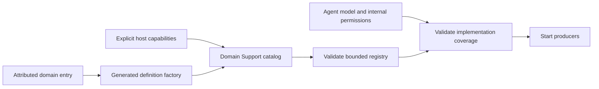
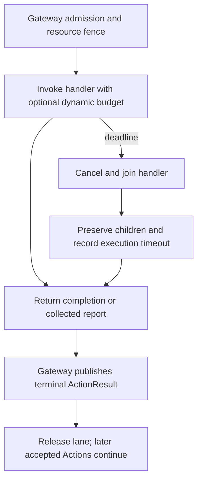

# Action Runtime

Purpose: bind, validate and execute Action implementations. Design goals: explicit completion, bounded composition/results, parameter-based resources and cooperative cleanup. Runtime consumes Actions/Contracts and Foundation; it owns no device or presentation policy.

## Registration and ownership

`@Action` generates typed `nameDefinition(handler:)` and `nameDefinition(completing:)` factories beside each canonical entry. Domain Support catalogs bind explicit host capabilities; `ActionModules` lists built-in domains. BehaviorAssembly constructs and validates the registry before producers start. Agent JSON and code-owned internal permissions remain the authorization source; metadata grants no permission.

`ActionRegistry` accepts at most32 modules and256 definitions. Paths follow the1–64-byte capability identifier grammar, display names must be nonblank and at most256 UTF-8 bytes, and completion descriptions at most512. Invalid/duplicate entries and missing capability implementations throw; nothing is silently replaced. Direct definition/empty-registry constructors support isolated runtimes and tests.

## Execution

`ActionInvocation` carries the module-owned request, execution ID, opaque context and report store. Gateway owns ScheduledAction, validates the Agent envelope and lease, assigns a fresh execution ID per admission and fences execution through ResourceCoordinator. Direct executor use does not acquire locks.

`ActionDefinition` stores kind, completion description, handler and resource/budget resolvers. `requiredResources(for:)` resolves the actual call parameters and rejects more than8 resources. A definition's static resource set is only the default. Children inherit their parent's resource fence.

Kinds and normal successful completions:

| Kind | Completion |
|---|---|
| finite | `completed` or `report` |
| state / activityUpdate | `completed` |
| activityStart | `activityStarted(id)` |
| activityStop | `activityStopped(id)` |

The Void handler adapter returns `completed`. Activity IDs refer to a service-owned lifetime; Runtime creates no background activity owner. A registered execution deadline can return a failure report for any kind.

`ActionExecutionBudget` separates expected duration from the timeout upper bound. Estimates never impose a minimum wait. The executor starts its timer after scheduling/resource admission, cancels on expiry and joins the handler's cleanup before releasing ownership. `ActionReport.executionFailure` records parent timeout separately from all collected child entries. An uncooperative handler cannot be forcibly terminated; timeout does not justify releasing resources while effects are still running.

Ordinary failure ends the current Action, including its wait barrier; it does not cancel the remaining input. Explicit user/session cancellation stops future work. Already committed physical effects are not rolled back. Delivery retries retry result messages only.

## Composition and reports

`ActionComposition` supports sequence, disjoint-resource parallel groups, repeat and explicit delay. Sequential children continue after failure. It validates before effects: depth≤8, resource union≤8, repeats1–32, delays0–30s and reserved results≤256. Each leaf reserves its declared result capacity plus one execution-level issue; overflow is an error, never silent truncation.

Budget estimates sum sequences, take the maximum for parallel nodes, multiply repeats and add delays with a100ms scheduling margin. A leaf without a declared budget makes the aggregate estimate unknown. Declared leaf deadlines are enforced cooperatively. Motor plans and measured completion rules belong in [NexArm](../NexArm/README.md), not Runtime.

Reports retain flat child paths, statuses, error codes and optional motor/target/observation data. Nested reports contribute to one parent result. Deadline cancellation is reported as timeout rather than user cancellation. Explicit cancellation marks remaining leaves not started and preserves previous outcomes. The invocation report store admits one final report and allows adapters to retain details through throwing/cancellation boundaries.

## Arguments and diagnostics

`ActionArguments` belongs to Actions/Contracts. It rejects undeclared keys, malformed values, nonfinite doubles and out-of-range integers; readers bound strings and source values. Domain code owns defaults and relationships between parameters. Gateway separately checks allowed parameter names. Dependency errors must not be relabeled as argument errors.

ChannelScheduler owns `ActionDiagnostics`, a circular ring of256 records by default, configurable1–4096. Overflow replaces the oldest record and increments an eviction count; it never drops device actions. Records contain execution identity, phase, effect and monotonic time, not arguments, media or error objects. Snapshots are bounded diagnostic history, not durable auditing. The separate execution ledger supplies self-described UI snapshots.

## Source map and status

| File | Responsibility |
|---|---|
| ../Contracts/ActionMacro / ActionDefinition | Compile-time metadata factories and runtime contracts |
| ActionRegistry / ActionModules | Validated registry and explicit domain catalog |
| ../Contracts/ActionInvocation / ActionReportStore | Module-owned request/context and bounded report store |
| ActionExecutor / ActionDeadline | Completion validation and cooperative deadlines |
| ActionComposition | Validated trees, resource/budget union and outcome aggregation |
| Gateway/Output/Scheduling/ActionDiagnostics | Payload-free bounded diagnostic ring |

✅ Registered execution, dynamic resource/budget resolution, composition, complete failure reporting and Channel continuation are implemented and tested.

❌ Automatic runtime discovery, generic activity supervision, durable result delivery and forced termination of uncooperative handlers are not implemented. Physical emergency stopping is a device capability, not a Swift cancellation promise.
