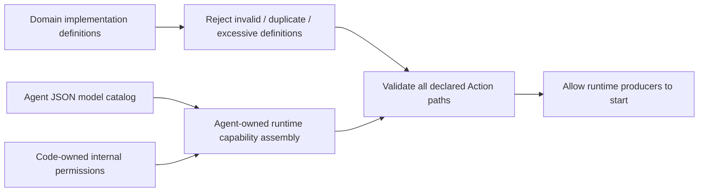
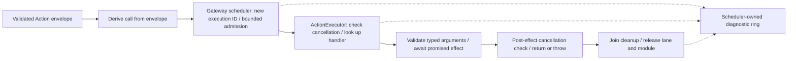
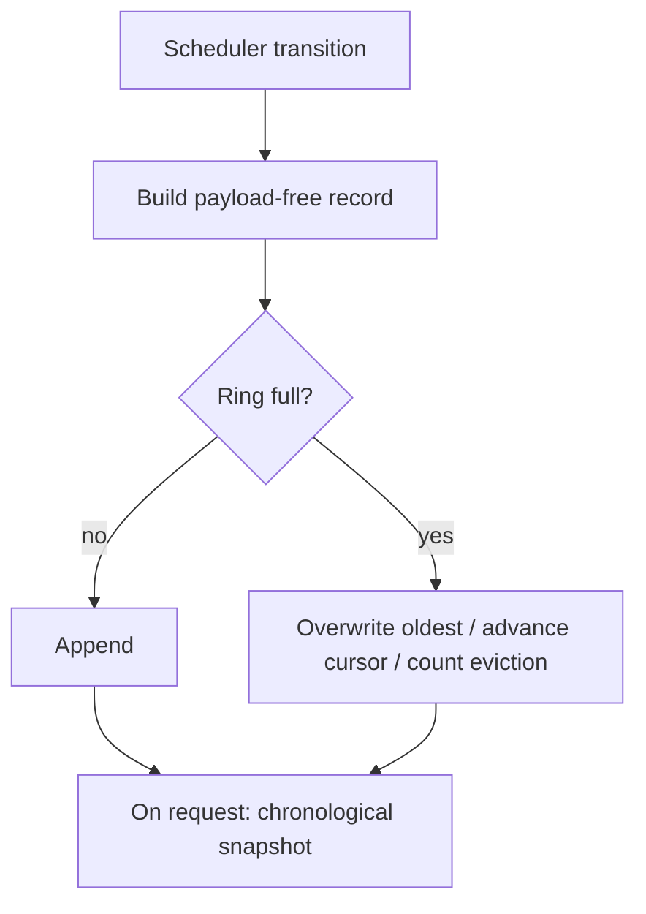

# Actions/Runtime — Implementation Contracts and Execution

Purpose: bind and execute declared Action implementations. Design goals: one consistent invocation, early registration errors, reusable argument decoding and bounded diagnostics without changing Channel/wait semantics. These sources compile in Actions and depend on AgentCore contracts, never concrete Agents, Gateway, App, UI or platform engines.

## Files and responsibilities

| File | Responsibility |
| --- | --- |
| ActionModule.swift | Explicit domain-owned definition catalog |
| ActionDefinition.swift | Path, implementation kind, completion description and awaited handler |
| ActionRegistry.swift | Immutable validated definitions and assembled capability coverage checks |
| ActionInvocation.swift | Single-envelope call construction and execution identity |
| ActionExecutor.swift | Handler lookup, cancellation checks and awaited execution |
| ActionExecutionError.swift | Definition/lookup/invocation errors only |
| ActionArguments.swift | Typed string/integer/finite-number/enum decoding and allowed-key validation |
| ActionDiagnostics.swift | Bounded payload-free execution record ring and chronological snapshots |

## Registration and completion contracts

Domain ActionModule implementations supply ActionDefinition arrays to `ActionRegistry(modules:)` through BehaviorAssembly. Direct `ActionRegistry(definitions:)` remains available for explicit isolated assembly. Arrays permit explicit duplicate detection; the former handlers dictionary initializer is removed. An explicit empty `ActionRegistry()` remains available for runtimes with no Actions. At most 256 definitions are admitted; excess throws. Path components use the existing 1–64-byte capability identifier grammar. Completion descriptions must be nonblank and at most 512 UTF-8 bytes. Invalid or duplicate definitions throw without overwriting or fallback.

`Kind` is `finite`, `state`, `activityStart`, `activityUpdate` or `activityStop`. It describes the implementation, not scheduling policy. The stored `ActionCompletionHandler` is `@Sendable (ActionInvocation) async throws -> ActionCompletion`. The `completing:` initializer requires typed completion; the existing `handler:` Void adapter maps success to `.completed`. All handlers are awaited through their real acknowledgment. A description is a declared promise, not proof that an adapter implements it. Activity labels do not create an activity owner or authorize hardware.

`validate(capabilities:)` checks every model-callable and code-owned internal Action path in an assembled CapabilityRegistry. It checks implementation coverage, not permission expansion or executable parameter schemas. App runs it before starting producers, reusing each Agent's own internal-capability assembler. JSON v5 remains the sole model-callable permission catalog; no metadata fields were added to it. See [App composition](../../App/Composition/README.md).

## Invocation and execution

`ActionInvocation(envelope:)` throws for a non-Action output and derives its call from that envelope. There is no independent `call:` argument to mismatch. The source/input/call convenience initializer constructs a matching envelope for trusted composition/tests. These constructors ensure consistency; they do not replace Gateway authorization, session checks or adapter permissions.

`ChannelScheduler.enqueue(invocation:)` no longer accepts a redundant path. On each admission it constructs a fresh invocation with a new execution UUID, returns that UUID as the admission receipt and passes the same invocation through handler execution and diagnostics. Reusing a submitted invocation requests another execution with a new ID; it is not retry deduplication. Direct ActionExecutor execution uses the invocation's existing ID and does not create scheduler diagnostics.

Execution creates no additional work queue, timeout task or detached worker. The scheduler retains its existing task-local FIFO/wait groups and global module exclusion. Handler completion must include its promised cleanup. A failure cancels the owning scheduled input as before; already committed effects are not rolled back. A post-effect CancellationError does not mean the effect was prevented.

## Arguments and error ownership

`ActionArguments` reads existing `[String: String]` transport values. `validateAllowedKeys` rejects undeclared keys; required readers reject missing keys, malformed values and out-of-range values. Strings preserve content and enforce caller-supplied UTF-8 limits; `allowBlank: true` explicitly permits empty/whitespace values. Integer/double/enum readers cap source values at 4096 UTF-8 bytes. Finite doubles reject NaN and infinities. Enum matching is exact. Optional defaults and relationships between fields remain explicit Action code; there is no coercion, clamping, reflection or implicit fallback.

UI Actions now use these readers and translate decoding errors into their domain errors **before** invoking dependencies. Dependency and cancellation errors are not caught by that translation. `UIActions.PresentationError` owns invalid text and presentation-call errors; existing emotion/gaze errors remain domain-owned. Gateway still independently checks the Agent's permitted parameter-name set.

Scheduling errors moved to `Gateway.ActionSchedulingError` (capacity, lifecycle and wait structure). `ActionExecutionError` contains missing handler, duplicate/invalid/excessive definitions and invalid invocation and completion-kind mismatch. Runtime forwards original handler errors without converting them to success. Stage 2 adds terminal ActionResult delivery through Gateway; only delivery retries, never Action effects.

## Diagnostic algorithm and limits

The scheduler actor is the sole production producer and mutable owner of `ActionDiagnostics`. Consumers explicitly call `diagnosticSnapshot()`; there is no subscriber queue, callback or worker. Snapshots contain chronological immutable records and the cumulative eviction counter.

| Property | Contract |
| --- | --- |
| Capacity | Default 256 records, configurable from 1 through 4096; invalid constructor configuration is a programming precondition |
| Overflow | Overwrite the oldest diagnostic record and increment evictedCount; never cancel, remove or skip an Action because diagnostics are full |
| Storage | Fixed-capacity circular array; no separate per-execution dictionary, payload storage or retained Error objects |
| Identity | Execution UUID, source, session, input, path, Channel, kind and monotonic timestamp |
| Phases | admitted; started; succeeded / failed / cancelled |
| Effects | notStarted for admission and cancelled queued work; unknown after entering execution on failure/cancellation; contractCompleted on success |
| Rejection | Failed admission produces no execution receipt or admitted record; its error propagates to the caller |
| Privacy | No parameters, generated/user text, PCM, credentials or error descriptions are recorded |
| Lifetime | Ring belongs to the scheduler; completed-task removal does not erase its retained history; shutdown adds terminal records and snapshots remain readable |

Admission records precede worker start. Queued work cancelled by a failure, explicit cancellation or shutdown gets a cancelled/notStarted record. Running work receives a terminal record only after its handler has returned/thrown and cleanup has been joined. If cancelled before entering the worker's execution boundary, it remains notStarted; once that boundary is crossed the conservative result is unknown. A stale UI no-op can still succeed according to its documented acceptance policy; contractCompleted is not a claim of rendered or physical completion.

The ring may evict part of an execution's history. It is diagnostic history, not durable auditing, ActionResult delivery, retry evidence or a full task-state database. The original error still propagates through finish. Snapshot cost is bounded by capacity; no user callback runs while the scheduler is mutating state.

## Status and verification

- ✅ Stage 1: implementation definitions, duplicate/metadata checks, assembled startup coverage, consistent invocation, typed arguments, error separation and bounded execution diagnostics.
- ✅ Deterministic [contract tests](../../../Tests/IntegrationTests/ActionContractTests.swift) cover metadata, internal grants, malformed invocations/arguments, finite versus state completion, ID correlation, eviction, cleanup and effect uncertainty; existing scheduling tests remain in place.
- ✅ Stage 2: typed completion, declared resource sets (maximum 8), trusted owner/feedback/lease invocation context; Gateway implements bounded feedback and resource arbitration.
- ❌ Full domain namespace/file/signature migration, generic activity registry, per-Action execution deadlines and all-device resource migration remain later work.
- ❌ Physical-device completion, animation and sustained-operation acceptance are not established by unit tests or simulator builds.

See [authoring standard](../README.md), [scheduling](../../Gateway/Output/Scheduling/README.md) and [ADR 0065](../../../docs/adr/0065-action-runtime-contracts.md). Handler cooperation remains necessary for cleanup; this stage does not force interruption or introduce rollback.

## Typed completion and resource declarations

`ActionExecutor` rejects a completion incompatible with definition.kind: finite/state/activityUpdate return `.completed`; activityStart returns `.activityStarted(id)`; activityStop returns `.activityStopped(id)`. Use `completing:` for activity controls. The ID identifies ongoing work owned by an injected service, not the execution UUID. The executor validates the type, not actual hardware state or registry ownership.

`ActionDefinition.resources` declares the resources used during this call; the scheduler checks at admission and fences execution through ResourceCoordinator. The invocation's ExecutionOwner is checked against envelope source/session; leases and non-none feedback require an owner. Gateway creates the trusted owner and lease context. Direct executor use is an internal/test API and does not arbitrate resources by itself. See [resources](../../Gateway/Output/Resources/README.md), [results](../../Gateway/Output/Results/README.md) and [ADR 0066](../../../docs/adr/0066-action-results-resource-leases.md).

## Domain-owned behavior assembly

✅ ActionModule owns an explicit definitions array. ActionRegistry(modules:) accepts at most 32 modules and 256 total definitions, then applies existing duplicate/metadata checks. No module initialization task or registration side effect is created. ❌ Runtime discovery and unbounded plugin catalogs are not supported.

## Action implementation audit

✅ Runtime remains infrastructure; no namespace-per-Action requirement applies to registry/executor/diagnostic services. Domain audit retains existing definition categories, resources and typed completion validation.

## Action and Tool presentation boundary

✅ ActionArguments now aliases AgentCore.CallArguments, allowing immediate Tools to share argument validation without a dependency on Actions. ❌ No scheduling behavior changes.
