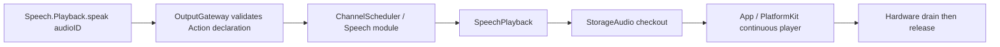

# Speech Actions

Purpose: canonical speech playback and revisioned listening execution functions. SpeechPerception owns listening policy; App injects native admission/capture endpoints. Production synthesis is owned by SpeechSynthesisAgent.

✅ Production `Speech.Playback.speak` accepts only `audioID`. SpeechActions.speak validates the audio ID; SpeechPlayback validates source/session/input ownership and obtains a single-consumer lease only when scheduled. Initial and intermediate empty PCM reads wait for synthesis progress; producer failure or cancellation wakes the reader immediately. Production reads have no independent first-frame or midstream deadline. The synthesis Agent retains its 60-second deadline from execution start, excluding its queue time; speak therefore has no fixed total PCM-wait timeout. Frames leave Storage as the player reads them; actual playback completion releases the single-use handle. Cancellation propagates to the individual synthesis job; input/session cancellation handles pending jobs too.

✅ Gateway has no speech preparation or prevalidation stage. The App output consumer releases remaining source/input audio after reply completion/error dispatch has joined Actions, and when dispatch fails; session teardown cancels session audio, and runtime teardown closes the store. Pending audio does not expire while waiting for its Action. The reply owner is the originating source/input, not the whole multi-turn voice session. Generation completion alone does not release unplayed audio. The hardware watchdog is separate: each scheduled buffer allows queued audio duration plus three seconds for playback completion. AppWorkflows.SpeechPlayback owns only the scheduled playback operation; its error/cancellation path releases the current audio ID.

✅ SpeechActions.swift contains only the audioID playback Action. Speech failure, playback cancellation and text-boundary tests exercise SpeechSynthesisAgent plus audioID playback.

❌ Persistent/repeatable audio and real iPhone latency, Bluetooth and sustained playback acceptance remain outstanding.

超时通过共享 audioID 的缓存失败传到等待中的或下一次 PCM 读取，再沿播放调用链抛回 Action；Agent 不直接通知或调用 Action。计时边界、尚未播放时的终态错误保留及清理顺序见 [合成执行超时与错误传递](../../Agents/SpeechSynthesis/README.md#synthesis-timeout-propagation)。

## Authoring standard

✅ SpeechActions.swift declares the namespace and defines `SpeechActions.speak(invocation:using:)`. The entry rejects unknown keys, requires a UUID audioID of at most 36 UTF-8 bytes and passes a typed UUID to the injected capability. It checks cancellation before parsing and after completion; invalid transport retains SpeechAudioError.missingAudio, while device and cancellation errors propagate unchanged. It never accepts text or synthesizes.

✅ SpeechPlayback receives a typed audio ID and owns checkout, playback acknowledgment and cache release. Its cancellation task is retained locally and joined before failure returns; cleanup errors mark the audio failed rather than becoming a silent success. There is at most one cancellation task per active playback; the scheduler/store retain their existing bounds. The service has no additional queue.

The handle is single-use, so repeated playback is not idempotent and no automatic execution retry is allowed. Success means the supplied player drained and the audio lease was released. Failure/cancellation stops/fails the owned audio through the existing store/player contracts; already played audio cannot be rolled back. The Speech module remains serialized; the PCM lease is not an audio.output device lease. ❌ Persistent physical audio resource mapping remains pending.

## Domain-owned behavior assembly

✅ SpeechModule owns Speech.Playback.speak metadata and binds SpeechPlaybackCapability. Session-owned playback still owns audio checkout/drain/release; no new playback actor or queue is created. Adding behavior using this existing capability changes the module, not App registration. ❌ New playback primitives may require capability/adapter changes.

✅ ActionAuthoringTests exercises invalid/extra/oversized arguments before effects, typed UUID handoff, original dependency errors and cancellation after an effect. Existing SpeechPlaybackTests and VoiceTests exercise hardware-drain handoff, delayed first/midstream PCM beyond the former three-second limit, explicit opt-in read deadlines, synthesis execution timeout and cancellation using the canonical Action decoder. ❌ Real-device completion remains separately validated.

## Source organization

| File | Responsibility |
| --- | --- |
| SpeechActions.swift | Canonical speak entry and audioID validation |
| Support/SpeechModule.swift | Explicit definition and SpeechPlaybackCapability interface |
| App/Workflows/SpeechPlayback.swift | Host-owned checkout, playback and cancellation cleanup |

✅ Entry and support share the existing Actions target. ❌ No synthesis, new queue or device resource lease is introduced.

✅ Action display names are declared in entry macros and copied into scheduler snapshots. Adding a registered operation requires no corresponding ActionActivityWorkflow mapping. Completion and device behavior remain unchanged.

✅ Entry metadata is declared with `@Action`; the Support catalog binds generated definition factories to explicit capabilities. Runtime behavior and Agent permissions are unchanged.

✅ SpeechActions validates the audio identifier with a module-owned SpeechActionError. The injected playback endpoint owns checkout and drain; AppWorkflows.SpeechPlayback adapts StorageAudio ownership.

✅ ADR0098: Execution values and services are imported from independent FunctionContracts; concrete Action domains and macro declarations remain in Actions. Published paths, parameters, bounds and completion behavior are unchanged.

✅ ADR0151: this domain is compiled once in Actions; both ActionCall and ToolCall entries use FunctionContracts contracts. Host injection and permission/feedback behavior are unchanged.
✅ Shared execution from ADR0157 is retained; ADR0160 separates callable functions from host bindings.

✅ ADR0152: functions are classified by domain before protocol unification. Canonical namespaces use `<Domain>Actions`; production uses one pure `<Domain>Module`; host registration creates Action/Tool projections. Superseded aliases/protocol catalogs are retired.
✅ Unified definitions and compatibility retirement are implemented in ADR0157.

## Cohesive module files — ADR0154

Purpose: implement directory/module-file/function ownership while preserving current protocol APIs. The domain Actions enum remains a used namespace facade; callable bodies belong exclusively to the files below. Support owns one domain catalog, values and host capabilities.

- [PlaybackActions.swift](PlaybackActions.swift)

✅ Implementations are split without forwarding or duplicated metadata/handlers. Generated factories and existing call paths, permissions, resources and scheduling are unchanged.
✅ Three-field addresses, Agent v6 configuration and shared definitions/results are implemented in ADR0156/0157.

✅ Playback Action definitions explicitly use serializationKey Speech, preserving process-wide exclusion independently of future three-level addresses.

✅ ADR0156: canonical execution addresses use domain/module/function; Agent v6 bindings resolve native names separately. Existing serialization/resource and output permissions are preserved.

✅ ADR0157: canonical executable definitions and shared outcomes replace duplicate protocol metadata; consumers import Actions/FunctionContracts. Protocol request views remain adapters, and production permission/resource boundaries are preserved.

❌ Physical acceptance and additional business capability exposure are not established by this migration.

✅ ADR0159 — Unified invocation: all business functions, injected capabilities and registered handlers receive FunctionInput with ActionExecutionContext. Native request/result normalization stays in Runtime/Gateway; no protocol-specific implementation signature remains.

✅ ADR0160: this domain exposes ActionFunction values with canonical invocation and intrinsic constraints. Protocol availability, native scheduling and feedback belong to host-created ActionBinding; domain code consumes no Tool wire/error contracts. ❌ New feature/physical acceptance remains separate.

✅ ADR0161: standard callable inputs use FunctionInput/FunctionContracts; common execution and call protocols belong to independent Gateway targets. This directory retains its existing ownership, resource/permission and lifecycle boundaries. ❌ Remaining feature Signal/continuation and physical acceptance are separate work.

ListeningActions.swift owns Speech.Listening.update; PlaybackActions.swift retains Speech.Playback.speak. SpeechModule injects optional listening authority separately from playback and rejects unavailable execution explicitly.

✅ Implemented: Listening Action acknowledges policy without awaiting an utterance. The App owns a separately cancellable pause task, fenced by command revision and capture generation. A newer command cancels/joins old pause work; user-off stops capture before joining it. Native cleanup cancels and joins pause/recovery tasks. Existing canonical serialization remains, but no utterance wait retains its lease.

## Listening policy ownership

✅ Speech.Listening.update is a code-owned SpeechPerception Action, excluded from all Chat model catalogs. Its finite acknowledgment accepts versioned consent/pause policy; injected App execution separately owns microphone readiness and playback/tail admission. It does not wait for a confirmed utterance while holding the Listening serialization lane.

❌ True-device acoustic echo, tail, route/interruption and native UI acceptance remain pending.
