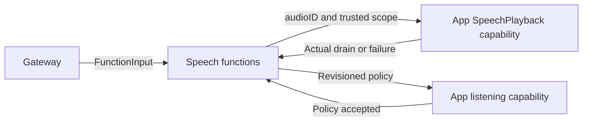

# Speech Playback and Listening Functions

## Summary

Canonical speech playback and resident listening-policy execution through typed App capabilities.

## Ownership and boundaries

PlaybackActions owns speak validation; ListeningActions owns policy update. SpeechPerception alone selects listening; Chat roles request synthesis and emit playback. App owns PCM/device lifetime and native barriers; there is no inference or audio cache here.

## External relationships and data flow

Runtime arrows show data or capability calls; dashed arrows show injection.

## Playback and policy contracts

Speech.Playback.speak requires one valid UUID audioID and rejects unknown parameters. The injected capability checks out owner-scoped PCM, awaits native playback and joins cleanup. The process-wide Speech serialization key is independent of visible caption producer; specialist speech does not cancel another authorized reply.

Speech.Listening.update is an internal Action granted only to actual SpeechPerception. Strict policy arguments carry enabled/pause revision context into the native endpoint. Completion means policy acceptance; startup and confirmed-utterance/pause/playback/350 ms tail work retain their separately owned native tasks. User-off stops capture; policy pause suppresses recognition without stopping native capture.

Synthesis is directed communication outside Channel eligibility. Producer timeout/failure passes through the audio handle and playback cleanup into the scheduled result; no implicit TTS retry or fabricated audible completion occurs.

✅ Explicit playback and resident listening functions are implemented.

## Related design

[Parent design](../README.md) · [Support](Support/README.md)
