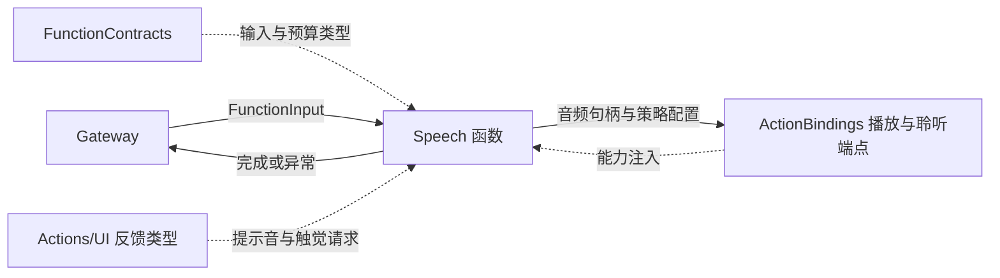
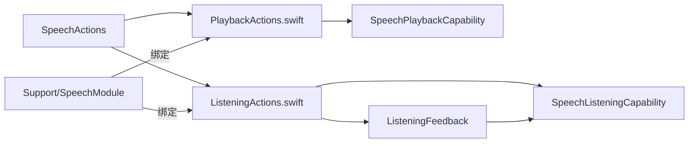

# Speech — 播放与聆听策略函数

✅ 原生提示音预备与播放共用 ActionBindings 的单份私有 PCM 缓存；Speech 函数继续只转发配置和真实 invocation，不接管设备或聆听策略。

## 简介

提供 `Speech.Playback.speak` 与 `Speech.Listening.update`。前者播放已有音频句柄，后者传递可信聆听策略和启动反馈配置；本域不生成语音、不持有音频流，也不选择聆听策略。

## 上下游关系（一级）

SpeechPerception 的策略选择和音频生成在调用上游；本域只通过已注册函数接收请求。原生播放、捕获与会话寿命属于注入的 ActionBindings 能力。

## 内部模块关系

## 接口与关键技术

| 函数 | 解析与完成 | 静态 timeout |
| --- | --- | --- |
| speak | 只接受 audioID，最多 36 字节且可解析为 ID；调用播放端点并等待它返回 | 300 秒 |
| update | enabled/paused 严格为 true/false；revision 为正 UInt64；可选启动反馈参数 | 90 秒 |

speak 将所有参数解析错误映射为 missingAudio，并在播放前后检查取消。端点契约要求播放排空与音频租约释放；入口不把音频存在或写入设备当作已播放完成。函数没有文本合成参数，也没有播放缓存。

update 拒绝未知键。cue 可选 wake/confirm/cancel/error/soft/save/discard（默认 wake），volume 为有限 0…1（默认 0.85），hapticStyle 可选 light/medium/heavy/rigid/soft（默认 heavy），hapticIntensity 为有限 0…1（默认 1）。解析结果包装为 ListeningFeedback，并连同真实 invocation 交给宿主。

update 的固定使用者是 SpeechPerception；实际 source/session/revision 准入由宿主验证，Actions 本身不解释权限。新启动的反馈与捕获由端点组合，子结果通过父 invocation 的报告端口保存。策略更新不等于每次都播放启动反馈。

## 生命周期与失败处理

SpeechModule 必须注入播放能力，聆听能力可选；缺少聆听能力时 update 抛 listeningUnavailable。入口没有排队、后台 worker 或自动恢复循环，取消传递与清理由端点及执行层共同实现。

聆听恢复、播放屏障、原生捕获和声学时序属于 AgentBindings/ActionBindings/SpeechPerception 的契约，不在本域设定固定恢复等待。端点返回可能表示策略接纳、加入启动完成或实际播放排空，应按对应接口解释；失败不触发这里的隐式语音重试。

[Actions 设计](../README.md) · [能力目录](Support/README.md) · [语音集成生命周期](../../Agents/Support/README.md)

## 待实现

- 暂无本目录独立的实现待办；跨模块及实际模型/设备验收见所属模块说明。

## Storage 依赖

✅ 存储访问使用独立的 State、Cache、Database 和 Files 接口；App 注册根实例，消费者通过构造器获得所需能力。存储容器不接管本目录的业务验证、执行和完成语义。
