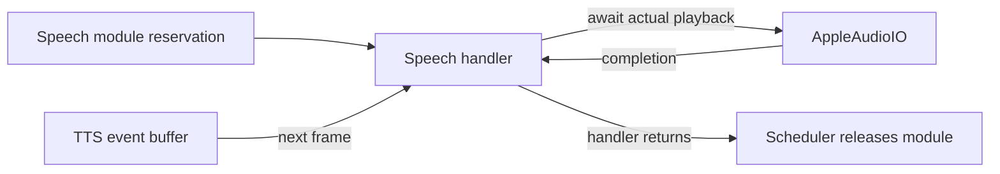

# Speech · 朗读行为

用途：执行真实语音输出。设计目标：通过 SpeechSynthesisCapability 合成，由注入的播放服务完成设备副作用。

- ✅ Speak.swift（SpeechActions.speak）：读取 ActionInvocation.call.parameters.text，合成并等待实际播放完成，保留取消检查。
- ✅ 调度器按 Channel 排队，并对 Speech 模块互斥，避免跨 Channel 朗读重叠。
- ❌ 独立 stopSpeak 注册、可恢复播放与标准 ActionResult。

维护：修改本目录代码、文件或子目录时同步 README；✅ 已实现，❌ 未实现。设计以 MobileHarness/README.md 为目标，历史决策见 ADR 0018。

✅ speak owns text extraction and validation (required, nonblank, at most 2000 UTF-8 bytes), TTS completion/audio checks, the 8 MiB audio budget, playback errors and session cleanup. No silent fallback is implemented. Validation is deliberately local to Speak.swift.

## Queue and asynchronous processing contract

The Speech Action consumes synthesis events sequentially and awaits playback for every audio frame before requesting the next. This supplies downstream playback backpressure but does not suspend the TTS producer when its event buffer fills; InferenceSession overflow fails explicitly. ChannelScheduler holds the Speech module until the handler returns, so later speech Actions do not overlap physical playback. Cancellation/error cancels the synthesis session; already audible audio is not rolled back. The handler also caps total consumed PCM at 8,388,608 bytes and requires a finished event plus nonempty audio before succeeding. This module owns no extra task queue, retry loop or audio mixer.

✅ The algorithm above describes the current implementation.

Maintenance: update this contract when changing producers, consumers, limits, ordering, cancellation or completion semantics.
