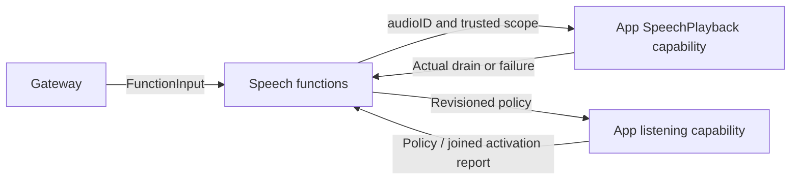

# Speech Playback and Listening Functions

## Summary

Canonical speech playback and resident listening-policy execution through typed App capabilities.

## Ownership and boundaries

PlaybackActions owns speak validation; ListeningActions owns policy update. SpeechPerception alone selects listening; Chat roles request synthesis and emit playback. App owns PCM/device lifetime and native barriers; there is no inference or audio cache here.

## External relationships and data flow

Runtime arrows show data or capability calls; dashed arrows show injection.

## Playback and policy contracts

Speech.Playback.speak requires one valid UUID audioID and rejects unknown parameters. The injected capability checks out owner-scoped PCM, awaits native playback and joins cleanup. Channel ordering is task-local; native playback admission and cleanup remain owned by the injected capability. Visible caption changes do not cancel another authorized reply.

Speech.Listening.update is an internal finite Action granted only to actual SpeechPerception. Strict enabled/paused/revision and optional cue/volume/hapticStyle/hapticIntensity arguments reach the trusted native endpoint. A new wake joins model/permission readiness and the canonical feedback/capture composition, retaining actual child reports. Disable joins the previous pause admission; reply-policy pause remains a separately owned confirmed-utterance worker. Both user-off and policy pause stop native capture. Automatic resume waits for policy and playback plus a 350 ms acoustic tail, without repeating startup feedback.

Synthesis is directed communication outside Channel eligibility. Producer timeout/failure passes through the audio handle and playback cleanup into the scheduled result; no implicit TTS retry or fabricated audible completion occurs.

✅ Explicit playback and resident listening functions are implemented.

## Related design

[Parent design](../README.md) · [Support](Support/README.md)

## Action-owned documentation and Skill instruction contract

✅ 本域函数用 `@Action(doc:parameters:)` 维护说明与参数契约。所属模块注册自动生成声明投影；业务顺序和调用示例由 Skill Instructions.md 教学，不再登记 examples。

## Channel-owned Action ordering

✅ Function metadata and business attributes have no serialization key. Scheduled ordering belongs to [ChannelScheduler](../../Gateway/Output/Scheduling/README.md); resources/budgets and native capability admission remain explicit.

## Action timeout contract (2026-10-12)

✅ Speech.Playback.speak has a static 300-second execution budget. Listening.update has a declared 90-second parent budget; readiness/capture children each use the shared 30-second default and cue/haptic children each use 5 seconds. Expiry cancels and joins owned work; no native readiness fallback fabricates success.

✅ Implemented: Listening.update validates optional startup cue/volume/hapticStyle/hapticIntensity in addition to policy identity. Defaults mirror UI.Feedback. It awaits the first native startup and actual child report, while unchanged policy pause/resume never repeats feedback. Startup cancellation joins physical cleanup; failed prerequisites never admit capture. Internal root-only authorization stays unchanged.

✅ Implemented: Listening optional cue metadata/validation accepts the expanded canonical seven-profile vocabulary; default wake and the existing activation order remain intact.
