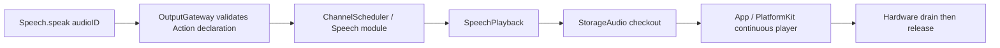

# Speech Actions

Purpose: scheduled physical speech playback. Production synthesis is owned by SpeechSynthesisAgent, not by Actions or Gateway.

✅ Production `Speech.speak` accepts only `audioID`. SpeechActions.speak validates the audio ID; SpeechPlayback validates source/session/input ownership and obtains a single-consumer lease only when scheduled. Initial and intermediate empty PCM reads fail after 3 seconds; known failure/expiry is immediate. Actual playback completion releases cached PCM. Cancellation propagates to the individual synthesis job; input/session cancellation handles pending jobs too.

✅ Gateway has no speech preparation or prevalidation stage. The App output consumer releases source/input audio when dispatch fails, session teardown cancels session audio, and runtime teardown closes the store. SpeechPlayback owns only the scheduled playback operation; its error/cancellation path releases the current audio ID.

✅ Removed the obsolete text-to-synthesis helper. Speak.swift now contains only the audioID playback Action. Speech failure, playback cancellation and text-boundary tests now exercise SpeechSynthesisAgent plus audioID playback; there is no legacy synthesis implementation in Actions.

❌ Persistent/repeatable audio and real iPhone latency, Bluetooth and sustained playback acceptance remain outstanding.

## Authoring standard

✅ SpeechActions.swift declares the namespace; Speak.swift defines `SpeechActions.speak(invocation:using:)`. The entry rejects unknown keys, requires a UUID audioID of at most 36 UTF-8 bytes and passes a typed UUID to the injected capability. It checks cancellation before parsing and after completion; invalid transport retains SpeechAudioError.missingAudio, while device and cancellation errors propagate unchanged. It never accepts text or synthesizes.

✅ SpeechPlayback receives a typed audio ID and owns checkout, playback acknowledgment and cache release. Its cancellation task is retained locally and joined before failure returns; cleanup errors mark the audio failed rather than becoming a silent success. There is at most one cancellation task per active playback; the scheduler/store retain their existing bounds. The service has no additional queue.

The handle is single-use, so repeated playback is not idempotent and no automatic execution retry is allowed. Success means the supplied player drained and the audio lease was released. Failure/cancellation stops/fails the owned audio through the existing store/player contracts; already played audio cannot be rolled back. The Speech module remains serialized; the PCM lease is not an audio.output device lease. ❌ Persistent physical audio resource mapping remains pending.

## Domain-owned behavior assembly

✅ SpeechActionModule owns Speech.speak metadata and binds SpeechPlaybackCapability. Session-owned playback still owns audio checkout/drain/release; no new playback actor or queue is created. Adding behavior using this existing capability changes the module, not App registration. ❌ New playback primitives may require capability/adapter changes.

✅ ActionAuthoringTests exercises invalid/extra/oversized arguments before effects, typed UUID handoff, original dependency errors and cancellation after an effect. Existing SpeechPlaybackTests and VoiceTests exercise drain, starvation and cancellation using the canonical Action decoder. ❌ Real-device completion remains separately validated.
