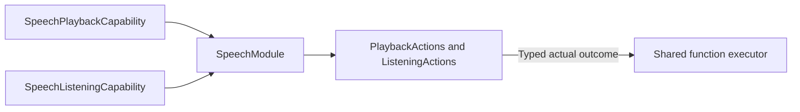

# Speech Capability Catalog

## Summary

Neutral speech playback/listening interfaces, errors and canonical function definitions.

## Ownership and boundaries

SpeechModule binds required typed capabilities. It owns no synthesis, audio buffer, native device, request queue or policy. Host chooses protocol/budget projection; role grants identify permitted emitters.

## External relationships and data flow

Runtime arrows show data or capability calls; dashed arrows show injection.

## Interface contract

SpeechPlaybackCapability accepts UUID audioID and opaque trusted FunctionInput, preserving audio ownership and awaited drain semantics. SpeechListeningCapability accepts typed command/revision context; absent unsupported fixture support reports listeningUnavailable. SpeechActionError distinguishes missingAudio and unavailable policy execution without inferring provider/native health.

Definitions use the canonical Speech serialization boundary and injected completion. No catalog automatically synthesizes text, chooses a provider, controls user consent or acknowledges subscriber delivery. Errors propagate through shared execution after capability cleanup.

✅ Typed capability injection and explicit speech definitions are implemented.

## Related design

[Parent design](../README.md)
