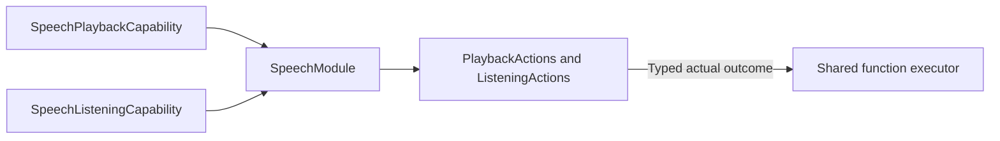

# Speech Capability Catalog

## Summary

Neutral speech playback/listening interfaces, errors and canonical function definitions.

## Ownership and boundaries

SpeechModule binds required typed capabilities. It owns no synthesis, audio buffer, native device, request queue or policy. Host chooses protocol/budget projection; role grants identify permitted emitters.

## External relationships and data flow

Runtime arrows show data or capability calls; dashed arrows show injection.

## Interface contract

SpeechPlaybackCapability accepts UUID audioID and opaque trusted FunctionInput, preserving audio ownership and awaited drain semantics. SpeechListeningCapability accepts typed command/revision context; absent unsupported fixture support reports listeningUnavailable. SpeechActionError distinguishes missingAudio and unavailable policy execution without inferring provider/native health.

Definitions retain resources/budgets and injected completion; task-local playback order belongs to ChannelScheduler, with native admission owned by the playback capability. No catalog automatically synthesizes text, chooses a provider, controls user consent or acknowledges subscriber delivery. Errors propagate through shared execution after capability cleanup.

✅ Typed capability injection and explicit speech definitions are implemented.

## Related design

[Parent design](../README.md)

## Action-owned documentation and Skill instruction contract

✅ 本目录 CapabilityModule 的 `@ActionCatalog` 从实际 `*Definition` 注册调用（含本类型的本地 helper）生成静态 declarations。添加已有域函数只需修改所属实现及本地依赖绑定，不再同步公共元数据列表。声明投影不捕获设备、处理器或运行会话。

✅ Implemented: SpeechListeningCapability receives a validated ListeningFeedback configuration and the trusted parent invocation. SpeechModule preserves the actual composed report through shared FunctionExecutor semantics. No extra native effect or global catalog lookup exists here.
