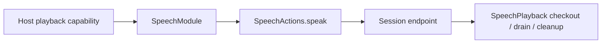

# Speech Action Support

Purpose: keep non-callable implementation support separate from registered entry points. Design goals: cohesive definitions, explicit typed injection, stable public names and no hidden registration.

SpeechModule and SpeechPlaybackCapability define registration and host injection; AppWorkflows.SpeechPlayback retains audio checkout, drain and cancellation cleanup.

✅ Sources compile once in Actions. Public visibility exists where App/test composition requires it; it does not grant model access. Definitions remain explicit, and Agent declarations remain the permission source. See the [domain contract](../README.md) for completion, lifetime, cancellation and limits.

✅ This directory adds no queue or scheduler. AppWorkflows.SpeechPlayback retains its existing single cancellation-cleanup task per active playback, joins cleanup before failure, and uses the bounded StorageAudio store described by the domain contract.

❌ No automatic discovery or hidden host binding.

✅ Entry attributes own displayName and completion metadata; the Support catalog binds handlers. Execution records carry this value; no App or UI switch enumerates domain actions. ❌ This is human-readable metadata, not model permission or a SwiftUI dependency.

✅ Entry metadata is declared with `@Action`; the Support catalog binds generated definition factories to explicit capabilities. Runtime behavior and Agent permissions are unchanged.

✅ This directory retains the playback capability and explicit module binding. SpeechPlayback moved to App/Workflows because it adapts Agent-owned stored audio to an Action context.

✅ ADR0098: Execution values and services are imported from independent FunctionContracts; concrete Action domains and macro declarations remain in Actions. Published paths, parameters, bounds and completion behavior are unchanged.

✅ ADR0151: this domain is compiled once in Actions; both ActionCall and ToolCall entries use FunctionContracts contracts. Host injection and permission/feedback behavior are unchanged.
✅ Shared execution from ADR0157 is retained; ADR0160 separates callable functions from host bindings.

✅ ADR0152: functions are classified by domain before protocol unification. Canonical namespaces use `<Domain>Actions`; production uses one pure `<Domain>Module`; host registration creates Action/Tool projections. Superseded aliases/protocol catalogs are retired.
✅ Unified definitions and compatibility retirement are implemented in ADR0157.

✅ ADR0154: SpeechTypes.swift owns SpeechActionError after playback entries move to PlaybackActions.swift. SpeechModule still binds the same factory and endpoint. ❌ Three-level path registration remains pending.

✅ ADR0160: this domain exposes ActionFunction values with canonical invocation and intrinsic constraints. Protocol availability, native scheduling and feedback belong to host-created ActionBinding; domain code consumes no Tool wire/error contracts. ❌ New feature/physical acceptance remains separate.

✅ ADR0161: standard callable inputs use FunctionInput/FunctionContracts; common execution and call protocols belong to independent Gateway targets. This directory retains its existing ownership, resource/permission and lifecycle boundaries. ❌ Remaining feature Signal/continuation and physical acceptance are separate work.

✅ Speech.Listening.update is an internal SpeechPerception function with injected native execution; Chat Agents report reply facts and have no listening grant. See [overall architecture](../../../README.md).
