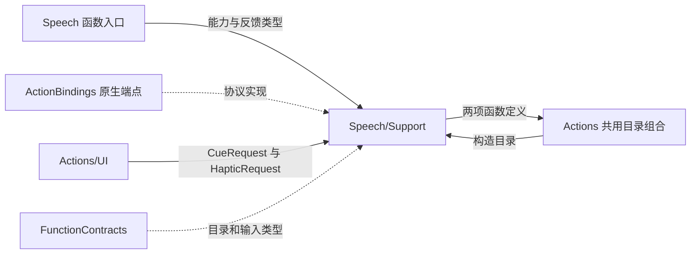
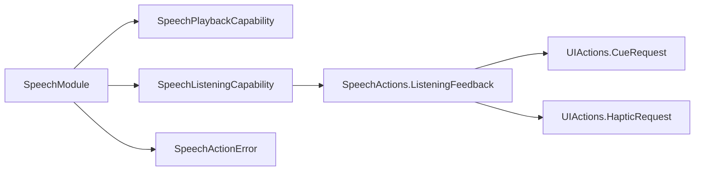

# Speech Support — 播放、聆听能力与目录绑定

## 简介

定义两个异步能力端口、聆听反馈值和 SpeechModule 的函数目录。接口保留真实 invocation，以便宿主核对音频/会话所有权并记录实际子结果。

## 上下游关系（一级）

## 内部模块关系

## 接口与绑定

SpeechPlaybackCapability 的 `play(audioID:invocation:)` 接受 ID 与标准输入，端点负责音频取出、原生排空和清理。SpeechListeningCapability 的 `updateListening` 接受 enabled、paused、revision、ListeningFeedback 和 invocation；策略的接纳条件、取消与启动流程由实现者负责。

ListeningFeedback 在 `ListeningFeedback.swift` 中组合已校验的 UI 提示音与触觉请求，不含设备句柄。`SpeechModule.swift` 保存 capability 并绑定 speak/update；前者必需，后者可选。`SpeechTypes.swift` 当前只有 Foundation 导入，没有独立值类型。

两项定义通过 Void handler 返回 completed。如果子工作已向 invocation.results 记录报告，报告由执行层保存；目录本身不把报告重编码成字符串。

## 生命周期与失败

缺少聆听端点明确抛 listeningUnavailable；播放参数错误为 missingAudio。端点异常继续向执行层传播。模块不拥有合成器、PCM 缓存、策略状态、订阅或请求队列；闭包引用端点的寿命随目录持有者管理。

[Speech 入口设计](../README.md) · [UI 反馈接口](../../UI/Support/README.md) · [共享契约](../../Support/Contracts/README.md)

## 原生执行集成

ActionBindings 编译 SpeechPlayback、ListeningActivationFeedback 和 VoiceNativeEffects。它们持有 PCM checkout、canonical 子调用反馈组合、一个激活 gate、单份 cue cache、原生提示音/触觉和真实播放器。VoiceNativeEffects 通过注入的当前 scope 校验和状态回调执行，不导入 Agents/Gateway。

输入同意、半双工策略、角色登记与输入发布属于 AgentBindings 的 VoiceSessionCoordinator。通用麦克风启停屏障属于 PlatformKit/Audio。生产者 SpeechSynthesisError 的用户文案属于 AgentBindings 的 SpeechFailurePresentation，原始错误保留。

## 待实现

- 暂无本目录独立的实现待办；跨模块及实际模型/设备验收见所属模块说明。

✅ VoiceNativeEffects 的播放电平子任务在播放结束、失败或取消后取消并加入，展示值经 UI 的公开方法提交。

## Storage 依赖

✅ 存储访问使用独立的 State、Cache、Database 和 Files 接口；App 注册根实例，消费者通过构造器获得所需能力。存储容器不接管本目录的业务验证、执行和完成语义。

## Platform 根、设备接入与同帧呈现

✅ VoiceNativeEffects 的 IO、提示音和触觉由 AudioContainer 注入，不自行创建原生实例。提示音/触觉保留模块拥有的可取消任务；根停止加入这些任务，生产语音/诊断/检测的会话冲突由 AudioContainer 拒绝。
