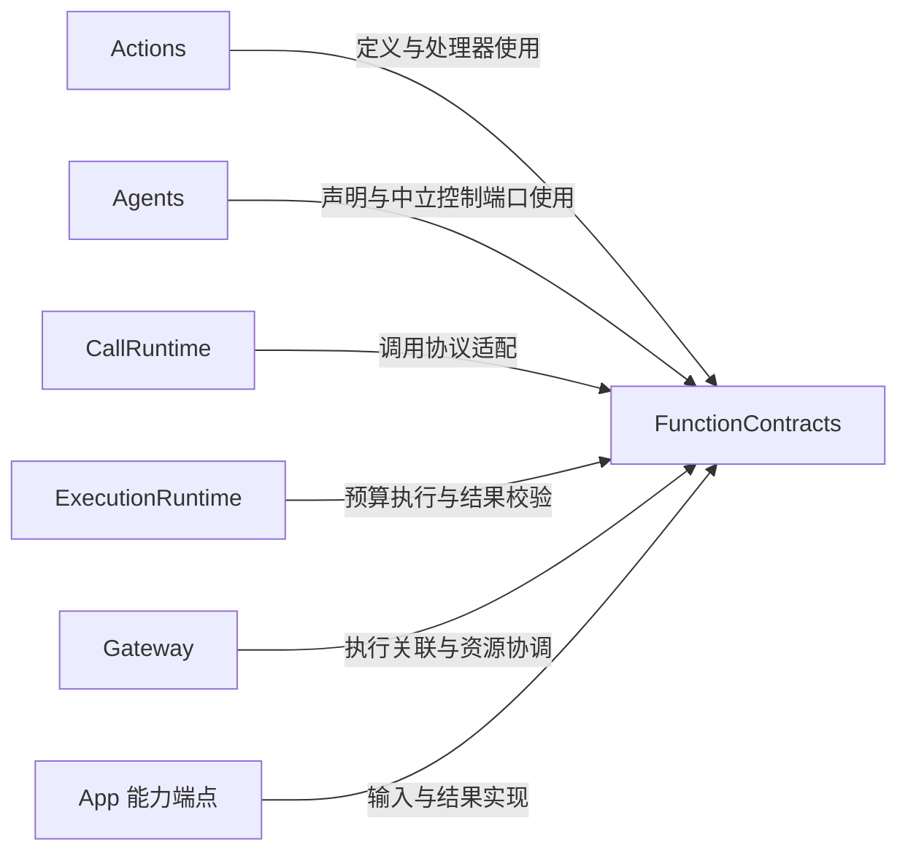
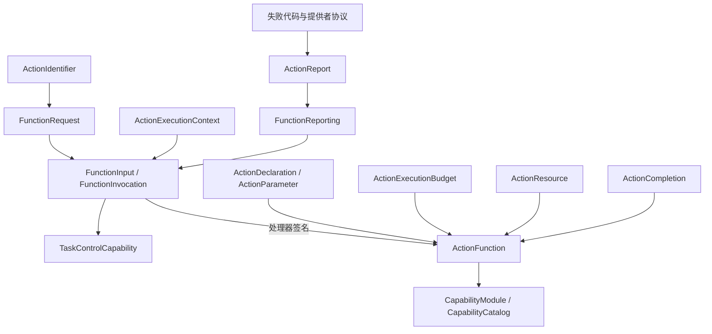

# FunctionContracts — 函数输入、执行约束与结果契约

## 简介

提供与 Agent、调用协议和调度器无关的业务函数契约。此目录单独编译为 FunctionContracts，仅使用基础 Swift/Foundation 类型，不依赖其他项目目标。

## 上下游关系（一级）

这些模块是契约的直接消费者；契约不回调它们的具体实现。

## 内部模块关系

## 接口与数据流

| 类型/文件 | 责任 |
| --- | --- |
| ActionIdentifier | 三段地址，显式 domain/module/function 与合法名称检查 |
| FunctionRequest | 已解析地址及 `[String:String]` 参数，不含 Channel |
| FunctionInput / FunctionInvocation | 请求、executionID、关联 context 与报告端口；后者是具体值实现 |
| ActionExecutionContext | source、session/input、sequence、correlation/ordinal、decision/task/executor 等不透明关联信息 |
| ActionArguments | 允许键、字符串字节数、整数范围、有限数值与枚举解析 |
| ActionDeclaration / ActionParameter | 函数说明、语义参数类型、必填性、约束与枚举候选 |
| ActionFunction | 处理器、kind、completion、资源、静态/动态预算及定义校验 |
| ActionCompletion | completed、value、report、activityStarted、activityStopped 的中立结果 |
| ActionReport | 有界逐叶结果、独立执行失败及失败描述 |
| TaskControlCapability | 传递操作名、原始字符串参数及真实 invocation 的宿主控制端口 |

✅ 协议只描述数据和接口。FunctionReporting 的存储、资源租约、超时取消、执行身份授权和 Task 状态都由消费者实现。

## 定义与声明校验

地址每段最多 64 个 UTF-8 字节，首字符是 ASCII 字母或下划线；后续允许字母、数字、下划线、连字符，地址段不允许点。资源名校验允许点。构造值本身不意味着已经通过 validate。

ActionDeclaration 要求合法地址、非空 doc（最多 2048 字节）、最多 32 个不同参数；参数名合法，description 非空且最多 2048 字节，constraints 最多 2048 字节，枚举候选最多 32 个且不重复。`nativeSchema` 将所有参数的传输类型生成为 string，保留 required、enum，并禁止额外属性；业务语义的整数/数值/布尔类型仍由处理器解析。`actionObject(alias:)` 先验证，再产生模型 Action 说明对象。

ActionFunction 校验 displayName 非空且不超过 256 字节，completion 非空且不超过 512 字节，声明地址匹配函数地址，资源最多八个，静态 timeout 位于 `(0, 86400]` 秒。动态资源解析结果同样限八个。CapabilityCatalog 最多接受 32 个模块、合计 256 个函数，并拒绝重复地址或无效定义。

## 预算算法

静态 timeout 缺省或 nil 时为 30 秒。`executionBudget(for:)` 先验证定义，再优先执行 dynamicTimeout；动态解析失败直接抛错。ActionExecutionBudget 要求 expected 非负、timeout 大于零且不小于 expected，最大 86400 秒。

串行组合分别累加 expected/timeout，并行组合分别取最大值；空组合为零预计时间和 100 毫秒 timeout。它们只是预算值运算，不启动计时器或强制中断执行。

## 报告、取消与失败

报告最多 256 条；每条路径非空且最多 128 字节，details 最多 16 项，键非空且最多 64 字节、值最多 512 字节。条目 status 为 succeeded/failed/cancelled/notStarted；执行级 failure 与既有条目分开存放。失败代码是最多 64 字节的非空标识符；部分值构造约束通过 precondition 实现，调用方必须先提供合法数据。

`code(for:)` 依次识别 CancellationError、报告失败提供者、执行失败提供者，最后使用 handlerFailed。`recordingFailure` 在保留当前条目的同时附加异常代码与描述。真实失败优先于取消：包含成功条目的真实失败为 partialFailure，否则为 failed；没有真实失败时才归为 cancelled。`isCancellationOnly` 表示有取消而无独立真实失败。

ActionReport.empty 表示没有叶子记录；其 status 运算为 succeeded，不代表实际效果已被证明。ActionReportedError 通过 throwing 接口保存完整报告。ActionCompletion 的 kind 匹配和 value 的 65536 字节执行上限由 ExecutionRuntime 验证，枚举本身不执行这些检查。

[共享 Support](../README.md) · [Actions 设计](../../README.md) · [执行实现](../../../Gateway/Runtime/README.md)
