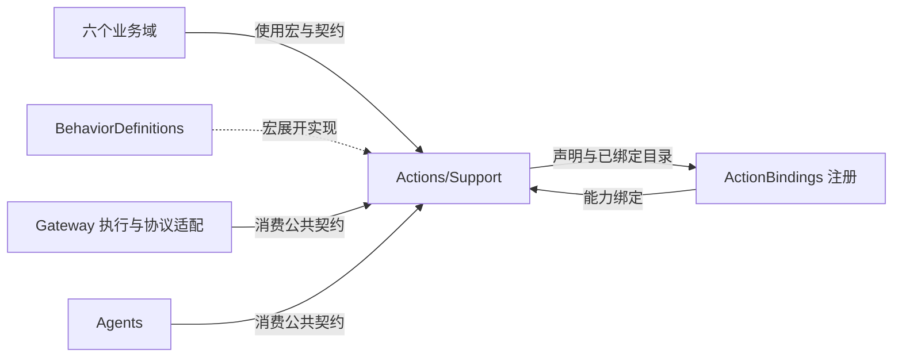
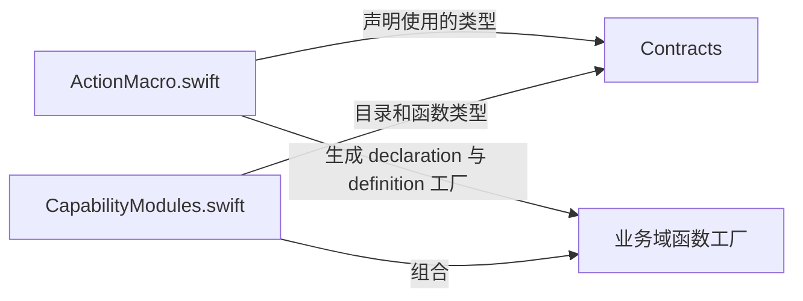

# Actions Support — 共用协议与函数作者工具

✅ Expression.setReplyWaiting 复用 print／beginReplyTurn 的 direct 呈现注册，完成为状态接纳，无 Channel 动画排队；权限由可信内部 grant 限定。

## 简介

为全部业务域提供公共输入/输出契约、编译期函数声明接口和生产目录组合。域专用值类型、能力端口及算法由各业务域的 Support 负责。

## 上下游关系（一级）

Runtime 和 Agents 只依赖这里独立编译的 FunctionContracts，不依赖具体目录组合。图表示本目录对直接使用者提供的接口。

## 内部模块关系

| 源码 | 责任 | 编译归属 |
| --- | --- | --- |
| [Contracts](Contracts/README.md) | 中立函数输入、元数据、资源、预算、完成值与报告 | FunctionContracts，无项目依赖 |
| `ActionMacro.swift` | 对外声明 `@Action`、`@ActionCatalog` | Actions，调用 BehaviorDefinitions 插件 |
| `CapabilityModules.swift` | 汇总声明及构造已注入的业务目录 | Actions |

Actions 目标排除 `Support/Contracts`，通过导入 FunctionContracts 使用它；公共契约只编译一次。

## 关键技术

`@Action` 是 peer 宏，声明生成 `函数名Declaration` 及 `函数名Definition` 工厂。它承载地址、说明、参数、kind、completion、资源及静态/动态预算。宏展开的 handler 工厂把 Void 结果包装为 completed；completing 工厂保留显式完成值。未提供 doc 时，插件使用 title 或函数名，未提供 parameters 时生成空参数列表。

`@ActionCatalog` 是 member 宏。插件扫描所属类型成员中的 `*Definition` 调用，去重并按名称排序生成 declarations；它会扫描本类型内的本地 helper，但不解析运行中的端点，也不跨类型发现任意注册。

`CapabilityModules.declarations` 汇总十二个目录的完整声明。`builtIn` 注入业务端点并构造实际目录：UI、导航、资源呈现、Speech、Camera、History、System、资源、Provider、Device、NexArm；仅当 presentation 端点实现 TaskControlCapability 时追加 TaskControlModule。静态完整声明列表与实际已绑定目录是两个不同投影。

反馈、装饰效果、聆听能力通过宿主接口转换注入。缺少可选能力时，对应定义仍可存在，但调用会返回明确 unavailable 错误；Task 控制则在缺少宿主端口时不加入实际目录。

## 生命周期与边界

本目录的宏声明和目录组合不持有异步任务、队列或设备会话。生成的工厂闭包捕获注入能力；其使用寿命由已构造目录和宿主负责。重复地址、无效定义与目录容量由 CapabilityCatalog 校验，不由声明汇总函数自动处理。

[Actions 设计](../README.md) · [编译目标地图](../../README.md#target-map) · [宏插件设计](../../../Macros/BehaviorDefinitions/README.md)

## 独立 ActionBindings 目标

BehaviorAssembly.swift、BehaviorProtocolBindings.swift 和 NativeCleanupFailure.swift 属于外层 ActionBindings，不编译进 Actions 核心。前两者冻结并校验真实函数/协议注册；后者保留多个原生清理错误，不把部分停止改写为成功。域内集成源同样由显式清单选择，不能因同目录而获得核心目标依赖。

## 待实现

- 暂无本目录独立的实现待办；跨模块及实际模型/设备验收见所属模块说明。

✅ Implemented: BehaviorProtocolBindings explicitly supports Action+Tool for History list/read, Provider readSettings, resource snapshot and Device readStatus. Action callers use their Skill Channel; the Tool projection remains direct. Other functions are unchanged.

## ApplicationControl 异常展示

✅ 已实现：BehaviorProtocolBindings 将 UI.RuntimeDiagnostics 注册为直接、返回结果的内部 Tool；不添加模型 Action 授权，沿用实际调用身份与失败回执。

✅ 已实现：独立UI.BluetoothStatus直接Tool组承载首页与设置两个蓝牙状态呈现函数；不暴露为模型Action别名。

✅ 已实现：BluetoothStatusActions.swift单独拥有UI.BluetoothStatus.showBluetoothHome／showBluetoothSettings；连接状态不归RuntimeDiagnostics异常函数组。使用现有Actions/UI目录和编译目标。

✅ UI.Expression.setLoading单独注册为direct／returning Tool，沿用Gateway身份授权与反馈，不进入有限表情Action调度队列；其他Expression函数语义保持。
