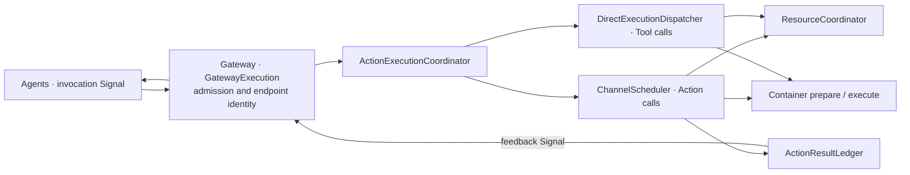

# Execution Shell

Like an operating-system shell, the Shell takes invocation requests and handles scheduling, resource arbitration, execution and result return. ActionsContainer owns the execution Shell that runs admitted Agent → Action invocation Signals and produces Action → Agent feedback Signals. Gateway carries those Signals and the Shell implements the neutral [ActionExecutionEngine](../Contracts/ActionExecutionEngine.swift) contract; Agents reach it only through Gateway, and Actions imports neither. The Shell compiles in ExecutionRuntime; its invocation/result contracts (ExecutionEnvelope, ScheduledAction, ExecutionResult, ActionSchedulingError) compile in FunctionContracts.

[ActionExecutionCoordinator.swift](ActionExecutionCoordinator.swift) is the facade. ActionsContainer builds it from the container's own preparation/execution and the resource definitions supplied at composition; it owns an ActionsAdmission that opens at start and closes at invalidation or stop. suspend cancels and joins scheduler, direct and resource work and releases leases so the Shell can reopen. shutdown additionally closes the Shell permanently and preserves primary and cleanup failures. Gateway binds exactly once through bindSignals, supplying the endpoint-identity check and the feedback exit; before binding, scope checks pass and feedback reports closed. Direct Tool calls, scheduled Action calls and resource leases use the same preparation, permit and cancellation contracts. State nodes are `actions.scheduler`, `actions.direct` and `actions.resources`.

### Scheduling

[`Scheduling/`](Scheduling/) holds ChannelScheduler, its Channel lanes, diagnostics and the passive execution ledger.

Bounded task-local FIFO/wait trees with separate resource arbitration. [ChannelScheduler](Scheduling/ChannelScheduler.swift) owns ordering, admission, finish, cancel and passive execution observation. Each task root contains phases and nested wait groups. A wait joins preceding parent work, executes ordinary per-Channel FIFO internally and releases its continuation only when closed and all children complete. Open active phases may execute received calls; dormant groups hold no resource locks. Native Tools are outside the tree.

The scheduler keys each root by producer and typed scheduling scope. The execution coordinator admits each round separately on the Action and Tool call lanes. It closes admission at each lane’s End and returns a settlement handle. Finishing or cancelling a round selects that root even when a standalone call uses the same ID string. Session and endpoint cancellation continue to select all matching roots.

`wait` is a scoped ActionCall handled on the Shell's main track. A Skill registers it (`callType: "scheduling"`, no Channel); the Shell converts its scoped ActionCall into internal `beginWait`, `endWait` and `pause(milliseconds:)` directives and owns no instructions or catalog text. Agent controls are never allowed inside a wait. A pause (`<wait time="seconds"/>`, decimal seconds on the call, converted to milliseconds by the Shell) is accepted for a tracked task after the producer's earlier events, holds only that task's main-track dispatch for the timer and never joins Actions already dispatched, so Channel lanes keep running. Each task may pause at most 120 seconds in total (`pauseLimitExceeded`); explicit cancellation, session cancellation or shutdown cancels the timer and the caller receives cancellation instead of a completed pause, and a pause holds no resource lock or Channel capacity.

| Boundary | Limit / policy |
| --- | --- |
| Tracked tasks | 64 until finish/cancel |
| Live Channel names | 16 process-wide |
| Unfinished Actions per Channel name | 32 across all tasks, including running/dormant |
| Cumulative Actions / waits per task | 120 / 32; root additional, at most 65 phases |
| Runtime wait depth | Eight; parser also bounds combined lexical depth |
| Preparation admissions | 128 concurrent |
| Finish | One terminal signal and one waiter; duplicate finish rejects |

Active phase lane heads are collected in admission order. An optional neutral orderingScope adds same source/session/Channel FIFO across round trees, including earlier dormant jobs and running cleanup; Assistant supplies it, and unrelated producers and Channels stay independent. A cancelled job releases its lane after actual handler cleanup, never at the cancellation request. Overflow never evicts admitted work and offers no backpressure or retry queue: the Agents adapter records the failure and cancels the owning tree.

Preparation reserves Channel capacity before the asynchronous prepare hop, validates matching envelope/context and registered endpoint scope, and rechecks scope and admission after actor hops. Rejection discards the credential; each accepted job retains the same report store. Caller cancellation and matching scope cancellation join preparation as well as queued/running work. The Shell executes under ResourceCoordinator's permit; action budgets apply during execution, not queue residence, and Channel/wait has no hidden overall timeout. finish seals a root and joins accepted work; unclosed waits fail invalidSchedule and cancel. A handler failure keeps its terminal report and advances later eligible work. Explicit cancellation removes dormant work and joins running handlers before advancing lanes or releasing resources. Executed effects are not rolled back.

### Instance control

The scheduler creates the per-execution [ActionControlRuntime](Scheduling/ActionControlRuntime.swift) for definitions that declare controls. If the Action supports pause or resume, the scheduled handler registers its controller before start feedback advertises the capabilities. Single-instance cancellation is performed by the scheduler and the existing execution cleanup still produces the terminal result. Runtime state changes and control receipts are delivered independently of execution results. A newer control can replace an in-flight transition, and a scheduled execution joins controls during cleanup before posting its terminal result. Each runtime has one active transition, one pending control, and up to 16 outstanding receipts. A bounded delivery worker can merge intermediate state under pressure and redelivers immutable feedback until acceptance, closure or expiry. The original Channel position, resource permits and deadline still apply during pause.

### Direct calls

[DirectExecutionDispatcher.swift](DirectExecutionDispatcher.swift) admits up to 128 active Tool calls and rejects overflow with directCapacityExceeded. It validates the endpoint scope, prepares the Tool, rechecks admission, acquires the resource permit and executes, discarding preparation on every terminal path. Caller cancellation, suspension and stop join actual work.

### Resources

[`Resources/`](Resources/) holds ResourceCoordinator.

ResourceCoordinator ([Shell/Resources](Resources/ResourceCoordinator.swift)) is the actor-owned arbiter for declared function and host resources, with live permits, bounded handoff and joined cleanup. Agents-authored opaque owner/preemption policy and Actions-supplied native stop callbacks reach it through ResourceDefinition at composition. holdings is the sole occupancy authority; device health, physical stop and Channel ordering are separate. Public snapshots are unlocked or locked(ExecutionOwner?), where nil means host use; release or late completion removes only its matching token. A definition declares owners, lease requirement, executionGroup, explicit preempts and a stop callback; intersecting multi-resource siblings retire together.

run reserves the actual writer before starting its task, binds owner and held IDs with a ResourceExecutionPermit and removes matching transient holdings after joined return. Effects validate the inherited permit; ended, revoked or handed-off uses reject. Caller cancellation remains cancellation unless a returned report carries an independent real execution or cleanup failure. Lease-bound effects also check the live lease and deadline. Unconfigured conflicts fail busy. All affected siblings are reserved before awaiting stop/cancel/revoke/join, and a successful handoff stays reserved until the exact requester grants or retires it. A timed-out request abandons its reservation and fails while coordinator-owned cleanup continues and unlocks only after all old writers end. Cleanup has no default time limit; uncooperative work stays occupied, and software cleanup never proves hardware stop, arrival or clearance.

| Boundary | Limit / policy |
| --- | --- |
| Resource definitions / owners each | 64 / 128 |
| Requested resource set / live leases | Eight / 32 |
| Active uses / retained cleanup attempts | 256 / 32; unfinished cleanup retained |
| Cleanup subscribers | Eight capacity-one completion streams |
| Lease duration | >0 through 60 seconds, explicit renewal |
| Resource waiting queue | None; conflicts and capacity fail explicitly |

Production camera capture requires its persistent lease, acquired through CameraResourceBinding over the same Shell. NexArm's six motors share a writer group and run through the Shell's current-context resource run. Manual Settings control is an explicit host bypass.

### Results and feedback

[`Results/`](Results/) holds the result ledger; ExecutionResult itself is a [contract](../Contracts/ExecutionResult.swift).

[ExecutionResult.swift](../Contracts/ExecutionResult.swift) preserves status, effect certainty, completion, report and failure separately. Queued cancellation is `notStarted`, a failure or cancellation after starting may leave an unknown effect, and success is `contractCompleted`. The scheduler-owned [ActionResultLedger.swift](Results/ActionResultLedger.swift) reserves one of 512 terminal slots by default (configurable 1–1,024) before admitting a feedback-producing action; overflow rejects admission. The feedback policy is `none`, `failuresOnly` or `terminal`. For feedback-enabled Assistant model calls, the ledger records actual execution start before the terminal result. A queued cancellation records the terminal after discarding preparation. A single worker redelivers immutable evidence through the Gateway feedback exit with backoff capped at one second until acceptance, scope closure, shutdown or a 60-second limit measured from result completion. Retry covers temporary receiver pressure only: past the limit the record ends as `expired`, keeps its result and invocation snapshot as evidence and counts toward `expiredResults`. finishRoundDelivery treats `expired` like `closed` and fails the round with resultDeliveryFailed, and reports unconfirmed native cleanup after the round’s deliveries settle. History keeps 256 outcomes with counted oldest eviction, and retained invocation evidence is limited to 32 MiB. Accepted means receiving admission, retry indicates temporary pressure and closed indicates a stale or absent scope.

Execution envelopes carry the immutable ActionInvocationSnapshot captured by the producing adapter before effects, so archived references survive scheduling and retries. Agents owns schema projection; Storage owns large evidence archives.

### Passive execution observation

Diagnostics retains 256 records by default (configurable 1–4096) with counted oldest overwrite. ActionExecutionLedger retains all active executions and 100 terminal entries with an eviction count. Eight observers receive newest-one complete snapshots, including initial and final state, and the optional App callback also receives each update; no observer await can block execution. The canonical function path, bounded parameter previews (2048 UTF-8 bytes each, credentials masked) and completion evidence are retained; failure text is limited to 512 characters. Tools never appear in this ledger. Rejected admission has no execution record.
