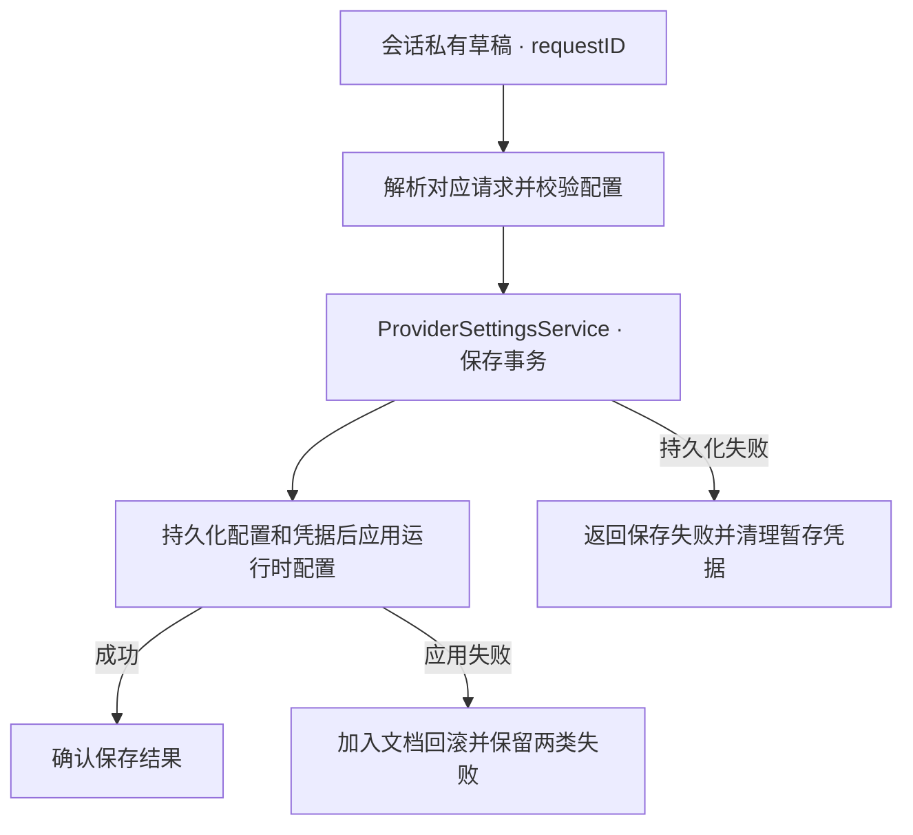

# System/Provider — 业务能力与执行

## 职责与关系

URL／密钥只在会话私有暂存和凭据端口中传递，函数参数仅带请求 ID。恢复／保存共享实际事务屏障；提交与回滚使用原始结果，不把后续清理失败改写为未发生提交。纯表单草稿、默认选择和忙态由基础 UI 的 SettingsFormController 拥有。

本目录由所属域目录绑定，接受标准 FunctionInput；调用权限、通用调度与资源仲裁由上游 Gateway 保持。下游只消费注入的基础能力。

## 文件与实现

| 文件 | 当前职责 |
| --- | --- |
| [ProviderActions.swift](ProviderActions.swift) | 业务函数的参数校验、能力调用与完成值 |
| [ProviderDiscovery.swift](ProviderDiscovery.swift) | 私有发现配置、错误与聊天模型列表过滤 |
| [ProviderDiscoveryRequests.swift](ProviderDiscoveryRequests.swift) | 会话隔离的有界发现请求暂存 |
| [ProviderModule.swift](ProviderModule.swift) | 发现与配置操作的函数绑定 |
| [ProviderSettingsRequests.swift](ProviderSettingsRequests.swift) | 配置请求的阶段、领取和结果槽 |
| [ProviderSettingsService.swift](ProviderSettingsService.swift) | 排他恢复／保存、模型切换和持久化回滚 |
| [ProviderSettingsStore.swift](ProviderSettingsStore.swift) | 配置文档与凭据引用的一致性 |
| [SettingsCredentialAdapter.swift](SettingsCredentialAdapter.swift) | Keychain 凭据协议实现 |
| [SettingsProviderAdapter.swift](SettingsProviderAdapter.swift) | Provider 实际发现、配置运行时和结果呈现 |

## Provider 请求暂存与容量

ProviderDiscoveryConfiguration 不可 Codable，保存 URL/key 私有值。ProviderDiscoveryRequests 是 actor：stage 校验 URL/key 最大 2048/4096 字节，为待领取请求设置 10 秒期限；领取前核对 sessionID，领取时移除待领取项，再执行注入发现工作。完成结果由相同会话读取或 discard；错误转换为安全 Provider 分类。

stage 以待领取项加 completed 项少于 32 作为准入条件。

ProviderSettingsRequests 是 MainActor 所有者，共最多 32 个 staged/executing/completed 条目。未领取期限为 10 秒；session、操作种类、阶段与期限必须匹配才能执行。active 不能被 discard，完成值可 result/take，take 移除记录；执行失败移除记录。没有自动过期 worker，过期待领取项在 stage 时过滤。

ProviderModelList 对至多 2048 个非空、最多 512 字节的 ID 进行应用聊天模型族过滤、保序去重；发现暂存端点先拒绝原始重复 ID，编码拒绝超量或超 65536 字节结果。该启发式不证明远端模型的协议兼容性。

## Provider 事务与凭据

ProviderSettingsService 在 MainActor 上拥有 saved/restored/changing、一个共享 restoration Task 和至多 32 个恢复等待者。并发 restore 加入同一个恢复任务；恢复读取持久化后调用 prepare 返回的 apply，成功才设置已确认状态。调用者不各自创建恢复工作，单个等待者取消不等同于取消共享恢复任务。

save 排斥其它更改和在途恢复：校验选项，prepare 获得 apply，加入 beginChange 屏障，持久化后应用，最终 endChange。应用失败时用独立 Task 加入持久化旧值回滚；回滚失败同时保留两个安全原因。此回滚是文档回滚，不保证原生状态能撤销。summary 仅在 restored 后返回 cloudEnabled/selectedCloudModel。

保存与恢复 Action 成功只产生结构化完成回执。已保存的表单由同一个请求端口领取，公开摘要与模型发现仍返回查询数据。

ProviderSettingsStore 是 actor，以 busy 排斥重叠读写，保存 version=1 的配置文档和 credentialID 引用。ProviderCredentialStorage 注入原生凭据读写；原文 key 不存入配置文档。只读取当前文档与 credentialID 引用；不读取旧 Keychain 配置，不将单 Provider 文档转换成列表。

替换时先写新凭据，再按 revision 保存文档；文档失败时尽力删除新凭据，提交成功后尽力删除旧凭据。凭据清理是 best effort，可能留下无引用记录，不将已提交配置改判为未提交。原生凭据策略及原始网络错误不进入协议结果；安全失败码与有界摘要由 ProviderSettingsError 提供。

[所属域设计](../README.md) · [Actions 模块](../../README.md)

### 保存与失败路径

## 多 Provider 管理

共享 Provider 列表至多 32 项，URL 唯一，Key 使用钥匙串。总页提交列表，Assistant、Writer 与 Decision 各自提交配置；UI 控制器在共享已提交快照上合并当前页改动，经原有私有设置事务保存。仅 Assistant 有效模型发生变化时应用其运行时配置，失败继续使用既有回滚机制。

Provider 名称与稳定 ID 是当前文档的必填字段，通过私有配置链路保存。新增/编辑采用独立 modal 草稿（name/url/key），默认生成未占用的 Provider N 名称；取消不修改选择和凭据，确认校验 URL 唯一性与名称。列表名称为主、URL 单行省略为辅，保留三字段粘贴和 Key 脱敏。

ProviderSettingsRequests 对 HTTP/HTTPS 的域名及 IP 配置采用一致的准入规则；安全错误提示同时列出两种协议。真实发现和推理的 URL 校验由 [OpenAI 适配器](../../../ModelKit/Language/LLM/OpenAI/README.md) 拥有。

SettingsProviderAdapter 的结果呈现调用显式忽略 UI 返回的接纳布尔值；会话及 revision 校验与现有呈现行为保持一致。

## Execution ownership and lifecycle

ProviderSettingsClient is an Actions-owned facade with coalesced restoration (at most 32 waiters) and joined shutdown. Provider draft/configuration and staging ports live in FunctionContracts; ApplicationControl owns cognitive authorization. UI SettingsFormController owns bounded discovery presentation workers and exposes joined shutdown, invoked by Actions cleanup.

设置文档包含 Assistant 选择 cloud、共享 providers 列表和 Writer、Decision 的独立选择。编辑 Provider 保留稳定 ID。Writer 获取其绑定的 Provider 和钥匙串凭据。未绑定云端时，旧设置仍可解析到本地能力，Agent Brains 将 Writer 显示为未配置，因为 Gemma 缺少其所需的原生工具调用。

模型发现由角色子页发起，进入时刷新已选云端 Provider，切换时查询新选择。表单控制器按 Provider ID 缓存结果，凭据快照和请求 ID 围栏迟到结果。模型选择由各角色保存，密钥留在钥匙串。UI 请求生命周期见 [Settings](../../../UI/Settings/README.md)。

Writer配置的writerThinking是独立选择，默认false；可选持久覆盖缺省表示当前角色默认低思考。恢复/保存/回滚通过原有事务传递，不改Provider/模型选择。新委托/续作模型选择按布尔值选择minimum/enabled，Assistant保持minimum；当前执行及其恢复时的模型选择持有原配置。

首次 Welcome 使用同一 SettingsOperating 保存完整 Provider 配置，沿 ApplicationControl/Gateway 请求与现有 ProviderSettingsService/ProviderSettingsStore 事务写入。仅新增 Provider 且尚未选择角色模型时保持既有本地配置；密钥仍经 credentialID 引用保存到钥匙串。Welcome 不引入新的凭据仓库、发现端点或模型默认策略。

Decision 在同一 Provider 设置文档提交 decisionUsesLocal、decisionProviderID 和 decisionModel。旧文档缺少模式字段时读取下载设置的历史模式，首次保存写入有效值。首次选择本地 D3 校验安装，既有本地模式可在制品缺失时保留。每次分类从一份已提交快照取得模式与可选云端工厂。进行中的保存继续提供上一次成功提交的快照。工厂按稳定 ID 解析 Provider 并使用 Decision 模型和最低思考。保存校验模型最长 512 字节，Provider 引用有效且有模型，清空引用时清空模型。
