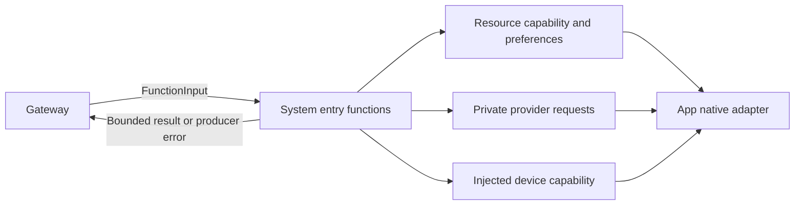

# System Queries and Configuration Functions

## Summary

Strict callable model-resource, provider and device operations over injected neutral capabilities.

## Ownership and boundaries

Entries own arguments, budgets and actual result encoding; Support owns preference/provider transaction policy. App supplies native/Keychain primitives; ModelKit supplies management via the injected adapter. No Agent, UI or call-protocol implementation is imported.

## External relationships and data flow

Runtime arrows show data or capability calls; dashed arrows show injection.

## Function groups

| Module | Functions and completion |
| --- | --- |
| ModelResources | snapshotResources, restoreSource, saveSource, configureSpeech, download, cancel, remove |
| Provider | discoverModels, restoreSettings, saveSettings, readSettings |
| Device | control, readStatus, readEnvironment |
| Runtime | runtimeInfo: fixed informational sentence only |

Unknown arguments reject; string booleans and UUID/request identity validate before effects. Resource commands/provider transactions use 60-second cooperative budgets. Download acknowledges native admission; cancel/remove join management cleanup. Source results are ≤2048 bytes; inventory/model lists ≤65,536 bytes. snapshotResources accepts no arguments and rejects partial/invalid inventory.

## Exposure and private data

Provider configuration uses opaque session-bound staged request IDs, never secret-bearing protocol values. readSettings returns only confirmed enabled/model summary without endpoint/key or binding mutation. discoverModels applies Actions-owned family eligibility to raw SDK IDs. Native errors become safe bounded producer codes; whole-list overflow fails rather than truncates.

ApplicationControl grants current read facts, download/cancel and selected device operations. Model removal is not granted because native quiescence can join the calling runtime. Provider configuration changes remain private human-staged operations. Assistant 的配置 Skill 使用 readEnvironment Action 获取新事实；BasicSkill 中的 Task 控制使用 Action Call。

Device.control validates operation-specific arguments and returns accepted submission, not motor arrival. Native endpoint separately checks foreground/connection/worker admission. Late failures retain independent trusted results; environment facts are current observations, not completion evidence.

✅ Resource/provider/device functions and safe factual queries are implemented.

❌ System.Runtime.runtimeInfo remains a fixed-text compatibility function; live health diagnostics are not implemented there.

## Related design

[Parent design](../README.md) · [Support](Support/README.md)

✅ Task controls are canonical finite Actions with an injected TaskControlCapability. They authorize the real source/input/decision and commit Assistant Skill/task state; terminal controls complete only after the round barrier.

## Skill/task-mode contract

✅ Support/TaskControlModule exposes five finite state controls for loading/releasing Skills and starting/finishing/cancelling tasks through an injected neutral port. State ownership remains Assistant; System executes no independent agent loop.

✅ 2026-10-11 correction: TaskControl functions are finite committed transactions returning a bounded value, not state/completed-only operations. Regression executes each through FunctionExecutor. Task reports move out of system instructions into data messages; include only same-session live declared background tasks or the exact current directed task, not legacy terminal delegation records. Completed local outcomes are selected only for the current input. Persistent/UI task history is retained.

## Action-owned documentation and Skill instruction contract

✅ 函数说明和参数契约放在本域函数的 `@Action(doc:parameters:)` 中；模块组合通过编译宏生成中立声明。业务示例属于使用该函数的 Skill Instructions.md，不属于函数注册。Agent.Task 控制的协议地址由 System/TaskActions 及 TaskControlModule 实现，复用同一宿主端口。

## Channel-owned Action ordering

✅ Function metadata and business attributes have no serialization key. Scheduled ordering belongs to [ChannelScheduler](../../Gateway/Output/Scheduling/README.md); resources/budgets and native capability admission remain explicit.

## Task controls through Action Calls

✅ BasicSkill 的五个 Task/Skill 控制函数使用 Control Channel Action Call；App 通过 ChannelScheduler 返回已提交状态。startTask/loadSkills/releaseSkills 返回的已提交业务状态在结果屏障后重建目录并 ReACT，finishTask/cancelTask 加入回复及清理屏障后恢复默认。新目录仅影响后续请求，不允许加载轮提前调用新函数。可信固定调用复用同一实现。
## Startup publication and foreground task regression

✅ startTask 的函数 doc 和参数 doc 明确：前台任务只传 goal、可选 skills/execution，不传 target/businessContract/payload；后三项只属于 execution=background。确定性状态校验仍拒绝混用参数，不丢弃它们或伪造成功。

✅ 提示词精简已实现：Task函数doc提供简短效果/结果，参数说明保留前后台字段边界；调用类型和5秒显式Action超时不变。

❌ finishTask说明区分目标完成和用户明确切换而关闭；startTask明确现有前台任务关闭前拒绝。仅调整函数说明，不增加参数或改变Action类型。

✅ Task关闭续轮修正：finishTask默认在收尾后结束当前决策，不重新提交已处理用户输入。仅显式continueDecision=true允许同一输入中尚未执行的新目标续轮；cancelTask始终结束。该可选参数在Action声明和Task状态中严格验证，默认false。跨边界模型回执使用实际终态/default目录，保留原始执行回执为历史证据。
