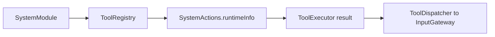

# System Tools

Purpose: small direct system functions, grouped in `SystemActions.swift`. The design keeps callable entries at the domain root and registration in [Support](Support/README.md).

✅ `SystemActions.runtimeInfo(_:)` returns the fixed configuration description. Its registered path remains `runtimeInfo`; it is not a live health probe. `Support/SystemModule.swift` declares the returning handler and App composes it through `CapabilityModules`.

❌ Live health reporting and additional system functions are not implemented. This domain owns no queue or scheduling state.

✅ Entry metadata is declared with `@Tool`; the Support catalog binds generated definition factories to explicit capabilities. Runtime behavior and Agent permissions are unchanged.

✅ System entries consume ToolRequest from Actions/Runtime/Contracts.

✅ ADR0098: Execution values and services are imported from independent ActionRuntime; concrete Tool domains, pose payload and macro declarations remain in Tools. Published paths, feedback and cancellation behavior are unchanged.

✅ ADR0151: this domain is compiled once in Actions; both ActionCall and ToolCall entries use ActionRuntime contracts. Host injection and permission/feedback behavior are unchanged.
❌ Unified capability definitions and protocol registration adapters remain pending.

✅ ADR0152: functions are classified by domain before protocol unification. Canonical namespaces use `<Domain>Actions`; production uses one `<Domain>Module` with Action/Tool registry projections. Legacy names are aliases or registration projections, not duplicated implementations.
❌ Unified callable definitions and migration of compatibility names remain pending.

## Cohesive module files — ADR0154

Purpose: implement directory/module-file/function ownership while preserving current protocol APIs. The domain Actions enum remains a used namespace facade; callable bodies belong exclusively to the files below. Support owns one domain catalog, values and host capabilities.

- [RuntimeActions.swift](RuntimeActions.swift)

✅ Implementations are split without forwarding or duplicated metadata/handlers. Generated factories and existing call paths, permissions, resources and scheduling are unchanged.
❌ Explicit three-field paths, versioned Agent configuration and unified definitions/results remain the next coordinated stage.
