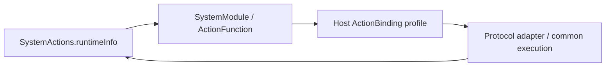

# System Actions

Purpose: own callable system queries. Design goals: protocol-neutral functions, bounded results and no runtime state or Agent dependency.

✅ RuntimeActions.swift implements System.Runtime.runtimeInfo using FunctionInput. @Action creates an ActionFunction; Support/SystemModule.swift wraps its string in ActionCompletion.value. No Tool request, binding or registry enters this domain.

✅ The current host exposes this query as a returning direct ToolCall. Agent configuration owns model aliases and permissions; changing the host protocol does not change the function.

❌ runtimeInfo currently returns a fixed status sentence. It is not a live configuration/health inspection or proof of model/device readiness. Real runtime diagnostics remain pending.

✅ ADR0161: standard callable inputs use FunctionInput/FunctionContracts; common execution and call protocols belong to independent Gateway targets. This directory retains its existing ownership, resource/permission and lifecycle boundaries. ❌ Remaining feature Signal/continuation and physical acceptance are separate work.
