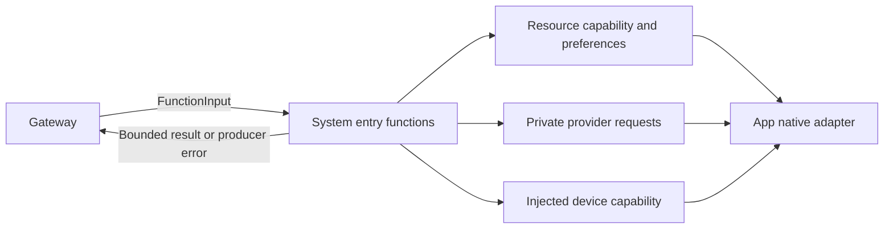

# System Queries and Configuration Functions

## Summary

Strict callable model-resource, provider and device operations over injected neutral capabilities.

## Ownership and boundaries

Entries own arguments, budgets and actual result encoding; Support owns preference/provider transaction policy. App supplies native/Keychain primitives; ModelKit supplies management via the injected adapter. No Agent, UI or call-protocol implementation is imported.

## External relationships and data flow

Runtime arrows show data or capability calls; dashed arrows show injection.

## Function groups

| Module | Functions and completion |
| --- | --- |
| ModelResources | snapshotResources, restoreSource, saveSource, configureSpeech, download, cancel, remove |
| Provider | discoverModels, restoreSettings, saveSettings, readSettings |
| Device | control, readStatus, readEnvironment |
| Runtime | runtimeInfo: fixed informational sentence only |

Unknown arguments reject; string booleans and UUID/request identity validate before effects. Resource commands/provider transactions use 60-second cooperative budgets. Download acknowledges native admission; cancel/remove join management cleanup. Source results are ≤2048 bytes; inventory/model lists ≤65,536 bytes. snapshotResources accepts no arguments and rejects partial/invalid inventory.

## Exposure and private data

Provider configuration uses opaque session-bound staged request IDs, never secret-bearing protocol values. readSettings returns only confirmed enabled/model summary without endpoint/key or binding mutation. discoverModels applies Actions-owned family eligibility to raw SDK IDs. Native errors become safe bounded producer codes; whole-list overflow fails rather than truncates.

ApplicationControl grants current read facts, download/cancel and selected device operations. Model removal is not granted because native quiescence can join the calling runtime. Provider configuration changes remain private human-staged operations. Assistant has no model Tools and uses readEnvironment Action for fresh facts.

Device.control validates operation-specific arguments and returns accepted submission, not motor arrival. Native endpoint separately checks foreground/connection/worker admission. Late failures retain independent trusted results; environment facts are current observations, not completion evidence.

✅ Resource/provider/device functions and safe factual queries are implemented.

❌ System.Runtime.runtimeInfo remains a fixed-text compatibility function; live health diagnostics are not implemented there.

## Related design

[Parent design](../README.md) · [Support](Support/README.md)
