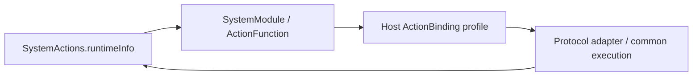

# System Actions

Purpose: own callable system queries and model-resource command validation. Design goals: protocol-neutral functions, bounded results and no runtime state or Agent dependency.

✅ RuntimeActions.swift implements System.Runtime.runtimeInfo using FunctionInput. @Action creates an ActionFunction; Support/SystemModule.swift wraps its string in ActionCompletion.value. No Tool request, binding or registry enters this domain.

✅ The current host exposes this query as a returning direct ToolCall. Agent configuration owns model aliases and permissions; changing the host protocol does not change the function.

❌ runtimeInfo currently returns a fixed status sentence. It is not a live configuration/health inspection or proof of model/device readiness. Real runtime diagnostics remain pending.

✅ ADR0161: standard callable inputs use FunctionInput/FunctionContracts; common execution and call protocols belong to independent Gateway targets. This directory retains its existing ownership, resource/permission and lifecycle boundaries. ❌ Remaining feature Signal/continuation and physical acceptance are separate work.

✅ Implemented: ModelResourcesActions.swift owns System.ModelResources.download/cancel/remove, required IDs and download source arguments, strict unknown-key rejection and60-second cooperative execution. Native commands return bounded acknowledgments; source functions return bounded canonical JSON; download is admission, while cancel/remove join native management cleanup. No concrete ModelKit/UI imports or implicit source fallback.

## Resource function execution

The functions have no Agent identity, ToolCall, ActionCall or registry dependency. ModelKit validates catalog identity/source suitability and owns transfer/installation; failures return through shared execution without stopping its caller runtime.

✅ ADR0167: configureSpeech validates only recognition/synthesis boolean strings, returns a bounded configuration acknowledgment and propagates failure through shared execution. Installation selection and source persistence remain staged consumer policy.

✅ ADR0168: restoreSource/saveSource validate standard arguments and return at most2048 bytes of canonical preference JSON. They have no model/UI/protocol dependency; Support owns the durable service and injected SDK validation.

✅ ADR0169: System.ModelResources.snapshotResources rejects input arguments, fetches neutral facts, validates the whole inventory and returns bounded canonical JSON. Failure never returns partial state; the function has no model/UI/calling-convention dependency.

✅ ADR0170: snapshotResources delegates neutral reading to ModelResourceInventory.read; its argument/encoded result contract remains unchanged.

✅ ADR0173: Preference native algorithms and wire values are unchanged; preference errors expose precise neutral domain codes through the existing failure-providing interface.

## Provider discovery

✅ Implemented: ProviderActions.swift adds System.Provider.discoverModels(requestID), strict UUID/key validation, cooperative60-second timeout and canonical bounded model-list JSON. It claims a private session-bound request through an injected capability. Unknown native failures become explicit provider.unavailable errors, not arbitrary secret-bearing error text. No configuration write, provider switch, implicit retry or call-protocol type.

Provider result limits preserve the existing SDK2048-ID/512-byte contract, with an additional65536-byte returning-result bound. Whole-list failure replaces truncation. Model-family heuristic migration from ModelKit remains pending.

## Provider configuration transactions

✅ Implemented: ProviderActions adds restoreSettings/saveSettings, strict UUID/unknown-key validation and cooperative60-second transaction budgets. Required ProviderSettingsCapability is awaited before returning requestID. No secret-bearing value, protocol logic or implicit retry belongs in the function.

## Completion batch — provider presentation and capability policy

✅ Implemented: provider discovery model-family eligibility belongs to Actions ProviderModelList; ModelKit validates/decodes raw IDs only. Preserve filtering/dedup/order and bounds at the app boundary. SettingsState becomes a passive editable snapshot, with no tasks or injected execution; SettingsInteractionWorkflow in the existing Settings directory owns bounded form admission, revision and page-independent saves. UI forwards edits/discovery/cancellation/save through SettingsControlling.

✅ Implemented: presentation-enabled provider intents select a second registered UI.ResourcePresentation.showProviderResult call after the business call, on success or failure. Headless requests retain one call. Private result lookup and revision/session fences prevent credentials in protocol payloads and stale form updates. One attempt only, no recursive presentation/replay; producer and presentation failure chains remain distinct. App injects the native UI endpoint; business functions remain independent of UI and call protocols.

## Read-only model grants and shared capability facts

✅ Implemented: Assistant JSON explicitly grants System.ModelResources.snapshotResources and System.Provider.readSettings as native read-only tools. The same canonical functions used by deterministic/manual routes return the current shared inventory and a confirmed cloud-enabled/model summary. Provider summary excludes endpoint/key and never restores or changes a binding; unavailable/unconfirmed state fails explicitly. LLM configuration mutations remain staged-secret human operations. These tools query current facts rather than fixed runtimeInfo text and can feed bounded model continuation.

## Typed device, navigation and environment entry points

✅ Implemented: app.interaction/1 maps explicit device commands and navigation destinations to fixed registered functions through ApplicationControl and the shared root transport. This Agent now coordinates native resource interactions as well as model resources; it performs no native I/O. UI controls emit typed intent through a root-owned BluetoothInteractionWorkflow; native BluetoothWorkflow remains the injected connection/recovery/manual worker host. Existing arrival tolerance, timeouts, pacing and takeover algorithms stay unchanged.

✅ Implemented: System.Device.control validates bounded string arguments and invokes neutral DeviceControlCapability; successful submission reports acceptance, not physical arrival. Read-only status and selected connection commands are explicitly model-granted. UI.Navigation.open commits native route state; manual taps and model requests share that function. A bounded latest motor-intent worker sends only changed values, with reset/stop priority and explicit failure display. No queued motion replay.

✅ Implemented: app.environment/1 stores latest sequenced scene/device/capability facts in the root Agent, with finite categories and bounded data. App still performs synchronous background/native safety fencing before reporting facts; physical safety cannot wait on Agent admission or iOS background execution. Native back navigation remains platform-owned and reports a fact, rather than replaying navigation effects. Photo-library creation and physical acceptance are feature/acceptance boundaries, not implied by navigation support.

## Model resource command grants

✅ Implemented: Assistant has grants for the existing canonical download/cancel functions with bounded model ID, explicit HTTPS source and boolean cellular arguments. Manual and native model calls share execution and native transfer ownership; download acknowledges admission only and cancel awaits cleanup. Model removal is not granted: its native quiescence can join the calling voice runtime, so removal needs the same explicit session-handoff design as provider changes. No configuration or provider mutation grant is implied. Model feedback reports errors as data and never automatically replays a transfer.

✅ Implemented admission hardening: the native device endpoint validates its existing foreground, connection and worker admission conditions before accepting scan/connect/reconnect/preset/jog. Rejected void UI commands must become explicit call errors, without changing native recovery/motion algorithms. Device facts include the current native issue. Motor arguments reject unrelated preset fields.
