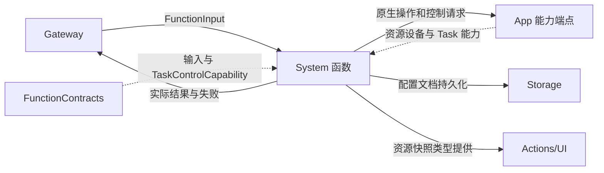
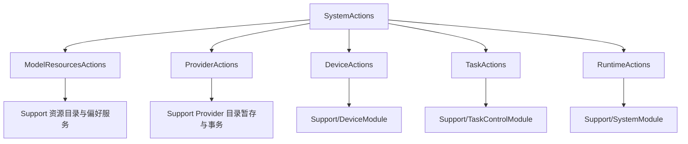

# System — 资源、Provider、设备与 Task 控制函数

## 简介

提供系统事实查询、模型资源管理、私有云配置事务及中立 Task 控制转发。入口维护参数、预算与真实结果，原生工作通过注入能力完成。

## 上下游关系（一级）

System 不导入 ModelKit、Agents、UI 或 Gateway 实现。它只调用中立端口；配置绑定、设备会话和 Task 状态由端点所属宿主负责。

## 内部模块关系

## 函数接口与完成语义

| 地址模块 | 函数 | 完成与静态预算 |
| --- | --- | --- |
| System.ModelResources | snapshotResources、restoreSource、saveSource、configureSpeech、download、cancel、remove | 全部 60 秒；下载是准入，取消/删除/绑定等待端点返回 |
| System.Provider | discoverModels、restoreSettings、saveSettings | 60 秒；暂存请求的实际结果或 requestID |
| System.Provider | readSettings | 默认 30 秒；已确认的启用状态和模型名 |
| System.Device | control | 60 秒；accepted 操作回执，不等于连接成功或电机到位 |
| System.Device | readStatus / readEnvironment | 默认 30 秒；原样有界事实字符串 |
| System.Runtime | runtimeInfo | 默认 30 秒；固定文字“本地聊天与语音能力已配置” |
| Agent.Task | loadSkills、releaseSkills、startTask、finishTask、cancelTask | 5 秒；宿主返回的 value completion |

TaskActions 属于 System 目录，但公开地址为 `Agent.Task`，这是显式的地址映射。它转发完整参数和 invocation，不在这里维护 Agent 状态或重复宿主的权限、参数及轮次验证。

## 参数、结果与私有数据

资源下载需要 id（最多 64 字节）、endpoint（最多 1024 字节）及严格 true/false 的 allowsCellular。source 保存同时接受 recognition/synthesis 严格布尔字符串；configureSpeech 只改变注入端点绑定，偏好持久化是另一项操作。source 编码上限 2048 字节，资源快照上限 65536 字节。

Provider 的发现、恢复、保存只传 requestID ID；URL/密钥留在同会话私有暂存中。发现结果最多 2048 个模型 ID、每项最多 512 字节、编码最多 65536 字节；过滤策略在 Support。readSettings 不返回 URL/密钥，不执行联网可用性探测。

Device.control 的模型声明提供 scan/stopScan/connect/reconnect/disconnect/forget/refresh；实际解析还支持 preset、motorVelocity、stopMotorControl、openPage、closePage、openSystemSettings 等可信操作。connect/reconnect 要求设备 ID；motorVelocity 要求电机 1…6 和有限 −1…1 的 value；preset 使用封闭动作名。可选 fence 必须为 ID。其余操作拒绝 id/value/action 混用，未知参数键拒绝。

readStatus/readEnvironment 不接收参数，分别限制 16384/65536 UTF-8 字节，内容由端点提供；入口不追加事实或证明物理完成。runtimeInfo 直接返回固定文字，当前不解析参数，也不是实时健康检查。

Task 声明描述 JSON 数组 Skills、前台/后台 Task 字段和终态控制：foreground 使用 goal 及可选 skills/execution；target/businessContract/payload 为后台字段。finishTask 的 continueDecision 默认 false，仅为同一输入剩余新目标声明显式续轮。实际验证、提交、清理与结果屏障均在宿主端口实现。

## 生命周期与约束

✅ 资源和 Provider 服务有独立准入及事务状态，见 Support。普通入口没有统一队列、原生设备 worker 或重试循环；异步异常和已经提交的结果按各端点契约返回。

❌ runtimeInfo 没有实时诊断实现。声明参数与可信入口解析的开放范围不是同一个集合，不能据函数存在推断模型权限或原生能力可用。

[Actions 设计](../README.md) · [System 服务实现](Support/README.md) · [共享契约](../Support/Contracts/README.md)

## SQLite records and runtime identity

✅ Implemented: technical identities are opaque UUID strings; committed business entities use dialog/message/task/media/device SQLite IDs. Consumers use Storage repositories while preserving ownership, cancellation and independent foundation boundaries. Complete messages, including each ReACT message, persist at termination; delta fragments do not persist. The custom allocator and replaced file/index implementation are removed. See the project SQLite business-record plan.
