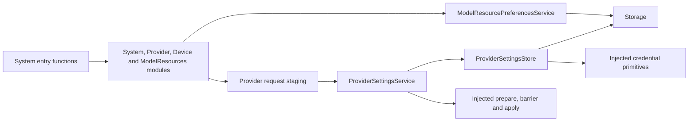

# System Values, Staging and Transactions

## Summary

Explicit catalogs and neutral resource/provider/device policy with bounded private request staging and atomic persistence.

## Ownership and boundaries

Catalogs do not own protocol registration. Services own transaction meaning; Storage owns file primitives, injected App callbacks own SDK/native/Keychain work. Model capability binding is not performed by preference persistence itself.

## External relationships and data flow

Runtime arrows show data or capability calls; dashed arrows show injection.

## Resource preferences and inventory

Preferences use a 4096-byte revision-checked document and legacy decoding. One mutation rejects overlap. Restore reconciles networking/missing-model flags; save validates current prerequisites before commit. Typed source/recognition/synthesis errors retain exact producer codes. Binding happens as a separate selected function; committed source survives later binding failure.

Inventory permits 64 unique items/65,536 UTF-8 bytes. ID/name/revision/license/failure limits are 64/256/512/512/1024 bytes; counters are nonnegative. Whole-result validation rejects invalid/duplicate/oversized state. The callable computes installedGroups: Nemotron recognition, MOSS synthesis, Gemma language and YOLO vision; Silero is optional. Native adapter returns raw neutral facts only. read(using:) shares cancellation/read/validation between query and presentation.

## Private provider staging

Discovery staging retains at most 32 unclaimed/completed requests, ten-second claim deadline, session validation and explicit discard. Configuration URL/key is private bounded data; claim consumes once before SDK await. Settings staging retains 32 staged/active/completed slots with the same unclaimed deadline, operation/session checks and private result take/discard. Active work belongs to invoking execution; no background query queue exists.

ProviderModelList validates at most 2048 IDs of ≤512 bytes, eligibility/dedup/order and ≤65,536-byte encoding. It is a heuristic application policy, not provider protocol capability discovery. ProviderModule binds four canonical functions; there is no duplicate discovery catalog.

## Provider transaction and credentials

ProviderSettingsService excludes/coalesces its transaction: validate/prepare before barrier/write, persist before apply, and join rollback on failed application before endChange. Preserve primary and rollback causes safely. Last-confirmed values remain after failure; explicit restore reconciles ambiguous result delivery without replaying save.

ProviderSettingsStore owns v1 document and credential-reference schema. Injected Keychain insert/read/delete primitives retain native service/accessibility. Verify legacy migration and replacement before deleting prior credentials; protocol results contain only opaque request identity or secret-free summary. Raw SDK messages/keys never enter history or errors.

DeviceControlRequest validates finite known operation categories and operation-specific bounded string fields; unsupported presets/motor mixtures reject. The capability returns current facts and actual native acknowledgment rather than selecting business retry.

✅ Bounded private staging, atomic preference/provider policy and neutral inventory are implemented.

## Related design

[Parent design](../README.md)
