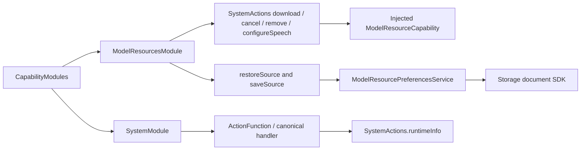

# System Action Support

Purpose: assemble the system catalog and own resource preference transactions and neutral inventory data. Design goals: explicit factories, revision-checked storage and no call-registration policy. Catalogs retain no queue; the preference actor rejects overlapping mutations.

✅ SystemModule.swift exposes one ActionFunction whose canonical handler calls SystemActions.runtimeInfo and returns ActionCompletion.value. Host composition separately creates ActionBinding; the catalog imports FunctionContracts only and grants no Agent permission.

❌ Live runtime health inspection remains pending; runtimeInfo returns fixed text. ✅ Resource management has a separate injected capability catalog.

✅ ADR0161: standard callable inputs use FunctionInput/FunctionContracts; common execution and call protocols belong to independent Gateway targets. This directory retains its existing ownership, resource/permission and lifecycle boundaries. ❌ Remaining feature Signal/continuation and physical acceptance are separate work.

✅ Implemented: ModelResourcesModule binds seven functions to explicit native and preference capabilities. SystemModule retains its independent runtimeInfo catalog; the combined production catalog includes both modules, preserving six business domains.

✅ ADR0167: ModelResourceCapability requires explicit speech-binding implementation; its fourth catalog function uses the same standard completing handler. There is no default no-op or protocol policy in the catalog.

✅ ADR0168: ModelResourcePreferencesService owns a4096-byte revision-checked store and legacy decoder. Restore migrates networking and missing-model flags; save validates fresh prerequisites before committing. One service mutation rejects overlap; it never applies speech binding directly.

✅ ADR0169: ModelResourceInventory validates64 items/65536 encoded bytes, duplicate IDs, bounded metadata and nonnegative counters. ResourceModelGroup owns the prerequisites shared by inventory and preferences. Native capability returns facts only; the callable computes installedGroups before encoding.

The inventory capability returns raw neutral facts. The snapshotResources function computes installed groups during callable execution and includes them in canonical JSON; the native adapter does not compute eligibility.

### Inventory contract

| Field / rule | Bound or meaning |
| --- | --- |
| Items / encoded inventory |64 items /65536 UTF-8 bytes; reject the entire result on overflow |
| ID / name / revision / license / failure |64 /256 /512 /512 /1024 UTF-8 bytes; IDs unique and nonempty |
| Counters | Nonnegative64-bit values; progress clamps completed/download bytes to1 |
| installedGroups | Computed by the callable from installed-phase facts; recognition requires Nemotron, synthesis MOSS, language Gemma, vision YOLO; Silero is optional for eligibility |
| Lifecycle | Read-only invocation, no private queue or subscription; cancellation and returning feedback are runtime-owned |

✅ ADR0170: ModelResourceInventory.read(using:) shares native fact acquisition, cancellation checks and whole-inventory validation between query and presentation.

✅ ADR0173: ModelResourcePreferenceError.executionFailureCode uses each existing domain reason rather than collapsing to invalidArguments. Validation/migration/save criteria and persistence ordering remain unchanged.

## Provider discovery

✅ Implemented: ProviderModule.swift owns ProviderDiscoveryConfiguration (not Codable), ProviderDiscoveryCapability, neutral errors and2048-model/512-byte-ID/65536-byte-JSON validation. ProviderDiscoveryRequests.swift owns up to32 opaque staged requests with ten-second claim deadlines, rejects overflow, checks session before removal, consumes once before SDK await and explicitly discards unclaimed requests. No queue or background task; the caller owns active query execution. ProviderModule creates a returning canonical definition; host registration chooses protocol.

## Provider configuration transactions

✅ Implemented: ProviderSettingsService.swift owns neutral ProviderSettings values, safe error chains, injected preparation/barrier operations and one excluded/coalesced transaction. Validation precedes barrier/write; persistence precedes apply; failed apply joins rollback before endChange. ProviderSettingsStore.swift owns the existing v1 document, Keychain reference schema and verified legacy migration using Storage plus injected credential primitives. ProviderSettingsRequests.swift owns32 total staged/active/completed slots,10-second unclaimed deadlines, session/operation checks, one claim and private result take/discard. No credential result is serialized into feedback. Store/service retain previous confirmed value after failure; unknown error text is excluded.

ProviderModule.swift replaces the separate discovery catalog and owns all three Provider function definitions. ProviderSettingsRequests remains private business staging; it does not assemble a second catalog for the same module. No compatibility alias or duplicate catalog is retained.

## Completion batch — provider presentation and capability policy

✅ Implemented: provider discovery model-family eligibility belongs to Actions ProviderModelList; ModelKit validates/decodes raw IDs only. Preserve filtering/dedup/order and bounds at the app boundary. SettingsState becomes a passive editable snapshot, with no tasks or injected execution; SettingsInteractionWorkflow in the existing Settings directory owns bounded form admission, revision and page-independent saves. UI forwards edits/discovery/cancellation/save through SettingsControlling.

✅ Implemented: presentation-enabled provider intents select a second registered UI.ResourcePresentation.showProviderResult call after the business call, on success or failure. Headless requests retain one call. Private result lookup and revision/session fences prevent credentials in protocol payloads and stale form updates. One attempt only, no recursive presentation/replay; producer and presentation failure chains remain distinct. App injects the native UI endpoint; business functions remain independent of UI and call protocols.

## Read-only model grants and shared capability facts

✅ Implemented: Assistant JSON explicitly grants System.ModelResources.snapshotResources and System.Provider.readSettings as native read-only tools. The same canonical functions used by deterministic/manual routes return the current shared inventory and a confirmed cloud-enabled/model summary. Provider summary excludes endpoint/key and never restores or changes a binding; unavailable/unconfirmed state fails explicitly. LLM configuration mutations remain staged-secret human operations. These tools query current facts rather than fixed runtimeInfo text and can feed bounded model continuation.

## Typed device, navigation and environment entry points

✅ Implemented: app.interaction/1 maps explicit device commands and navigation destinations to fixed registered functions through ApplicationControl and the shared root transport. This Agent now coordinates native resource interactions as well as model resources; it performs no native I/O. UI controls emit typed intent through a root-owned BluetoothInteractionWorkflow; native BluetoothWorkflow remains the injected connection/recovery/manual worker host. Existing arrival tolerance, timeouts, pacing and takeover algorithms stay unchanged.

✅ Implemented: System.Device.control validates bounded string arguments and invokes neutral DeviceControlCapability; successful submission reports acceptance, not physical arrival. Read-only status and selected connection commands are explicitly model-granted. UI.Navigation.open commits native route state; manual taps and model requests share that function. A bounded latest motor-intent worker sends only changed values, with reset/stop priority and explicit failure display. No queued motion replay.

✅ Implemented: app.environment/1 stores latest sequenced scene/device/capability facts in the root Agent, with finite categories and bounded data. App still performs synchronous background/native safety fencing before reporting facts; physical safety cannot wait on Agent admission or iOS background execution. Native back navigation remains platform-owned and reports a fact, rather than replaying navigation effects. Photo-library creation and physical acceptance are feature/acceptance boundaries, not implied by navigation support.

## Manual worker terminal feedback

✅ Implemented: accepted device-control calls acknowledge submission only. Preset/jog native workers capture their own origin and report sink, retain one latest structured terminal failure, publish independent home issues and deliver a trusted ActionResult through InputGateway after non-cancellation failure. Root ApplicationControl accepts runtime-owned Action results into a bounded128-result inbox; environment context exposes the latest result summary. No accepted Tool receipt is rewritten, no movement replay, and no tolerance/arrival/timeout algorithm changes. Ordinary failure stops only its worker and keeps subsequent intents admissible. Diagnostic delivery rejection is reported separately.

## Provider draft boundary

✅ Implemented: the cloud toggle edits a draft only. UI performs no installed-model check or extra refresh before save; the existing Actions-owned provider transaction validates its injected native binding before persistence or lifecycle fencing. An invalid local selection follows the registered provider error result and leaves the saved configuration intact.
