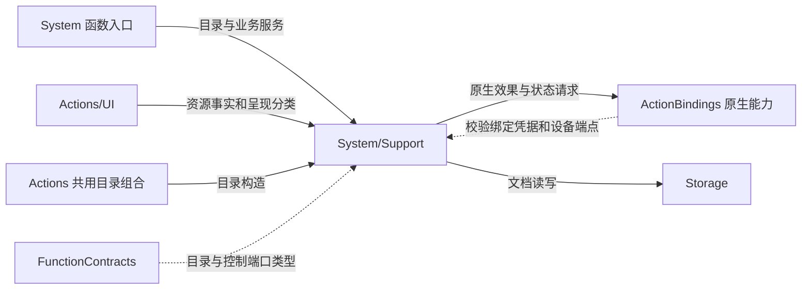
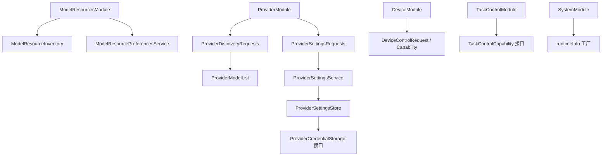

# System Support — 资源值、私有暂存与配置事务

## 简介

提供 System 的五个目录、资源事实与偏好、Provider 私有请求暂存/事务/凭据文档，以及设备控制值。业务规则属于本目录，文件一致性和原生服务由 Storage 与注入端点负责。

## 上下游关系（一级）

## 内部模块关系

## 目录与值接口

ModelResourcesModule、ProviderModule、DeviceModule、TaskControlModule、SystemModule 各绑定其实际函数。目录不选择调用协议或模型权限。TaskControlModule 只注入中立端口，SystemModule 只提供固定信息函数。

DeviceControlRequest 保存 operation、可选 id/value/action/fence；它的构造器不校验操作组合，校验位于 DeviceActions。DeviceControlCapability 接收标准输入，并提供状态/环境字符串；默认 readEnvironment 明确抛 unavailable。

## 资源快照与偏好

ModelResourceInventory 是 version=1 的 Codable 值。read 从 capability 获得原始事实，并以 installed 项推导 installedGroups：recognition=nemotron、synthesis=moss-tts-nano、language=gemma4-e2b、vision=yolo26n-pose。Silero 不在这些必需集合中。

快照最多 64 个唯一 ID、编码最多 65536 字节；ID/name/revision/license/failure 分别限 64/256/512/512/1024 UTF-8 字节，字节计数非负。active 对应 queued/downloading/verifying/deleting，progress 对总量做有界计算。decode 校验版本、条目和大小；installedGroups 的一致性推导发生于构造读取路径，validate 不重新计算已解码集合。

ModelResourcePreferencesService 是 actor，惰性获取注入的 DocumentRepository，通过 changing 标志拒绝重叠 restore/save。restore 校验存储值并依据已安装资源关闭不可用自定义语音选项；只有联网/语音开关变化时才回写，单独 endpoint 规范化不触发写入。save 先校验源与已安装前提，再以预期 revision 保存。偏好结果编码上限 2048 字节；文档存储容量由注入 store 配置。

偏好解码支持 preferDownloadedSpeech 字段映射到两个独立开关；新编码只写当前字段。持久化不负责模型绑定，已提交偏好不会因另一项绑定失败自动撤销。

## Provider 请求暂存与容量

ProviderDiscoveryConfiguration 不可 Codable，保存 URL/key 私有值。ProviderDiscoveryRequests 是 actor：stage 校验 URL/key 最大 2048/4096 字节，为待领取请求设置 10 秒期限；领取前核对 sessionID，领取时移除待领取项，再执行注入发现工作。完成结果由相同会话读取或 discard；错误转换为安全 Provider 分类。

stage 以待领取项加 completed 项少于 32 作为准入条件。

ProviderSettingsRequests 是 MainActor 所有者，共最多 32 个 staged/executing/completed 条目。未领取期限为 10 秒；session、操作种类、阶段与期限必须匹配才能执行。active 不能被 discard，完成值可 result/take，take 移除记录；执行失败移除记录。没有自动过期 worker，过期待领取项在 stage 时过滤。

ProviderModelList 对至多 2048 个非空、最多 512 字节的 ID 进行应用聊天模型族过滤、保序去重；发现暂存端点先拒绝原始重复 ID，编码拒绝超量或超 65536 字节结果。该启发式不证明远端模型的协议兼容性。

## Provider 事务与凭据

ProviderSettingsService 在 MainActor 上拥有 saved/restored/changing、一个共享 restoration Task 和至多 32 个恢复等待者。并发 restore 加入同一个恢复任务；恢复读取持久化后调用 prepare 返回的 apply，成功才设置已确认状态。调用者不各自创建恢复工作，单个等待者取消不等同于取消共享恢复任务。

save 排斥其它更改和在途恢复：校验选项，prepare 获得 apply，加入 beginChange 屏障，持久化后应用，最终 endChange。应用失败时用独立 Task 加入持久化旧值回滚；回滚失败同时保留两个安全原因。此回滚是文档回滚，不保证原生状态能撤销。summary 仅在 restored 后返回 cloudEnabled/selectedCloudModel。

ProviderSettingsStore 是 actor，以 busy 排斥重叠读写，保存 version=1 的配置文档和 credentialID 引用。ProviderCredentialStorage 注入原生凭据读写；原文 key 不存入配置文档。迁移旧凭据时，先提交新文档，再重新读取并核对，成功后移除旧记录。

替换时先写新凭据，再按 revision 保存文档；文档失败时尽力删除新凭据，提交成功后尽力删除旧凭据。凭据清理是 best effort，可能留下无引用记录，不将已提交配置改判为未提交。原生凭据策略及原始网络错误不进入协议结果；安全失败码与有界摘要由 ProviderSettingsError 提供。

[System 入口与参数](../README.md) · [Storage 文档一致性](../../../Storage/README.md) · [共享契约](../../Support/Contracts/README.md)

## SQLite records and runtime identity

Settings/model-preference services consume DocumentRepository protocols; concrete settings-file construction stays in module integration/test factories. Preserve revision conflicts and producer-owned rollback policy.

## 配置与制品的真实能力绑定

ActionBindings 编译 SettingsCredentialAdapter、SettingsProviderAdapter、SettingsModelResourcesAdapter、ModelArtifactStorageAdapter、ArtifactServices、ModelDownloadBackgroundService 及显式模型/语音诊断执行。Provider 事务和资源策略仍由 Actions 核心服务拥有；绑定只调用 SDK/Keychain/文件能力并适配展示值。SettingsCredentialAdapter 提供公开的无参数构造和凭据协议实现；SettingsProviderAdapter.discoverModels 提供公开异步发现端口，供 AgentBindings 注入领域请求服务。

ArtifactServices 根持有一个准备任务；模型权重仍按需加载。后台回调最多保留 10 个 session completion，重复 identifier 替换时先完成旧回调，溢出明确保留 lastFailure 并结束该次交接。真实制品读取错误保留，不伪造恢复成功。单份 OS 准备额度由 PlatformKit.NativeBackgroundAllowance 提供，不承担设备安全。

SpeechDiagnosticWorkflow 的 stopAndWait 加入真实播放、操作和卸载；卸载/音频会话清理错误保留并向根服务传播，成功报告只在真实完成后设置。App 委托仅转交 OS 参数。

## 待实现

- 发现中的请求已经移出 entries，未占用容量槽，所以此条件不是待领取/执行中/完成的总量硬上限；并发总量控制仍需宿主约束。
