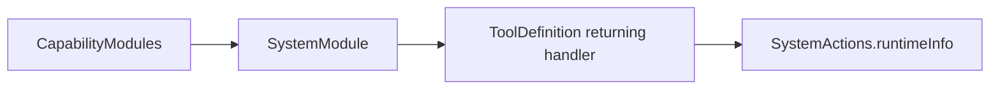

# System Tool support

Purpose: keep domain registration separate from callable system functions. The design uses explicit definitions, with no discovery or hidden App binding.

✅ `SystemModule.swift` registers the existing `runtimeInfo` returning handler. It owns no state or queue.

❌ No health service or additional capability interface is needed or implemented.

✅ Entry metadata is declared with `@Tool`; the Support catalog binds generated definition factories to explicit capabilities. Runtime behavior and Agent permissions are unchanged.

✅ Explicit module bindings use Tools-owned contracts; no Agent dependency.

✅ ADR0098: Execution values and services are imported from independent ActionRuntime; concrete Tool domains, pose payload and macro declarations remain in Tools. Published paths, feedback and cancellation behavior are unchanged.

✅ ADR0151: this domain is compiled once in Actions; both ActionCall and ToolCall entries use ActionRuntime contracts. Host injection and permission/feedback behavior are unchanged.
❌ Unified capability definitions and protocol registration adapters remain pending.

✅ ADR0152: functions are classified by domain before protocol unification. Canonical namespaces use `<Domain>Actions`; production uses one `<Domain>Module` with Action/Tool registry projections. Legacy names are aliases or registration projections, not duplicated implementations.
❌ Unified callable definitions and migration of compatibility names remain pending.
