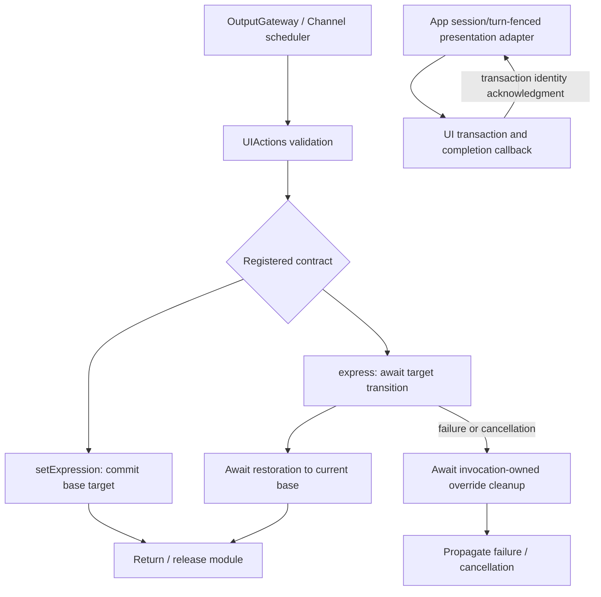

# UI — Scheduled Expressions

Purpose: implement one-shot expression performances and persistent base expressions. Design goals: explicit finite/state completion, bounded lifecycle, typed injection and no SwiftUI dependency.

| Entry | Kind / parameters | Completion and lifetime |
| --- | --- | --- |
| UI.express | finite; required case-sensitive emotion, excluding clear | Await transition to the expression and restoration to the current base. Each call performs again, including the same emotion. Expected budget 2 seconds; timeout 5 seconds cancels and joins cleanup, never substitutes for an animation acknowledgment. |
| UI.setExpression | state; required case-sensitive emotion, including clear | Commit the persistent base target. No animation acknowledgment is promised. Repetition is idempotent; clear removes the base. Replacement, next user turn and session teardown end the state. |

Both reject unknown keys and malformed arguments before effects. Allowed emotions: smile, happy, laugh, thinking, surprised, sad, love, angry, scared, playful. setExpression also accepts clear. Assistant JSON v5 owns both model aliases under Display. Both share the UI module exclusion key and Action scheduling; wait joins their respective handler contracts.

Actions owns the finite enter/restore sequence; App adapts it to UI transactions and retains one override owner and one pending acknowledgment, with no secondary queue. Conflicting activation fails busy. SwiftUI acknowledges removal of the actual transaction affecting both eyes; no guessed settling sleep is used. Restoration reads the current base rather than an old snapshot. Invocation and transaction IDs prevent delayed cleanup/callbacks from touching a replacement.

New-turn/session reset invalidates the override and resumes any waiter with cancellation. Cancellation releases only the calling invocation's override and restores the current base immediately without promising a completed cancelled animation. Hidden/inactive rendering cancels the waiting transition; a missing renderer rejects activation. A stale session/turn fails with cancellation rather than reporting an unperformed finite effect as success. Already displayed effects are not rolled back.

Fixed captions, transcript, voice state, reply initialization, gaze/following and skeleton display remain completion-only Tools without Channels or Action history. beginReplyTurn resets expression as part of its existing atomic turn policy.

| File | Responsibility |
| --- | --- |
| UIActions.swift | finite/state entry validation, enter/restore composition and deadline metadata |
| Support/UIActionTypes.swift | Emotion and validation/busy/unavailable errors |
| Support/UIActionModule.swift | Both generated definitions and explicit presentation capability binding |

✅ Runtime kind metadata remains finite/state; no new dispatch algorithm or activity is introduced. UI imports neither Actions nor ActionRuntime. App owns session lifetime; pages only render transactions and report completion/availability.

❌ Physical-device animation, Reduce Motion and repeated-turn visual acceptance remain pending. Persistent looping performances and Activity control are not implemented.

✅ A one-shot performance includes a 6% eye emphasis and return, so performing the same emotion as the base still has an animated endpoint; persistent base setting never adds this emphasis.
