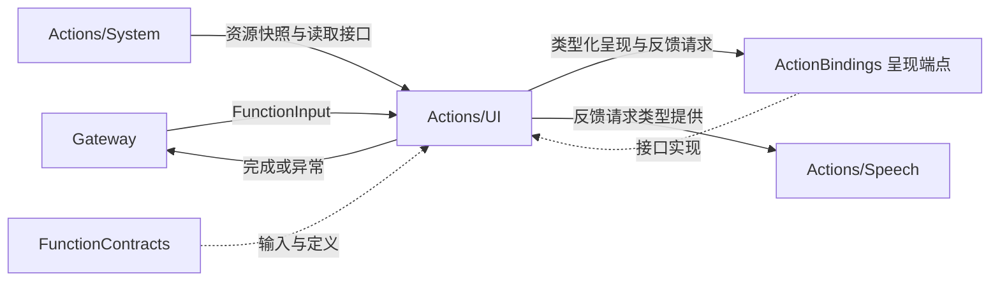
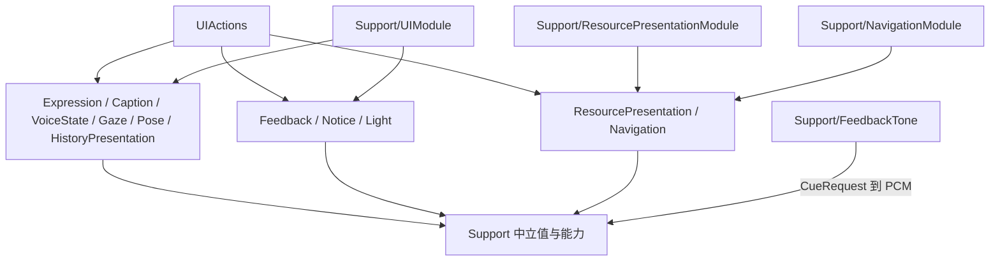

# UI Actions — 呈现、反馈与装饰效果函数

## 简介

此业务域将表情、文字、视线、姿态、资源呈现、导航以及短反馈转换为类型化能力调用。它与独立 UI 模块分属不同编译目标：Actions/UI 不导入 SwiftUI、UIKit 或 UI 项目实现。

## 上下游关系（一级）

呈现/执行绑定端点负责执行关联检查、UI 状态适配、动画/设备服务及期限任务。本域不负责页面布局、权限选择或设备寿命。

## 内部模块关系

## 接口与完成语义

| 模块 | 函数与参数 | 完成边界 |
| --- | --- | --- |
| Expression | express/setExpression：emotion | express 加入呈现与恢复；setExpression 接纳持续基础状态 |
| Caption | beginReplyTurn/finishTranscript 无参数；print/setTranscript：text | 端点接纳本轮或文字更新 |
| VoiceState | setVoiceState：listening/hearing/processing | 显示状态接纳，不产生麦克风效果 |
| Gaze | moveEyes：有限 x/y，均为 −1…1 | 视线目标接纳 |
| Pose | showPose：payload JSON | 全部骨架数据替换，空 people 清除 |
| HistoryPresentation | showHistory 无参数 | 注入的历史呈现端点完成 |
| Feedback | playCue：cue/volume；vibrate：style/intensity/count/intervalMS | 提示音实际排空；触觉为有界脉冲请求发出 |
| Notice | showNotice：text/tone/durationMS；dismissNotice 无参数 | 瞬时提示状态提交或自身提示清除 |
| Light | updateLight：enabled 及位置/透明度/强度/期限 | 装饰光状态提交，不等待渲染期限结束 |
| ResourcePresentation | showResources、showResourceFailure、showResourceOperationFailure、showResourcePreferenceFailure、showProviderResult | 端点呈现接纳，保留实际资源结果或 presented |
| Navigation | open：destination | 导航端点完成后返回 presented |

普通呈现函数静态预算为 5 秒，showResources 为 60 秒。setExpression 是 state kind，其余入口是 finite；finite 不表示所有视觉插值都要结束，应按各函数的 completion 理解。

## 关键参数与算法

express 支持 closed/smile/happy/laugh/thinking/surprised/sad/love/angry/scared/playful，拒绝 clear；setExpression 额外支持 clear。express 即使呈现或取消检查失败也尝试恢复自身覆盖；清理失败时 ExpressionCleanupFailure 保留 primary/cleanup 两个错误。

print 要求非空 text，最多 2000 UTF-8 字节；setTranscript 允许空文本作为清除，最多 4096 字节。beginReplyTurn 和 finishTranscript 拒绝参数。Gaze 校验有限数值范围。showPose 的实际参数读取及载荷上限见 [Support](Support/README.md)。

playCue 默认为 wake、volume=0.85；vibrate 默认为 heavy、intensity=1、count=1、intervalMS=80。七种 cue 和五种触觉风格是封闭枚举；volume/intensity 为有限 0…1，count 为 1…3，intervalMS 为 40…250。原生音频准入和触觉可用性属于宿主。

Notice 的非空文字限 1024 UTF-8 字节，tone 为 info/warning/error（默认 warning），默认期限 8000 毫秒。Light 的 x/y/initialOpacity/intensity 为有限 0…1，默认 0.5/0.4/0.85/1，默认期限 3000 毫秒。两类期限范围为 500…30000 毫秒；本域只提交请求，宿主拥有过期与清理任务。清除请求不表示清除真实错误记录或聆听策略。

资源呈现使用正 UInt64 generation；错误文本限 2048 字节，偏好错误 reason 为 invalidSource/recognitionRequired/synthesisRequired/execution。Provider 呈现使用 ID requestID，可选失败码最多 64 字节且以 provider. 开头，不传递 URL/密钥。导航目标为 home/settings/language/recognition/synthesis/vision/bluetooth/history。

## 生命周期与约束

本域不创建动画计时器、设备会话或呈现队列。入口通常在效果前后检查取消；Notice/Light 等状态提交入口不等待宿主期限。它们的真实 scope/stale 检查由能力端点负责。

函数被编译或绑定不意味着向模型开放。可选反馈/装饰能力缺失时明确 unavailable，不能伪造成功。呈现回执说明状态或效果边界，不代表对应业务操作、照片导入或设备运动已经成功。

[Actions 设计](../README.md) · [值类型与目录](Support/README.md) · [呈现集成](Support/README.md)

## 待实现

- 暂无本目录独立的实现待办；跨模块及实际模型/设备验收见所属模块说明。

## Storage 依赖

✅ 存储访问使用独立的 State、Cache、Database 和 Files 接口；App 注册根实例，消费者通过构造器获得所需能力。存储容器不接管本目录的业务验证、执行和完成语义。

## ApplicationControl 异常展示

✅ 已实现：新增内部 UI.RuntimeDiagnostics.recordFailure：校验有界展示参数，调用注入的 RuntimeFailurePresentationCapability；完成仅表示异常记录/提示状态提交，不代表故障恢复。仅 ApplicationControl 根会话可调用，不向模型 Skill 暴露。

✅ 已实现：RuntimeDiagnosticsActions.swift 独立拥有 UI.RuntimeDiagnostics 函数地址，沿用既有 UI 目录，不新建目录或编译目标。

## UI 全量容器化

✅ 应用级 UI 状态由八个子容器统一创建，消费者注入所需 Presenting 接口并提交 UI 自有值，不直接写字段。App 注册并管理同一 UI 根；原业务身份/版本校验、原生完成和基础库依赖边界保持。跨模块连接迁移仍是独立待办。