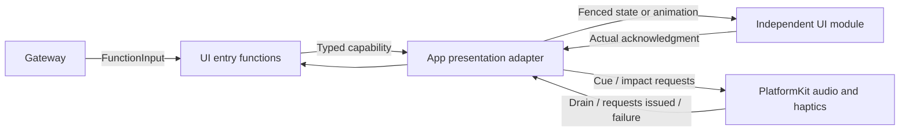

# Presentation Functions

## Summary

Canonical finite/state presentation and short feedback operations through narrow injected capabilities.

## Ownership and boundaries

This domain owns argument/semantic validation and completion policy, not SwiftUI state/layout or native rendering lifetime. App validates actual producer/session/task and translates values into independent UI types. Touch presentation may call shared UI methods locally.

## External relationships and data flow

Runtime arrows show data or capability calls; dashed arrows show injection.

## Function and completion map

| Module | Contract |
| --- | --- |
| Expression | express performs transition/restore; setExpression commits persistent base state |
| Feedback | playCue awaits native drain; vibrate issues a bounded native impact pattern |
| Caption | beginReplyTurn, print, setTranscript, finishTranscript with bounded text/turn semantics |
| VoiceState | hearing/processing/listening display; no microphone effect |
| Gaze / Pose | Completion-only latest-state moveEyes/showPose, no Channel queue for fixed perception |
| HistoryPresentation | showHistory from authorized current journal projection |
| ResourcePresentation | Snapshot/query/operation/preference errors and private provider result commitment |
| Navigation | open finite supported page; Agent grant and App scope checked separately |

express permits closed/smile/happy/laugh/thinking/surprised/sad/love/angry/scared/playful, not clear. setExpression additionally permits clear and is idempotent for repeated state. Caption rollover changes visible state without cancelling task/speech. Gaze is finite [−1,1]; pose JSON is separately strictly validated. Unknown arguments reject before presentation.

Resource presentation acknowledges current session/revision commitment independently of business operation success. Operation error ownership is separate from passive progress; preference reason uses exact typed classification. Provider result lookup remains private, and only one presentation attempt occurs. Navigation supports both host protocols; local button navigation invokes the shared state method without requesting an execution grant.

✅ Typed presentation functions and distinct state/animation completion are implemented.

## Related design

[Parent design](../README.md) · [Support](Support/README.md)

## Action-owned documentation and Skill instruction contract

✅ 本域函数用 `@Action(doc:parameters:)` 维护说明与参数契约。所属模块注册自动生成声明投影；业务顺序和调用示例由 Skill Instructions.md 教学，不再登记 examples。

## Channel-owned Action ordering

✅ Function metadata and business attributes have no serialization key. Scheduled ordering belongs to [ChannelScheduler](../../Gateway/Output/Scheduling/README.md); resources/budgets and native capability admission remain explicit.

## Action timeout contract (2026-10-12)

✅ 快速 UI 展示入口静态 5 秒；express 改为静态 5 秒而非固定值的动态函数；showResources 保留 60 秒。状态接纳与真实动画完成仍有不同完成语义，动画取消加入恢复清理。

✅ Implemented: UI.Expression.express and setExpression both accept closed; clear remains set-only. Action metadata documents the new vocabulary and preserves enter/restore acknowledgments and strict validation.

✅ Implemented: FeedbackActions.swift adds UI.Feedback.playCue(cue=wake|confirm|cancel|error|soft|save|discard, volume=0…1) and vibrate(style=light|medium|heavy|rigid|soft, intensity=0…1, count=1…3, intervalMS=40…250). Cue defaults wake/0.85; haptic defaults heavy/1/1/80. Strict arguments reject before effects; cue completion awaits native drain, vibration completion means bounded native impact requests issued, not measured perceived strength. Each has 5 s finite budget.

✅ Implemented: UI.Feedback.playCue adds save and discard semantic profiles alongside existing five. Host controls exclusive/overlay audio admission; no cue replaces ongoing speech or capture. Same parameter bounds, native drain completion and 5 s budget.

## UI control coverage audit (2026-10-13)

An implemented canonical definition and an effective model grant are separate facts. Assistant loads ExpressionInteraction as a base Skill, exposing only express/setExpression by default. Photography requires its Skill and actual host/task admission. Business callers can use public functions with injected capabilities; canonical FunctionExecutor/ActionComposition execution additionally retains declared budgets/completion/reports. Direct calls do not bypass endpoint ownership or automatically provide Gateway scheduling/resources/Agent grants.

| Surface | Current canonical control | Model exposure / limitation |
| --- | --- | --- |
| Eye expressions | UI.Expression.express / setExpression | Assistant base ExpressionInteraction; closed is supported, nonclosed finite effects reject while voice is off |
| Short sound / haptic | UI.Feedback.playCue / vibrate | No Skill exposure; trusted business composition retains strict parameters and native busy/scope admission |
| Task goal label | Agent.Task.startTask / finishTask / cancelTask | BasicSkill; root projects actual active Task goal. No independent label/toast mutation Action |
| Capture / save / ignore | Camera.Capture.takePhoto / savePhoto / ignorePhoto | Photography Skill; appearance/departure/removal are joined host behavior, no separately model-configurable animation Action |
| Listening halo / automatic eyes | Speech.Listening.update indirectly commits consent/generation | Speech.Listening.update remains internal. UI.Light.updateLight exists for business calls without Skill registration with x/y, initialOpacity, intensity and durationMS; no mic/eye effect |
| Text notice | UI.Notice.showNotice / dismissNotice | No Skill exposure; transient business text separate from actual error history. Genuine Agent/App/system errors remain priority failure projections; Action failures stay panel-only |
| Captions / voice state / gaze / pose | UI.Caption.*, UI.VoiceState.setVoiceState, UI.Gaze.moveEyes, UI.Pose.showPose | Canonical implementations exist; fixed perception/host bindings, not all exposed to Assistant model |
| Navigation / history / resources | UI.Navigation.open, UI.HistoryPresentation.showHistory, UI.ResourcePresentation.* | Navigation appears in ApplicationControl Skill; history/resource presentations have role/scoped internal endpoints |
| Spectrum / measured FPS / local controls | None for individual rendered values/disclosures/drafts | Native telemetry and local view state; log filtering, inspection, form drafts, scrolling and FPS disclosure are not model functions |

✅ Independent notices and decorative lights are implemented through explicit typed host endpoints. Task goal display remains an actual-state projection, controlled through Agent.Task Actions. Local UI rendering values never import Actions or control native consent.

✅ Implemented (2026-10-13): UI.Notice.showNotice/dismissNotice and UI.Light.updateLight are canonical presentation Actions for trusted business calls, currently registered by no Skill. Neutral Actions values cross RuntimePresentation into root-owned HomeEffectsWorkflow, which retains one replaceable notice expiry and one light expiry, UUID-fenced cleanup, and explicit stop. Notices remain separate from factual ExecutionIssue history; actual upper-layer errors have display priority and Action failures remain panel-only. Decorative light accepts normalized origin, initial opacity/intensity and duration; it never changes consent, microphone or eyes. Native renderer separates light generations from listening eye generations and preserves existing exit fade. RuntimePresentation converts neutral Action requests into UI-owned values; AppPresentationWorkflow retains existing dependencies. No UI project dependencies or new directories.

✅ Implemented (2026-10-13 Skill scope review): canonical Actions unify trusted business calls and model calls; Skill exposure is optional and must serve an actual procedure. ExpressionInteraction retains two expression functions; Feedback/Notice/Light model exposure is removed while implementations and business bindings remain. ApplicationControl keeps navigation/status/resource/Bluetooth operations, removing duplicate robot functions; RobotInteraction owns them. BasicSkill removes unused send while production background contracts are absent. Affected instructions/revisions and explicit communication-only test catalogs are aligned; all six Skills were audited for prerequisites, result handling and cross-Skill references.
