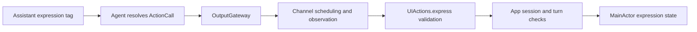

# UI — Scheduled Expression Action

Purpose: implement the model-callable `UI.express` Action. Design goals: typed validation, explicit scheduled completion and no SwiftUI dependency.

- ✅ `UIActionModule` registers `express` as a state Action. `UIPresentationCapability` accepts a typed `UIActions.Emotion` and trusted ActionInvocation.
- ✅ Required, case-sensitive emotion: clear, smile, happy, laugh, thinking, surprised, sad, love, angry, scared, playful. Missing, extra or invalid arguments throw before presentation.
- ✅ Cancellation is checked before and after the injected callback. Success means the presentation policy accepted the target, not that animation finished.
- ✅ Assistant JSON declares the model alias and default Display channel. Explicit channel/wait scopes still apply. Its scheduled status appears in the Action panel, like every other Action.
- ✅ Fixed caption, recognition, voice phase, gaze and turn lifecycle updates moved to [Tools/UI](../../Tools/UI/README.md). They have no Action definitions or channels. That module also owns ConversationPresentation, shared by App's expression endpoint.
- ❌ Native model Tool output and animation-completion acknowledgments remain outside this change. Expression intentionally remains an Action until that model transport is supported.

The Action owns no task or queue. App rejects outdated sessions and turns; stale updates may complete as no-ops. Repeating the same expression sets the same target, without a one-shot restart contract. New user speech clears expression through the immediate beginReplyTurn Tool. No physical resource is declared.

## Source organization

| File | Responsibility |
| --- | --- |
| UIActions.swift | Canonical express entry and validation |
| Support/UIActionTypes.swift | Emotion and ExpressionError, retaining UIActions nested names |
| Support/UIActionModule.swift | Definition and UIPresentationCapability injection interface |

✅ Only the entry lives in the domain root; support declarations are not separate callable Actions. ❌ No rendering or animation lifecycle is added.

✅ Action display names are declared in Support registrations and copied into scheduler snapshots. Adding a registered operation requires no corresponding ActionActivityWorkflow mapping. Completion and device behavior remain unchanged.
