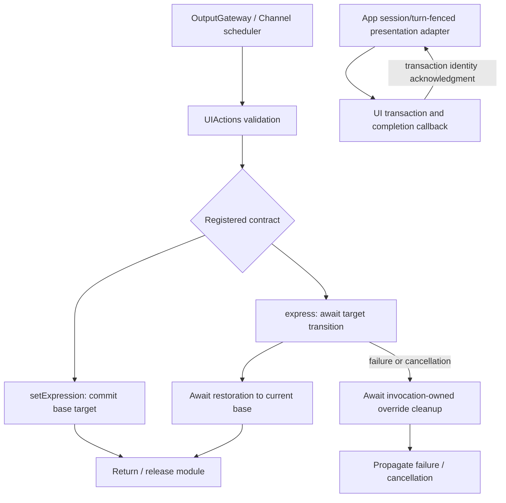

# UI — Presentation Actions

Purpose: own expression, gaze, caption, voice-state, pose and history-presentation functions in one UIActions namespace and UIModule catalog. Design goals: explicit finite/state completion, bounded lifecycle, typed injection and no SwiftUI dependency.

| Entry | Kind / parameters | Completion and lifetime |
| --- | --- | --- |
| UI.Expression.express | finite; required case-sensitive emotion, excluding clear | Await transition to the expression and restoration to the current base. Each call performs again, including the same emotion. Expected budget 2 seconds; timeout 5 seconds cancels and joins cleanup, never substitutes for an animation acknowledgment. |
| UI.Expression.setExpression | state; required case-sensitive emotion, including clear | Commit the persistent base target. No animation acknowledgment is promised. Repetition is idempotent; clear removes the base. Replacement, next user turn and session teardown end the state. |

Both reject unknown keys and malformed arguments before effects. Allowed emotions: smile, happy, laugh, thinking, surprised, sad, love, angry, scared, playful. setExpression also accepts clear. Assistant JSON v6 owns both model aliases under Display. Both share the UI module exclusion key and Action scheduling; wait joins their respective handler contracts.

Actions owns the finite enter/restore sequence; App adapts it to UI transactions and retains one override owner and one pending acknowledgment, with no secondary queue. Conflicting activation fails busy. SwiftUI acknowledges removal of the actual transaction affecting both eyes; no guessed settling sleep is used. Restoration reads the current base rather than an old snapshot. Invocation and transaction IDs prevent delayed cleanup/callbacks from touching a replacement.

New-turn/session reset invalidates the override and resumes any waiter with cancellation. Cancellation releases only the calling invocation's override and restores the current base immediately without promising a completed cancelled animation. Hidden/inactive rendering cancels the waiting transition; a missing renderer rejects activation. A stale session/turn fails with cancellation rather than reporting an unperformed finite effect as success. Already displayed effects are not rolled back.

Fixed captions, transcript, voice state, reply initialization, gaze/following and skeleton display remain completion-only Tools without Channels or Action history. beginReplyTurn resets expression as part of its existing atomic turn policy.

| File | Responsibility |
| --- | --- |
| UIActions.swift | finite/state entry validation, enter/restore composition and deadline metadata |
| Support/UIActionTypes.swift | Emotion and validation/busy/unavailable errors |
| Support/UIModule.swift | Both generated definitions and explicit presentation capability binding |

✅ Runtime kind metadata remains finite/state; no new dispatch algorithm or activity is introduced. UI imports neither Actions nor ActionRuntime. App owns session lifetime; pages only render transactions and report completion/availability.

❌ Physical-device animation, Reduce Motion and repeated-turn visual acceptance remain pending. Persistent looping performances and Activity control are not implemented.

✅ A one-shot performance includes a 6% eye emphasis and return, so performing the same emotion as the base still has an animated endpoint; persistent base setting never adds this emphasis.

## ToolCall protocol entries

# UI Tools

Purpose: immediate presentation effects through OutputGateway and Actions/Runtime. Design goals: explicit text semantics, bounded arguments, session/turn validation and no Channel scheduling. Tools owns its execution contracts; App supplies typed endpoints and UI owns display state.

| Tool | State operation | Argument contract |
| --- | --- | --- |
| UI.Caption.print | Append one reply sentence/chunk exactly once per accepted output sequence | Nonblank text, <=2000 UTF-8 bytes; preserves whitespace |
| UI.Caption.setTranscript | Replace the entire recognition preview; empty clears | Text <=4096 UTF-8 bytes; SpeechPerception sends its current preview tail, never an append delta |
| UI.Caption.finishTranscript | Clear and close this turn's transcript | No arguments; late partials cannot reopen it |
| UI.Caption.beginReplyTurn | Clear reply and expression once per turn | No arguments; recognition preview remains independent |
| UI.VoiceState.setVoiceState | Replace listening/hearing/processing phase | Required state; no microphone admission effect |
| UI.Gaze.moveEyes | Replace current gaze target | Finite x/y in [-1,1]; negative left/up |
| UI.HistoryPresentation.showHistory | Replace history snapshot through a scoped host endpoint | No arguments; internal ConversationMemory permission |
| UI.Pose.showPose | Replace all skeletons; empty people clears | <=3000 UTF-8 bytes, <=6 COCO-17 skeletons |

✅ UIModule owns completion-only definitions. UIUpdateCapability and PosePresentationCapability expose typed effects; ToolInvocation retains opaque host correlation. ToolArguments decodes keys and values without a dependency on Actions. Cancellation is checked before and after each effect. Completion means state accepted, not animation/rendering finished; no ToolResult is generated.

✅ AppWorkflows.ConversationPresentation retains one turn, closed-transcript/reply flags and at most six sequence entries. App first validates the active session. It rejects old turns, same-ordinal conflicting IDs, wrong sources and non-increasing sequences. Reply/expression require beginReplyTurn. Fresh print sequences append; duplicate sequences never append twice. Only speech updates or Assistant beginReplyTurn can advance the turn. The scheduled expression Action uses this same acceptance policy.

```mermaid
flowchart LR
    Agent[Agent internal ToolCall] --> Gateway[OutputGateway validation]
    Gateway --> Tool[Immediate completion handler]
    Tool --> Validate[Bounded typed arguments]
    Validate --> Session[App session validation]
    Session --> Policy[Turn and output sequence / camera frame sequence]
    Policy --> State[MainActor append or replacement]
    State --> Done[Completion without feedback or Action history]
```

✅ App voice/camera output consumers await each Tool sequentially; history transport awaits its correlated output separately. Tool execution introduces no Channel wait or detached task. A wait scope applies only to ActionCalls; Tools do not become barrier members. MainActor scheduling can still take time. VisionPerception's two-entry newest output buffer explicitly coalesces only replaceable gaze/skeleton state, counting replacements; reply chunks are never coalesced.

❌ No generic Tool replacement, physical device control or native model Tool transport is added. Model-selected expression remains the scheduled UI.Expression.express Action by explicit product choice. Physical display latency still requires device acceptance.

## Source layout

✅ `UIActions.swift` groups the eight callable presentation entries. `Support/UIModule.swift` owns registrations and typed host capability contracts; `Support/UIToolTypes.swift` owns nested value/error types. `App/Workflows/ConversationPresentation.swift` retains the bounded turn/sequence acceptance policy as a separate cohesive implementation. See [Support](Support/README.md).

❌ This organization adds no rendering acknowledgement, queue or native model Tool transport.

✅ Entry metadata is declared with `@Tool`; the Support catalog binds generated definition factories to explicit capabilities. Runtime behavior and Agent permissions are unchanged.

✅ ToolPoseOverlay is the tool-owned decoded payload. App converts it to the UI overlay value. Conversation source/turn acceptance belongs to AppWorkflows, not Tools.

✅ ADR0098: Execution values and services are imported from independent ActionRuntime; concrete Tool domains, pose payload and macro declarations remain in Tools. Published paths, feedback and cancellation behavior are unchanged.

✅ UI.Pose.showPose accepts optional finite nonnegative statistics and validates timing consistency before the host effect; existing payloads remain valid and the 3000-byte/six-person bound is unchanged.

✅ Optional adaptive interval statistics remain in UI.Pose.showPose; validation accepts 0...1000ms finite values and legacy statistics without the field. No new callable entry or output queue is added.

✅ UI.Pose.showPose retains its existing permission and 3000-byte bound while carrying optional normalized image-motion activity in statistics. Invalid activity is rejected before effects.

✅ UI.HistoryPresentation.showHistory invokes the required HistoryPresentationCapability; App validates the root memory session and adapts raw records into UI state. ❌ Navigation and model-callable history presentation remain pending.

✅ ADR0151: this domain is compiled once in Actions; both ActionCall and ToolCall entries use ActionRuntime contracts. Host injection and permission/feedback behavior are unchanged.
❌ Unified capability definitions and protocol registration adapters remain pending.

✅ ADR0152: functions are classified by domain before protocol unification. Canonical namespaces use `<Domain>Actions`; production uses one `<Domain>Module` with Action/Tool registry projections. Legacy names are aliases or registration projections, not duplicated implementations.
❌ Unified callable definitions and migration of compatibility names remain pending.

## Cohesive module files — ADR0154

Purpose: implement directory/module-file/function ownership while preserving current protocol APIs. The domain Actions enum remains a used namespace facade; callable bodies belong exclusively to the files below. Support owns one domain catalog, values and host capabilities.

- [ExpressionActions.swift](ExpressionActions.swift)
- [GazeActions.swift](GazeActions.swift)
- [CaptionActions.swift](CaptionActions.swift)
- [VoiceStateActions.swift](VoiceStateActions.swift)
- [PoseActions.swift](PoseActions.swift)
- [HistoryPresentationActions.swift](HistoryPresentationActions.swift)

✅ Implementations are split without forwarding or duplicated metadata/handlers. Generated factories and existing call paths, permissions, resources and scheduling are unchanged.
❌ Explicit three-field paths, versioned Agent configuration and unified definitions/results remain the next coordinated stage.

✅ Expression Action definitions explicitly use serializationKey UI, preserving existing global exclusion as entry modules evolve. Gaze and other Tool calls retain their existing execution protocol.

✅ ADR0156: canonical execution addresses use domain/module/function; Agent v6 bindings resolve native names separately. Existing serialization/resource and output permissions are preserved.

✅ ADR0157: canonical executable definitions and shared outcomes replace duplicate protocol metadata; consumers import Actions/ActionRuntime. Protocol request views remain adapters, and production permission/resource boundaries are preserved.

❌ Physical acceptance and additional business capability exposure are not established by this migration.
