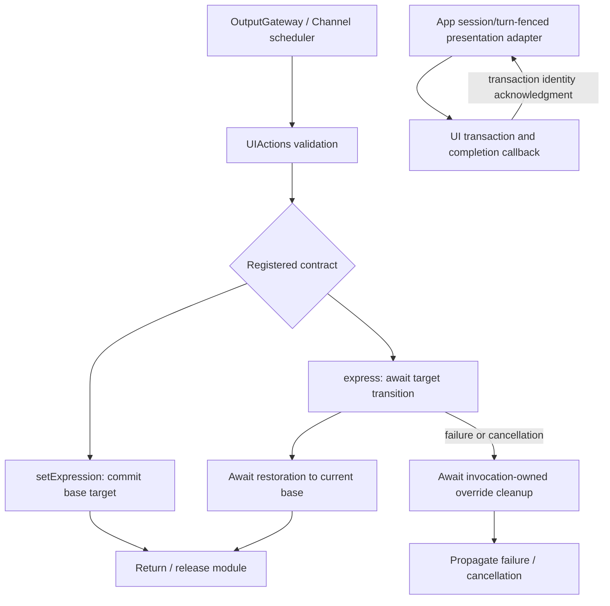
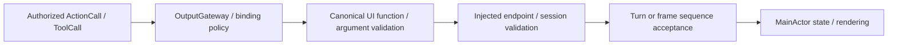

# UI — Presentation Actions

Purpose: own expression, gaze, caption, voice-state, pose and history-presentation functions in one UIActions namespace and UIModule catalog. Design goals: explicit finite/state completion, bounded lifecycle, typed injection and no SwiftUI dependency.

| Entry | Kind / parameters | Completion and lifetime |
| --- | --- | --- |
| UI.Expression.express | finite; required case-sensitive emotion, excluding clear | Await transition to the expression and restoration to the current base. Each call performs again, including the same emotion. Expected budget 2 seconds; timeout 5 seconds cancels and joins cleanup, never substitutes for an animation acknowledgment. |
| UI.Expression.setExpression | state; required case-sensitive emotion, including clear | Commit the persistent base target. No animation acknowledgment is promised. Repetition is idempotent; clear removes the base. Replacement, next user turn and session teardown end the state. |

Both reject unknown keys and malformed arguments before effects. Allowed emotions: smile, happy, laugh, thinking, surprised, sad, love, angry, scared, playful. setExpression also accepts clear. Assistant JSON v6 owns both model aliases under Display. Both share the UI module exclusion key and Action scheduling; wait joins their respective handler contracts.

Actions owns the finite enter/restore sequence; App adapts it to UI transactions and retains one override owner and one pending acknowledgment, with no secondary queue. Conflicting activation fails busy. SwiftUI acknowledges removal of the actual transaction affecting both eyes; no guessed settling sleep is used. Restoration reads the current base rather than an old snapshot. Invocation and transaction IDs prevent delayed cleanup/callbacks from touching a replacement.

New-turn/session reset invalidates the override and resumes any waiter with cancellation. Cancellation releases only the calling invocation's override and restores the current base immediately without promising a completed cancelled animation. Hidden/inactive rendering cancels the waiting transition; a missing renderer rejects activation. A stale session/turn fails with cancellation rather than reporting an unperformed finite effect as success. Already displayed effects are not rolled back.

The host currently binds expression functions as scheduled Action calls and the eight update functions as completion-only direct Tool calls. These are registration choices; UIModule and the callable functions contain no protocol policy. beginReplyTurn retains its atomic reply/expression reset behavior.

✅ UI imports neither Actions nor FunctionContracts. App owns session lifetime; pages render transactions and report completion/availability. A one-shot expression includes a6% eye emphasis and return, so the base emotion can still produce an animated endpoint.

❌ Physical animation, Reduce Motion and repeated-turn acceptance remain pending. Persistent looping performances and Activity control are not implemented.

## Presentation update functions

| Function | State operation | Argument contract |
| --- | --- | --- |
| UI.Caption.print | Append one reply sentence/chunk exactly once per accepted output sequence | Nonblank text, <=2000 UTF-8 bytes; preserves whitespace |
| UI.Caption.setTranscript | Replace the entire recognition preview; empty clears | Text <=4096 UTF-8 bytes; SpeechPerception sends its current preview tail, never an append delta |
| UI.Caption.finishTranscript | Clear and close this turn's transcript | No arguments; late partials cannot reopen it |
| UI.Caption.beginReplyTurn | Clear reply and expression once per turn | No arguments; recognition preview remains independent |
| UI.VoiceState.setVoiceState | Replace listening/hearing/processing phase | Required state; no microphone admission effect |
| UI.Gaze.moveEyes | Replace current gaze target | Finite x/y in [-1,1]; negative left/up |
| UI.HistoryPresentation.showHistory | Replace history snapshot through a scoped host endpoint | No arguments; internal ConversationMemory permission |
| UI.Pose.showPose | Replace all skeletons; empty people clears | <=3000 UTF-8 bytes, <=6 COCO-17 skeletons |

✅ Every function consumes FunctionInput and validates bounded arguments before effects. Completion means the endpoint accepted the update, not that animation/rendering finished. Native completion-only success yields no ToolResult because of the host binding, not because the function implements a Tool protocol.

✅ AppWorkflows.ConversationPresentation retains one turn, transcript/reply flags and at most six sequence entries. App first validates the session. Old turns, conflicting IDs, wrong sources and non-increasing sequences are rejected. Reply/expression require beginReplyTurn; only speech updates or Assistant beginReplyTurn advance the turn. Fresh reply chunks append and duplicates do not. Camera adaptation separately validates frame/session identity.

✅ Current voice/camera consumers await native presentation calls sequentially. Direct native bindings do not join XML wait membership; explicitly scheduled native bindings use shared scheduling. VisionPerception coalesces only replaceable gaze/pose outputs in its two-entry newest buffer and counts replacements. Reply chunks are never coalesced.

## Source ownership

UIActions.swift is the namespace facade. Callable bodies live in ExpressionActions.swift, GazeActions.swift, CaptionActions.swift, VoiceStateActions.swift, PoseActions.swift and HistoryPresentationActions.swift. Support owns UIModule, typed endpoints and values; see [Support](Support/README.md). App/Workflows/Presentation owns conversation acceptance; UI owns display state.

✅ Expression functions retain explicit serializationKey UI. Pose validation retains the3000-byte/six-person bound, optional finite timing measurements, adaptive interval0...1000ms and normalized image motion0...1. Existing payloads remain valid. History presentation uses the required memory-session endpoint and its internal Agent permission.

❌ No automatic model exposure, generic replacement, rendering acknowledgment for state updates or new navigation/device primitive. Physical acceptance remains separate. ADR0160 defines the function/binding boundary.

✅ ADR0161: standard callable inputs use FunctionInput/FunctionContracts; common execution and call protocols belong to independent Gateway targets. This directory retains its existing ownership, resource/permission and lifecycle boundaries. ❌ Remaining feature Signal/continuation and physical acceptance are separate work.
