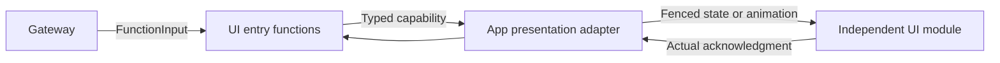

# Presentation Functions

## Summary

Canonical finite/state presentation operations through narrow injected UI capabilities.

## Ownership and boundaries

This domain owns argument/semantic validation and completion policy, not SwiftUI state/layout or native rendering lifetime. App validates actual producer/session/task and translates values into independent UI types. Touch presentation may call shared UI methods locally.

## External relationships and data flow

Runtime arrows show data or capability calls; dashed arrows show injection.

## Function and completion map

| Module | Contract |
| --- | --- |
| Expression | express performs transition/restore; setExpression commits persistent base state |
| Caption | beginReplyTurn, print, setTranscript, finishTranscript with bounded text/turn semantics |
| VoiceState | hearing/processing/listening display; no microphone effect |
| Gaze / Pose | Completion-only latest-state moveEyes/showPose, no Channel queue for fixed perception |
| HistoryPresentation | showHistory from authorized current journal projection |
| ResourcePresentation | Snapshot/query/operation/preference errors and private provider result commitment |
| Navigation | open finite supported page; Agent grant and App scope checked separately |

express permits smile/happy/laugh/thinking/surprised/sad/love/angry/scared/playful, not clear. setExpression additionally permits clear and is idempotent for repeated state. Caption rollover changes visible state without cancelling task/speech. Gaze is finite [−1,1]; pose JSON is separately strictly validated. Unknown arguments reject before presentation.

Resource presentation acknowledges current session/revision commitment independently of business operation success. Operation error ownership is separate from passive progress; preference reason uses exact typed classification. Provider result lookup remains private, and only one presentation attempt occurs. Navigation supports both host protocols; local button navigation invokes the shared state method without requesting an execution grant.

✅ Typed presentation functions and distinct state/animation completion are implemented.

## Related design

[Parent design](../README.md) · [Support](Support/README.md)
