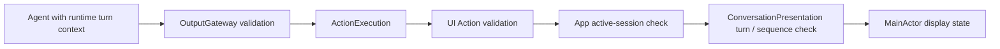

# UI — Caption and Expression Actions

Purpose: present captions and facial expressions using App-injected callbacks. Design goals: keep validation and output selection inside each function, remain independent of SwiftUI, and use one function for all expressions.

- ✅ `Print.swift` / `UI.print`: required nonblank text, at most 2000 UTF-8 bytes; preserves original formatting.
- ✅ `Express.swift` / `UI.express`: required, case-sensitive `emotion`: clear, smile, happy, laugh, thinking, surprised, sad, love, angry, scared, playful.
- ✅ Missing or unsupported emotion throws `ExpressionError.invalidEmotion` before presentation; no default or fallback. The separate smile function and registration are removed.
- ✅ Both functions check cancellation before and after presentation and propagate callback failures. No shared TextAction helper is used.
- ✅ Default Display Channel; explicit scopes can override it. Gateway owns ordering and module exclusion.
- ❌ Physical facial control, general show actions and animation-completion acknowledgments.

App injects separate expression and caption callbacks. Success means MainActor display state has been updated, not that the decorative animation has completed. One current expression replaces the previous state; no extra queue or timer is created. The eyes return to neutral on new user speech or session stop. XML example: `<express emotion="smile"/> Hello.`

Maintain this README alongside implementation, Agent JSON and App handler bindings. Add new supported emotions to express rather than adding a separate Action for each face.

✅ Skeleton presentation moved to [Tools/UI](../../Tools/UI/README.md); UI.showPose has no Action registration or default Channel.

✅ SetTranscript.swift / UI.setTranscript replaces the recognition caption independently of UI.print reply captions. Required text accepts empty string to clear and at most 4096 UTF-8 bytes. Missing/oversized text fails before presentation. The function checks cancellation before and after the injected callback. SpeechPerception code declares its internal transcript permissions on the Transcript Channel; the App handler rejects old voice sessions. Completion means MainActor state was updated. This Action introduces no extra queue or timer.

✅ BeginReplyTurn.swift / UI.beginReplyTurn accepts no parameters and atomically clears the previous Assistant reply and expression once per conversation turn. Assistant owns this behavior. UI.express additionally accepts emotion=clear; the typed clear identifier tells its registered handler to return to neutral. Both use cancellation-checked Action execution, not Signals.
✅ SetVoiceState.swift / UI.setVoiceState requires state=listening|hearing|processing, validates it before calling the UI handler, and never changes capture admission. Missing/unknown values fail. Default Display Channel serializes these actions with expression/reply changes. Reply presentation state is updated by the explicit recognition state plus actual playback activity; UI.print only appends text.

## Turn-scoped presentation

✅ ConversationPresentation is a bounded, framework-independent acceptance policy used by App UI handlers. It keeps one current ConversationTurn (UUID and session-local ordinal), one closed-transcript flag, one reply-begun flag and at most six update sequence records. App verifies the session first. Older turns, conflicting IDs at the same ordinal, duplicate/out-of-order updates and wrong-source updates are ignored. Only SpeechPerception display Actions or Assistant beginReplyTurn may advance the current turn.

✅ FinishTranscript.swift / UI.finishTranscript closes and clears recognition text; later partials cannot reopen that turn. Empty preview text alone is not a close. beginReplyTurn resets reply/expression atomically but never clears the current recognition caption. Reply/expression updates require beginReplyTurn and newer Action sequence numbers. Old Actions cannot overwrite a new round. Neither class owns SwiftUI or device services.

❌ Device timing/animation acceptance remains manual. This policy does not provide durable delivery or synchronize speech with every displayed character.

✅ UI.express now supplies a validated `UIActions.Emotion` value, never an emoji or glyph. Missing/unknown values still fail. SwiftUI pose definitions belong to the separate [UI module](../../UI/README.md). App converts the emotion into UI state through injected handlers; Actions has no UI target dependency. Completion means presentation state accepted the target, not that the visual interpolation finished. See ADR 0046.

✅ `MoveEyes.swift` / `UI.moveEyes(x:y:)` validates two finite numbers in [-1,1] before invoking a typed Gaze callback. Negative is left/up, positive right/down; zero centers. VisionPerception code declares its internal UI.moveEyes permission on the Gaze Channel. Cancellation is checked before/after presentation. Success accepts a target, not animation completion. No physical motion or new dependency. ❌ Animation appearance requires device acceptance.

## Authoring standard and current exceptions

Follow the [Actions authoring standard](../README.md) for new code and planned migrations. `express`, `moveEyes`, `setTranscript` and `setVoiceState` set presentation state; `beginReplyTurn` and `finishTranscript` perform state transitions. `print` is a finite append operation whose text may persist. Completion is acceptance by the presentation policy, never animation completion; stale/duplicate updates can be intentional no-ops under the policy above.

✅ Existing paths, semantic emotion values, turn/session checks and completion behavior are unchanged. ❌ UIActions is still declared in Print.swift, callback labels remain `present:`, and namespace/file/signature migration remains pending. Migrate these explicitly to the root standard with bindings and tests; do not treat the existing layout as the template for new domains. One-shot expression/restore behavior remains unimplemented.

## Runtime stage 1 adoption

✅ Every UI Action now uses shared ActionArguments decoding and rejects unknown keys before effects. Text and parameterless/voice-state failures use `UIActions.PresentationError` in Types.swift; expression/gaze errors remain domain-owned. Byte limits, semantic values, callback completion, session/turn checks and cancellation are preserved. These are accepted-state acknowledgments, not animation completion.

❌ UIActions namespace extraction and the `present:` → `using:` signature migration remain deliberate later work; no new expression or one-shot animation behavior is implemented.
