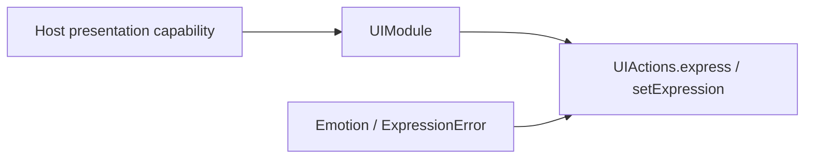
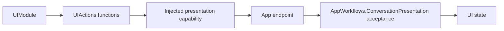

# UI Action Support

Purpose: keep non-callable implementation support separate from registered entry points. Design goals: cohesive definitions, explicit typed injection, stable public names and no hidden registration.

UIModule and UIPresentationCapability define registration and host injection; UIActionTypes owns semantic emotion and validation errors.

✅ Sources compile once in Actions. Public visibility exists where App/test composition requires it; it does not grant model access. Definitions remain explicit, and Agent declarations remain the permission source. See the [domain contract](../README.md) for completion, lifetime, cancellation and limits.

✅ This directory adds no queue or scheduler. Definitions and typed values introduce no background work, buffering or mutable runtime owner.

❌ No automatic discovery or hidden host binding.

✅ Entry attributes own displayName and completion metadata; the Support catalog binds handlers. Execution records carry this value; no App or UI switch enumerates domain actions. ❌ This is human-readable metadata, not model permission or a SwiftUI dependency.

✅ Entry metadata is declared with `@Action`; the Support catalog binds generated definition factories to explicit capabilities. Runtime behavior and Agent permissions are unchanged.

✅ Presentation capability contracts consume module-owned Action context, without importing UI or AgentCore.

✅ ADR0098: Execution values and services are imported from independent ActionRuntime; concrete Action domains and macro declarations remain in Actions. Published paths, parameters, bounds and completion behavior are unchanged.

✅ UIPresentationCapability separates awaited transition/restore from base-state commitment. Both entries share one module; unavailable/busy errors propagate without fallback. ❌ No looping Activity owner.

## ToolCall protocol entries

# UI Tool support

Purpose: support immediate presentation tools without exposing implementation files as callable entries. The design keeps registration and host interfaces together, values separate, and stateful acceptance policy independently reusable.

- ✅ `UIModule.swift`: eight completion-only definitions, `UIUpdateCapability`, `PosePresentationCapability` and `HistoryPresentationCapability`; App injects endpoints.
- ✅ `UIToolTypes.swift`: `UIActions.Gaze`, `VoiceState` and validation errors; existing public names are preserved.
- ✅ App-owned `App/Workflows/ConversationPresentation.swift`: current turn, transcript/reply flags and one sequence per six update kinds. New accepted turns reset bounded state; stale/duplicate updates are rejected. It owns no queue; App validates session identity.
- ❌ Rendering acknowledgement and new host primitives are not implemented here.

The callback must complete before the Tool completes. Types and policy do not register themselves or grant Agent permissions.

✅ Entry metadata is declared with `@Tool`; the Support catalog binds generated definition factories to explicit capabilities. Runtime behavior and Agent permissions are unchanged.

✅ Support contains capability interfaces and explicit bindings. ConversationPresentation moved to App/Workflows; Tools does not choose permitted Agent identities.

✅ ADR0098: Execution values and services are imported from independent ActionRuntime; concrete Tool domains, pose payload and macro declarations remain in Tools. Published paths, feedback and cancellation behavior are unchanged.

✅ ToolPoseOverlay optionally decodes timing/FPS/replacement statistics independently of AgentCore. Validation rejects negative/nonfinite values and inconsistent total/queue/inference measurements; App converts the values at its existing boundary.

✅ Optional detectionIntervalMilliseconds decodes independently of AgentCore and validates as finite, nonnegative and ≤1000ms; App maps it to the shared presentation value.

✅ Optional imageMotion validates as finite 0...1. Legacy pose/statistics payloads without the field remain valid; no Agent/ModelKit dependency is added.

✅ ADR0132: Domain validation/availability errors provide bounded ActionRuntime producer codes; generic execution and home observation preserve them without importing platform errors. ❌ Physical acceptance remains pending.

✅ HistoryPresentationCapability carries scoped ToolInvocation for completion-only UI.HistoryPresentation.showHistory. ❌ Support does not read Storage or choose Agent identities.

✅ ADR0151: this domain is compiled once in Actions; both ActionCall and ToolCall entries use ActionRuntime contracts. Host injection and permission/feedback behavior are unchanged.
❌ Unified capability definitions and protocol registration adapters remain pending.

✅ ADR0152: functions are classified by domain before protocol unification. Canonical namespaces use `<Domain>Actions`; production uses one `<Domain>Module` with Action/Tool registry projections. Legacy names are aliases or registration projections, not duplicated implementations.
❌ Unified callable definitions and migration of compatibility names remain pending.

The current catalog is UIModule.swift. UIPresentationCapabilities.swift declares host endpoints; UIActionTypes.swift and UIPresentationTypes.swift hold domain values/errors. Both expression and gaze/display handlers are bound here; no separate UIActionModule or UIToolModule implementation remains.
