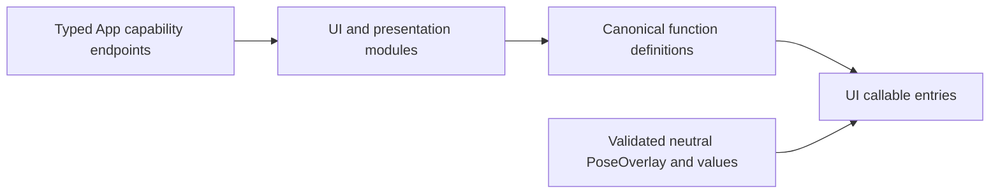

# Presentation Values and Capability Catalogs

## Summary

Neutral display values, validated pose payloads and explicit presentation/navigation catalogs.

## Ownership and boundaries

Owns UIModule, ResourcePresentationModule, NavigationModule and typed capabilities without UI imports. App implements endpoints; Agents defines exposure. These catalogs own no model/device queue or page lifetime.

## External relationships and data flow

Runtime arrows show data or capability calls; dashed arrows show injection.

## Interfaces and validation

UIPresentationCapability supplies expressions/playback-independent captions; UIUpdateCapability supplies immediate state changes; PosePresentationCapability and HistoryPresentationCapability supply whole domain updates. ResourcePresentationCapability supplies revisioned resource errors/snapshots/provider results and navigation endpoint. Opaque FunctionInput retains execution ownership, not concrete UI state.

UIActionTypes owns finite emotion vocabulary/errors; UIPresentationTypes owns voice state and immediate values. PoseOverlay is an independently Codable validated callable payload: bounded complete COCO joints/people, quantized coordinates/confidence and optional finite same-frame statistics. It is distinct from business PoseObservation and UI-owned display types; App adapts across both boundaries.

Catalog definitions retain intrinsic completion/resource policy; host bindings cannot weaken it. Required endpoints have no no-op production default. Unsupported/stale generations and missing renderer/owner fail explicitly rather than acknowledging a dropped effect.

✅ Independent typed values, strict payload validation and explicit presentation catalogs are implemented.

## Related design

[Parent design](../README.md)

## Action-owned documentation and Skill instruction contract

✅ 本目录 CapabilityModule 的 `@ActionCatalog` 从实际 `*Definition` 注册调用（含本类型的本地 helper）生成静态 declarations。添加已有域函数只需修改所属实现及本地依赖绑定，不再同步公共元数据列表。声明投影不捕获设备、处理器或运行会话。

✅ Implemented: UIActions.Emotion adds closed as a semantic value; geometry stays in UI and the App adapter exhaustively maps it.

✅ Implemented: UIFeedbackTypes.swift defines capability and bounded semantic requests; FeedbackTone.swift generates seven original bounded 48 kHz PCM profiles with finite smooth envelopes. Wake references measured user-video F-major partials and 0.94 s decay, without packaging user/system audio. UIModule binds optional feedback support with explicit unavailable failure, and includes both canonical factories in declarations.

✅ Implemented: UIModule.feedbackDefinitions(feedback:) is the single reusable factory set for both top-level bindings and Listening composition, so App never directly calls domain Action bodies.

✅ Implemented: FeedbackTone adds an ascending save chime and a descending filtered-noise/crumple discard cue; all seven original profiles remain cached, finite, ramped, <=1 s at 48 kHz. UIFeedbackTypes adds enum values only.

✅ Implemented (2026-10-13): UI.Notice.showNotice/dismissNotice and UI.Light.updateLight are canonical presentation Actions for trusted business calls, currently registered by no Skill. Neutral Actions values cross RuntimePresentation into root-owned HomeEffectsWorkflow, which retains one replaceable notice expiry and one light expiry, UUID-fenced cleanup, and explicit stop. Notices remain separate from factual ExecutionIssue history; actual upper-layer errors have display priority and Action failures remain panel-only. Decorative light accepts normalized origin, initial opacity/intensity and duration; it never changes consent, microphone or eyes. Native renderer separates light generations from listening eye generations and preserves existing exit fade. RuntimePresentation converts neutral Action requests into UI-owned values; AppPresentationWorkflow retains existing dependencies. No UI project dependencies or new directories.

✅ Implemented: UIModule.effectDefinitions exposes the same canonical factories for isolated hosts, with nil capability explicitly unavailable. Robot Assistant fixtures no longer register unrelated feedback/light/notice paths; isolated effect tests retain explicit capabilities. Clearing a decorative override restores an already-active listening rim without replaying its wake burst; its new generation still replays normally.
