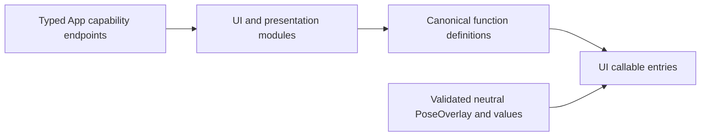

# Presentation Values and Capability Catalogs

## Summary

Neutral display values, validated pose payloads and explicit presentation/navigation catalogs.

## Ownership and boundaries

Owns UIModule, ResourcePresentationModule, NavigationModule and typed capabilities without UI imports. App implements endpoints; Agents defines exposure. These catalogs own no model/device queue or page lifetime.

## External relationships and data flow

Runtime arrows show data or capability calls; dashed arrows show injection.

## Interfaces and validation

UIPresentationCapability supplies expressions/playback-independent captions; UIUpdateCapability supplies immediate state changes; PosePresentationCapability and HistoryPresentationCapability supply whole domain updates. ResourcePresentationCapability supplies revisioned resource errors/snapshots/provider results and navigation endpoint. Opaque FunctionInput retains execution ownership, not concrete UI state.

UIActionTypes owns finite emotion vocabulary/errors; UIPresentationTypes owns voice state and immediate values. PoseOverlay is an independently Codable validated callable payload: bounded complete COCO joints/people, quantized coordinates/confidence and optional finite same-frame statistics. It is distinct from business PoseObservation and UI-owned display types; App adapts across both boundaries.

Catalog definitions retain intrinsic serialization/completion/resource policy; host bindings cannot weaken it. Required endpoints have no no-op production default. Unsupported/stale generations and missing renderer/owner fail explicitly rather than acknowledging a dropped effect.

✅ Independent typed values, strict payload validation and explicit presentation catalogs are implemented.

## Related design

[Parent design](../README.md)
