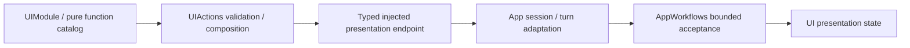

# UI Action Support

Purpose: assemble callable presentation functions and typed host endpoints. Design goals: protocol-neutral catalogs, explicit injection, bounded values and no SwiftUI/Agent dependency.

✅ UIModule.swift supplies ten ActionFunctions across Expression, Gaze, Caption, VoiceState, Pose and HistoryPresentation. UIPresentationCapabilities.swift declares expression/transition, update, pose and history endpoints; App injects their implementations. Catalogs select no call protocol, scheduler or native feedback policy.

✅ UIActionTypes.swift owns expression values/errors. UIPresentationTypes.swift owns gaze, voice-state and update validation. PoseOverlay.swift owns decoded pose data, including optional timing/adaptive statistics. Domain errors provide neutral FunctionContracts producer codes.

✅ Expression functions own awaited enter/restore composition and persistent-state commitment. Other presentation functions validate arguments and await the endpoint. Call protocol and completion-only/returning native feedback are chosen by host ActionBinding profiles; the same functions can be explicitly registered through either protocol.

✅ App/Workflows/Presentation/ConversationPresentation.swift owns turn/sequence acceptance; camera adaptation owns session/frame acceptance. Support creates no runtime owner, queue or scheduler and grants no Agent permission.

❌ No automatic discovery, rendering acknowledgment for ordinary state updates or new host primitives. Physical animation/display acceptance remains separate.

✅ ADR0161: standard callable inputs use FunctionInput/FunctionContracts; common execution and call protocols belong to independent Gateway targets. This directory retains its existing ownership, resource/permission and lifecycle boundaries. ❌ Remaining feature Signal/continuation and physical acceptance are separate work.
