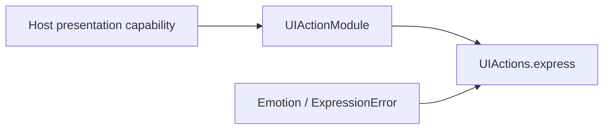

# UI Action Support

Purpose: keep non-callable implementation support separate from registered entry points. Design goals: cohesive definitions, explicit typed injection, stable public names and no hidden registration.

UIActionModule and UIPresentationCapability define registration and host injection; UIActionTypes owns semantic emotion and validation errors.

✅ Sources compile once in Actions. Public visibility exists where App/test composition requires it; it does not grant model access. Definitions remain explicit, and Agent declarations remain the permission source. See the [domain contract](../README.md) for completion, lifetime, cancellation and limits.

✅ This directory adds no queue or scheduler. Definitions and typed values introduce no background work, buffering or mutable runtime owner.

❌ No automatic discovery or hidden host binding.

✅ Entry attributes own displayName and completion metadata; the Support catalog binds handlers. Execution records carry this value; no App or UI switch enumerates domain actions. ❌ This is human-readable metadata, not model permission or a SwiftUI dependency.

✅ Entry metadata is declared with `@Action`; the Support catalog binds generated definition factories to explicit capabilities. Runtime behavior and Agent permissions are unchanged.
