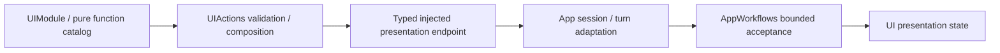
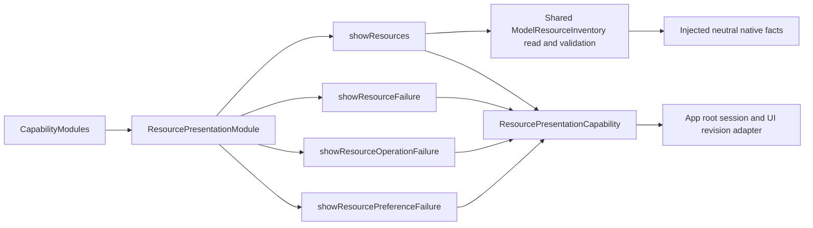

# UI Action Support

Purpose: assemble callable presentation functions and typed host endpoints. Design goals: protocol-neutral catalogs, explicit injection, bounded values and no SwiftUI/Agent dependency.

✅ UIModule.swift supplies ten ActionFunctions across Expression, Gaze, Caption, VoiceState, Pose and HistoryPresentation. UIPresentationCapabilities.swift declares expression/transition, update, pose, history and resource endpoints; App injects their implementations. Catalogs select no call protocol, scheduler or native feedback policy.

✅ UIActionTypes.swift owns expression values/errors. UIPresentationTypes.swift owns gaze, voice-state and update validation. PoseOverlay.swift owns decoded pose data, including optional timing/adaptive statistics. Domain errors provide neutral FunctionContracts producer codes.

✅ Expression functions own awaited enter/restore composition and persistent-state commitment. Other presentation functions validate arguments and await the endpoint. Call protocol and completion-only/returning native feedback are chosen by host ActionBinding profiles; the same functions can be explicitly registered through either protocol.

✅ App/Workflows/Presentation/ConversationPresentation.swift owns turn/sequence acceptance; camera adaptation owns session/frame acceptance. Support creates no runtime owner, queue or scheduler and grants no Agent permission.

❌ No automatic discovery, rendering acknowledgment for ordinary state updates or new host primitives. Physical animation/display acceptance remains separate.

✅ ADR0161: standard callable inputs use FunctionInput/FunctionContracts; common execution and call protocols belong to independent Gateway targets. This directory retains its existing ownership, resource/permission and lifecycle boundaries. ❌ Remaining feature Signal/continuation and physical acceptance are separate work.

✅ ADR0170: add ResourcePresentationModule.swift resides in this existing directory, using explicit inventory and presentation capabilities. UIPresentationCapabilities declares neutral resource endpoints. Separate catalog is included in CapabilityModules.builtIn; no registration policy is owned here.

✅ ADR0172: ResourcePresentationCapability declares a required operation-error endpoint; ResourcePresentationModule registers a returning definition in the existing module. No default success or protocol registration policy.

✅ ADR0173: ResourcePresentationCapability requires the typed ResourcePreferenceFailureReason endpoint; catalog adds a returning canonical function in the existing module. Enum is a neutral endpoint contract, not UI or runtime data.

## Completion batch — provider presentation and capability policy

✅ Implemented: provider discovery model-family eligibility belongs to Actions ProviderModelList; ModelKit validates/decodes raw IDs only. Preserve filtering/dedup/order and bounds at the app boundary. SettingsState becomes a passive editable snapshot, with no tasks or injected execution; SettingsInteractionWorkflow in the existing Settings directory owns bounded form admission, revision and page-independent saves. UI forwards edits/discovery/cancellation/save through SettingsControlling.

✅ Implemented: presentation-enabled provider intents select a second registered UI.ResourcePresentation.showProviderResult call after the business call, on success or failure. Headless requests retain one call. Private result lookup and revision/session fences prevent credentials in protocol payloads and stale form updates. One attempt only, no recursive presentation/replay; producer and presentation failure chains remain distinct. App injects the native UI endpoint; business functions remain independent of UI and call protocols.

## Typed device, navigation and environment entry points

✅ Implemented: app.interaction/1 maps explicit device commands and navigation destinations to fixed registered functions through ApplicationControl and the shared root transport. This Agent now coordinates native resource interactions as well as model resources; it performs no native I/O. UI controls emit typed intent through a root-owned BluetoothInteractionWorkflow; native BluetoothWorkflow remains the injected connection/recovery/manual worker host. Existing arrival tolerance, timeouts, pacing and takeover algorithms stay unchanged.

✅ Implemented: System.Device.control validates bounded string arguments and invokes neutral DeviceControlCapability; successful submission reports acceptance, not physical arrival. Read-only status and selected connection commands are explicitly model-granted. UI.Navigation.open commits native route state; manual taps and model requests share that function. A bounded latest motor-intent worker sends only changed values, with reset/stop priority and explicit failure display. No queued motion replay.

✅ Implemented: app.environment/1 stores latest sequenced scene/device/capability facts in the root Agent, with finite categories and bounded data. App still performs synchronous background/native safety fencing before reporting facts; physical safety cannot wait on Agent admission or iOS background execution. Native back navigation remains platform-owned and reports a fact, rather than replaying navigation effects. Photo-library creation and physical acceptance are feature/acceptance boundaries, not implied by navigation support.
