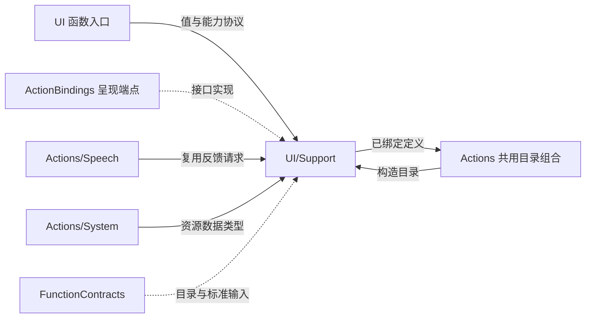
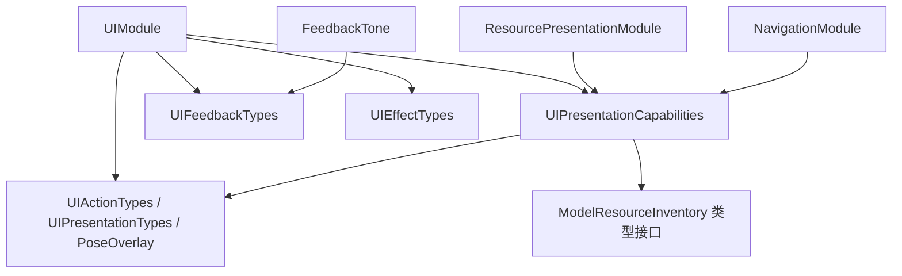

# UI Support — 中立呈现接口、载荷与反馈生成

## 简介

定义与 UI 框架无关的能力协议、请求值、姿态载荷、反馈 PCM，以及三个呈现目录的依赖绑定。核心值/函数源编译于 Actions；RuntimePresentation 等外层集成源由互斥清单编译于 ActionBindings，通过 UI 公开接口呈现。

## 上下游关系（一级）

## 内部模块关系

## 能力接口与目录

| 类型/文件 | 职责 |
| --- | --- |
| UIPresentationCapability | 有限表情呈现、覆盖恢复与持续基础表情提交 |
| UIUpdateCapability | 文字、转写、回复轮次、语音显示状态及视线目标更新 |
| PosePresentationCapability | PoseOverlay 与 sessionID 的整包呈现 |
| HistoryPresentationCapability | 基于真实 invocation 的历史呈现 |
| ResourcePresentationCapability | 导航、资源快照/错误、偏好错误、私有 Provider 结果呈现 |
| UIFeedbackCapability / UIEffectCapability | 音频/触觉、瞬时提示/装饰光请求 |
| UIActionTypes / UIPresentationTypes | Emotion、VoiceState、Gaze 和类型化错误 |
| UIFeedbackTypes / UIEffectTypes | 带范围校验的反馈、Notice、Light 值 |

UIModule 组合表情、一般呈现、反馈和装饰定义；ResourcePresentationModule 绑定五项资源呈现，NavigationModule 绑定 open。`feedbackDefinitions`、`effectDefinitions` 提供相同工厂集合供独立宿主复用，避免另造一份实现。

反馈与装饰能力可为 nil，但对应调用会明确抛 unavailable；资源协议扩展中，未实现的 navigate/presentProviderResult 也抛 unavailable。其余必需端点由注入者提供。目录声明来自本类型实际 definition 调用，不捕获运行时设备状态。

## 姿态载荷与校验

PoseOverlay 是独立 Codable 调用数据，不是模型后端或 UI 页面类型。Joint 使用恰好三个整数的数组编码：x、y、confidence；坐标单位为图像的 1/10000，置信度单位为 1/1000。

showPose 入口要求 payload 最多 3000 UTF-8 字节、timestamp 有限且非负、rotation 为 0…3、最多六人、每人完整 17 个 COCO 关节。坐标范围 −10000…20000，confidence 为 0…1000。空 people 用于清除。PoseOverlay 构造器本身不自动执行这些入口校验。

Statistics 要求各项存在值有限且非负、replacements 非负；detectionIntervalMilliseconds 最多 1000，imageMotion 最多 1。queueMilliseconds 与 totalMilliseconds 必须同时存在或同时缺省；存在时 total 至少覆盖 queue+inference（允许 0.001 毫秒误差）。这些是推理结果返回前的统计，不包含 UI 绘制确认。

## 反馈音频算法

FeedbackTone 的不可变静态 bank 缓存七种原始单声道 Float PCM，采样率 48000 Hz。samples 按已校验请求的 volume 缩放，不打开设备、不改变系统音量。wake/confirm/cancel/error/soft/save 使用多声部正弦、平滑起音、指数衰减和尾部包络；discard 使用固定种子的低通噪声、下降音与短点击。

| cue | 长度（秒） |
| --- | --- |
| wake | 0.94 |
| confirm | 0.38 |
| cancel | 0.40 |
| error | 0.46 |
| soft | 0.52 |
| save | 0.62 |
| discard | 0.58 |

## 生命周期与失败

所有请求都是中立 Sendable 值。能力调用以真实 FunctionInput 或明确 sessionID 为关联；原生设备准入、期限取消、状态过滤与动画恢复属于宿主。Emotion/VoiceState 是封闭词汇，Gaze/姿态/呈现参数错误提供 invalidArguments 分类，表情恢复可保留双重失败。

核心值/目录没有异步缓存加载、请求队列或后台任务；呈现集成的事务及实际渲染等待由 UI 拥有。反馈 PCM 缓存有固定七项边界；未提供端点不产生静默空操作。

[UI 入口与完成](../README.md) · [System 资源类型](../../System/Support/README.md) · [共享契约](../../Support/Contracts/README.md)

## 直接 UI 绑定

RuntimePresentation、EyeExpression、ConversationPresentation、ConversationPresentationController 和 HomeEffectsBindings 独立编译为 ActionBindings。它们实现标准 Actions 呈现能力，把 FunctionInput/中立业务值转换为 UI 自己的公开值和能力；实际调用不经过 App。

HomeEffectsWorkflow 的 timer、文本/UUID 围栏和状态在 UI/Conversation，只接受 UI.PresentationOwner；HomeEffectsBindings 转换 invocation 身份，不把 FunctionContracts 依赖带入 UI。会话/角色/执行权限分别由 Gateway、领域端点及呈现接纳负责；表情有限动画等待保留真实 renderer completion，持续表情只确认状态接纳。

✅ ConversationPresentationController 委托 UI 表情呈现对象等待实际动画完成；只保留执行身份接纳和领域值转换，不直接修改页面字段。

## 待实现

- showPose 当前只读取 payload，没有统一拒绝其它参数键；调用规范应只发送 payload。

## Storage 依赖

✅ 存储访问使用独立的 State、Cache、Database 和 Files 接口；App 注册根实例，消费者通过构造器获得所需能力。存储容器不接管本目录的业务验证、执行和完成语义。

## Platform 根、设备接入与同帧呈现

✅ PosePresentationCapability 增加携带 FunctionInput 的提交入口；通用独立宿主可使用原有无像素端口，生产 RuntimePresentation 则从受控 attachment 取得同帧 CameraFrame 并交给相机呈现端点。缺失/错帧/过期在生产端明确失败，不回退到单独骨架或原生视频。

## ApplicationControl 异常展示

✅ 已实现：UIModule 绑定 RuntimeDiagnostics；中立 RuntimeFailurePresentationCapability/RuntimeIssue 值不依赖 Agent/UI。RuntimePresentation 验证 ApplicationControl 根身份后写入注入的同一 ActionActivityState，不决定分类或提示文案。

## UI 全量容器化

✅ 应用级 UI 状态由八个子容器统一创建，消费者注入所需 Presenting 接口并提交 UI 自有值，不直接写字段。App 注册并管理同一 UI 根；原业务身份/版本校验、原生完成和基础库依赖边界保持。跨模块连接迁移仍是独立待办。