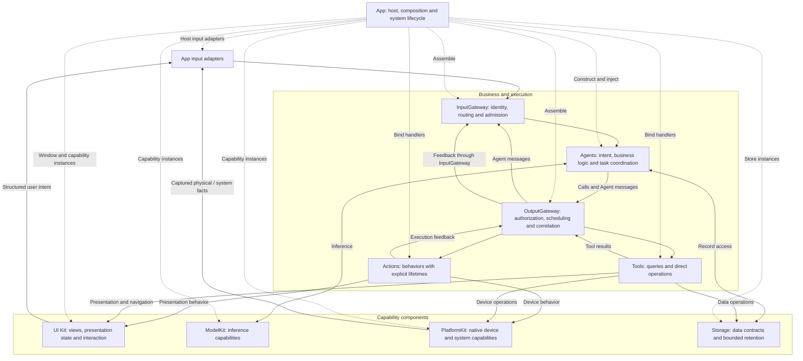
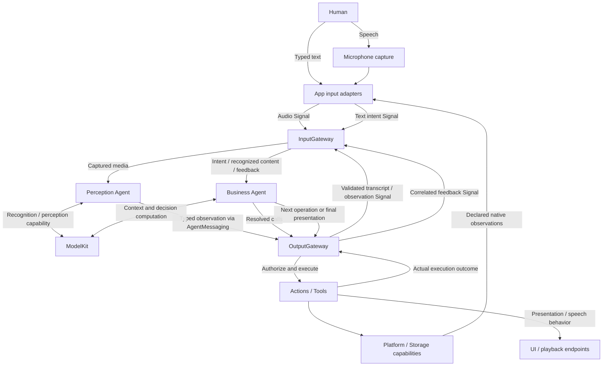
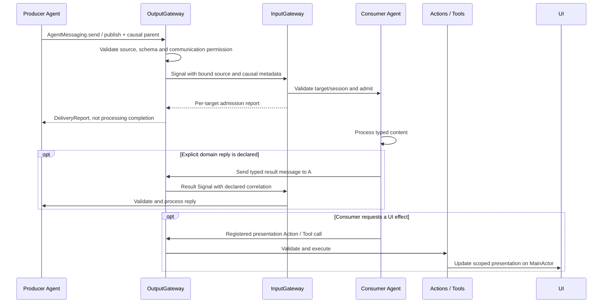
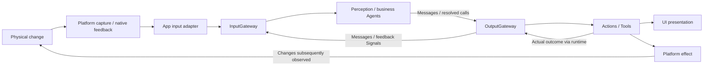
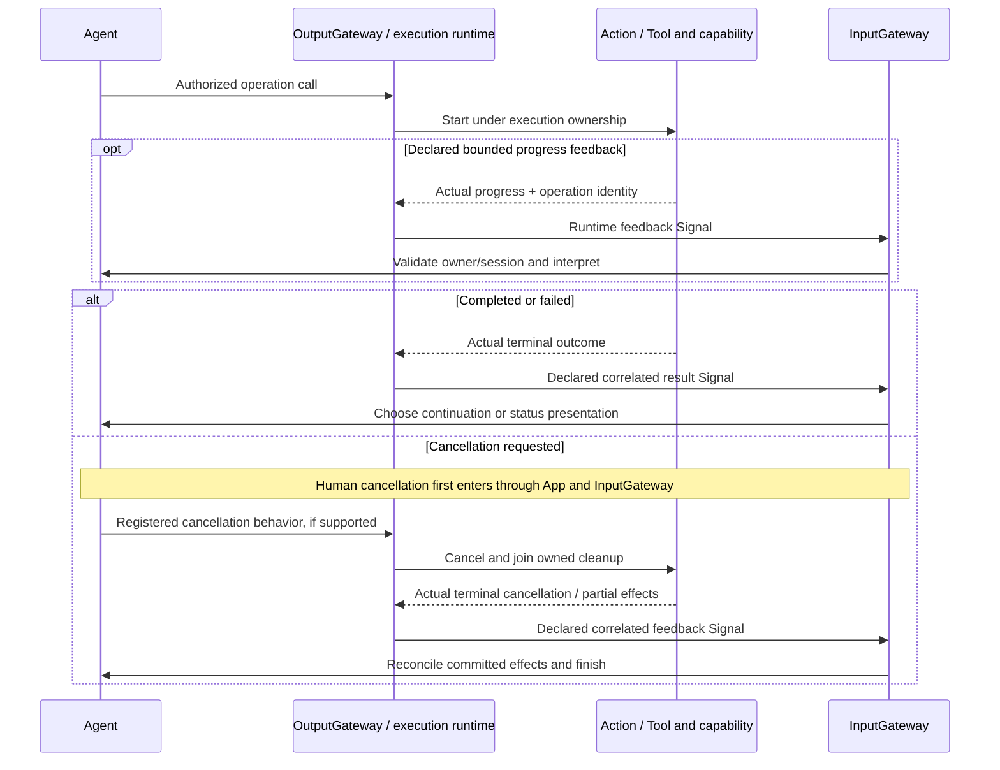

# Agent-Driven App Architecture

Status: active architecture, implemented in stages. This is the authoritative Agent-driven design for ongoing migration. Implemented contracts and outstanding work are labeled explicitly; new runtime changes must update this design before implementation. See the [technical plan](README.md), [current architecture](../docs/Architecture.md) and owning module READMEs for compilation boundaries and implementation details.

Read in order: [Goal](#goal) → [Architecture](#architecture) → [Signal contract](#unified-signal-contract) → [Execution and feedback](#execution-and-feedback) → [Scenarios](#signal-and-effect-scenarios) → [Cross-cutting cases](#cross-cutting-cases) → [Implementation and migration](#implementation-and-migration).

## Goal

Build an application whose business processing is driven by Agents. Agents own data-processing strategies, business decisions and task coordination. Human interaction, physical-world observations, system events, Agent messages and execution feedback enter as Signals through InputGateway. External inputs pass through App adapters; Agent communication and execution feedback follow their validated Gateway paths.

Direct interaction and LLM-selected behavior use the same Agent-owned business flows, shared capabilities and actual execution results. An Agent may handle explicit intent deterministically or use a model to decide its next step. It drives operations and presentation through OutputGateway and registered Actions/Tools, then uses returning Signals to continue, complete or cancel work.

UI, ModelKit, PlatformKit and Storage provide foundational presentation, inference, native I/O and persistence capabilities. App hosts and assembles the system, adapts external inputs and owns application lifecycle. UI renders Agent-driven state, captures human intent and retains local presentation state. As migration proceeds, every deliberately exposed application feature becomes operable through direct interaction or conversation within the same permissions and execution contracts.

## Architecture



Solid arrows show runtime flow; dashed arrows show composition. They do not prescribe Swift imports. **UI Kit** is the component name; retain the Swift module name `UI` because `UIKit` names Apple's framework.

### Ownership

| Component | Responsibility |
| --- | --- |
| App | Create the system, inject capabilities, host windows and forward system lifecycle events. Business workflows gradually move to Agents. |
| Agents | Own business decisions, context selection, summaries, retrieval strategies and multi-step tasks. |
| Gateway | Validate external inputs, Agent communication and outputs; correlate execution results. |
| Actions / Tools | Implement callable business behavior using injected capability interfaces. |
| UI Kit | Implement presentation endpoints, navigation, rendering, animation and localized wording. Emit structured user intent. |
| ModelKit | Supply independent inference capabilities. |
| PlatformKit | Supply permissions/capability facts, native I/O, connection, protocol encoding and device feedback. |
| Storage | Own schemas, retrieval mechanisms, bounds, ownership, atomic persistence and compatibility. |

Agents drive presentation through OutputGateway and registered Actions/Tools, rather than mutating SwiftUI state directly. UI endpoints execute on MainActor; runtime and stores retain actor isolation. Page-local state such as scrolling, expansion and form drafts stays in UI.

The host role remains necessary even when business coordination leaves App. Device and model sessions must outlive pages where required; foreground eligibility and cleanup must have explicit owners.

## Unified Signal Contract

A **Signal** is immutable information admitted to an Agent: human intent, a captured physical observation, another Agent's message, or execution feedback. Signal is the architectural concept; **`AgentInput` is its canonical in-process envelope**. Keep one envelope rather than introducing a parallel `Signal` type. Payloads retain domain-specific types and validation.

An Agent's registered Action/Tool call is an execution request in `OutputEnvelope`, not an input Signal. Its returning feedback becomes a Signal. Model inference returns and private intermediate computations remain local capability results unless explicitly communicated to another Agent. UI drafts, scrolling and expansion remain local presentation state.

### External and internal origin

Origin and payload meaning are independent dimensions. All origins share the `AgentInput` envelope; intent, observation and feedback remain domain semantics rather than inheritance branches.

| Origin | Examples | Authority |
| --- | --- | --- |
| External | Human interaction, native capture/device facts, OS lifecycle and permission changes, future remote inputs | App adapters bind source identity and adapt validated native inputs. |
| Internal / Agent | Published observations, directed commands and declared domain replies | Identity-bound AgentMessaging binds a live Agent source through both Gateways. |
| Internal / Runtime | Actual execution feedback, task progress/cancellation and future declared runtime timer triggers | The owning execution/runtime producer binds operation identity and feedback authority. |

“External” means outside the Agent system, even when UI or a native SDK runs in the same process. A hardware notification is an external fact; the executor's correlated interpretation of an operation outcome is internal feedback. Both can exist, with distinct contracts and deduplication rules. Model inference returns stay local unless explicitly communicated.

The design uses composition of common envelope, typed origin and domain payload rather than a class hierarchy. Origin must be bound by the producing adapter or runtime, not asserted by payload content. Neither payload kind nor a missing incarnation identifies origin, and an internal label grants no permission. Current typed-origin coverage and remaining legacy paths are listed under [implementation status](#current-implementation-status).

### Envelope and payload

| Contract element | Canonical structure / rule |
| --- | --- |
| Identity and scope | `AgentInput.id`, `sessionID`, optional `AgentTurn`; distinguish delivery identity, session and interaction. |
| Schema | `InputMetadata.contract` and `version` identify payload semantics; `topic` currently equals contract. Agent configuration JSON v5 is a separate format version. |
| Producer | `source` and optional `incarnation`; App input adapters assign external sources, and the runtime binds Agent identity. Model text cannot assign trusted identity or permissions. |
| Time and order | `capturedAt` uses process uptime; `sequence` is producer-scoped; `deadline` uses `ContinuousClock`. These are process-local values, not wall-clock timestamps or a remote wire format. |
| Causality | `rootID`, optional `parentID`, `hops`; forwarded messages preserve their root and identify their parent. Execution feedback also preserves its call/execution correlation and owning session. |
| Content | `InputPayload` selects typed text, event, audio, image, Agent message, Tool result, Action result or activity feedback. A kind declaration alone does not implement a payload or adapter. |
| Domain message | `AgentMessage` carries immutable `Encodable & Sendable` content. Domain-owned schemas validate concrete type, fields, units, encoded size and freshness through `CommunicationContracts`. |

### Payload meaning

Origin describes who produced a Signal; the following categories describe what it means. They do not introduce a second transport enum:

| Category | Producers and examples | Current representation |
| --- | --- | --- |
| Intent / command | Human clicks, text requests, Agent-generated synthesis or cancellation | `.text`, legacy `.event`, or registered `.observation(AgentMessage)` with command semantics |
| Observation | Microphone/camera capture, perceived transcript, pose or sound direction; future device discovery facts | `.audio`, `.image`, registered `.observation(AgentMessage)` |
| Execution feedback | Actual Tool/Action outcomes and activity lifecycle updates | `.toolResult`, `.actionResult`, `.activityEvent` |

The existing name `observation` is a generic domain-message carrier and currently includes commands. `CommunicationContract.startsNewWork` distinguishes generated work from forwarded observations. New business intents must use domain-owned typed contracts registered through this mechanism; do not expand string-encoded `runtime.event` commands. Existing history strings remain a documented migration exception until replaced. Payload types belong to their domain, generic envelope/routing types to AgentCore, and native SDK values are converted by App adapters.

## Execution and Feedback

### Routing and authorization

External Signals enter through App → InputGateway. Agent messages use AgentMessaging → OutputGateway → InputGateway. Agent-driven business effects, including UI changes, use Agent → OutputGateway → registered Action/Tool → capability endpoint; actual returning feedback enters InputGateway again.

Each Agent declares model-callable Actions/Tools and communication permissions in JSON v5. Fixed internal behavior and output permissions belong to Agent code. App binds concrete handlers; Gateway validates coverage and authorization. Runtime control notices describe protocol completion/failure, not unregistered business effects.

1. Contracts and permissions are explicit: validate payload/schema, allowed source, live identity, session, deadline and capacity before admission. Publish selects exact static subscriptions; send selects an explicit recipient. Unknown contracts and incompatible versions reject, with no fallback recipient.
2. Admission means accepted for processing. It does not imply inference, rendering or physical completion. Returning Tools provide correlated results; completion-only Tools return execution outcomes without injecting a ToolResult. Actions retain their execution/lifecycle semantics.
3. Forwarded observations cannot extend the parent's deadline. Registered newly generated work receives a fresh bounded admission deadline while retaining causal association. Runtime result/cancellation producers follow their explicitly owned feedback contracts. Admission expiry is not an execution timeout or a hardware stop guarantee.
4. Agents fence feedback by session and call/execution identity before continuation. Failed delivery is separate from failed execution; delivery retry must not repeat a completed effect. Cancellation uses the owning execution protocol and joins cleanup; a durable effect remains committed.
5. Every admission, inbox and output buffer has an explicit bound and overflow policy. Gateway has bounded active admission and no waiting Signal queue or FIFO guarantee. Only explicitly declared latest-state observations may coalesce; intents, results and device actions must have explicit rejection/retry/failure handling rather than silent replacement.

### Result semantics and presentation

| Event or result | Agent responsibility | Observable effect |
| --- | --- | --- |
| Input admission | Await actual processing/execution; handle rejection at the producer | No implied operation success or completed UI effect |
| Data or successful execution feedback | Validate correlation, update task state and choose the next step | A new authorized Action/Tool may present results or perform another operation |
| Progress / physical observation | Interpret domain facts under freshness and operation scope | Explicit presentation or behavior output; only declared latest-state inputs may coalesce |
| Failure / cancellation | Stop or continue according to task policy; retain committed effects and join owned cleanup | Explicit status presentation where registered; no automatic effect replay |
| UI endpoint completion | Respect the endpoint's declared completion semantics | State acceptance does not prove animation completion, audio drain or physical arrival |
| New selection / changed environment | Treat as a fresh scoped input linked to its relevant task | Re-enter through InputGateway when business processing is required |

Presentation endpoints fence session/request/turn identity before applying a business update, so late feedback cannot overwrite newer state.

Rendering a state change does not automatically produce a new Signal. Only meaningful user, system or domain feedback re-enters the input boundary. This keeps the feedback loop explicit and avoids self-triggered presentation loops. Endpoint failures remain execution outcomes; completion-only UI Tools do not manufacture returning ToolResult Signals.

## Signal and Effect Scenarios

These flows apply the common contracts above. A task can cross several scenarios; the categories are not separate Signal types. App adapts input and forwards output without selecting business operations. Diagrams describe the architecture; actual coverage and staged exceptions are recorded under [implementation status](#current-implementation-status).

### Scenario coverage

Six categories cover human intent, Agent collaboration, independent observations, host facts and execution feedback:

| Scenario | Input / origin | Business processing and effects |
| --- | --- | --- |
| 1. Direct UI interaction | External intent | Agent selects an operation and presentation; local drafts/scroll remain in UI. |
| 2. Conversation | External text/audio, followed by internal perception messages | Business Agent interprets intent and handles actual results; inference itself is local computation. |
| 3. Agent collaboration | Internal Agent message | Receiver processes content, optionally replies or emits registered effects. |
| 4. Physical-world observation | External capture/native fact, optionally followed by internal perception messages | Agent may react without a new human request, within an enabled task and declared permissions. |
| 5. System and capability event | External lifecycle, permission, route or availability fact | Host handles immediate lifecycle mechanisms; Agents decide scoped business reactions. |
| 6. Execution lifecycle | Internal runtime feedback | Agent interprets progress, actual completion, failure or cancellation and chooses continuation/presentation. |

### 1. Human interaction with UI

Preserve familiar mobile interactions—taps, gestures, forms, navigation and confirmation—to support existing user habits and direct, precise control. An Agent-driven app still offers these interactions alongside conversation.

The difference is the business path: UI emits explicit intent instead of implementing business processing or directly coordinating services. The responsible Agent handles that intent, selects registered Actions/Tools through OutputGateway, processes actual feedback through InputGateway and requests the resulting presentation. Direct UI intent can be handled deterministically without invoking an LLM; conversational intent uses the same business capabilities, permissions and execution contracts. UI retains rendering and local interaction state.

This implemented deletion example shows the shared intent/effect boundary and where confirmation belongs. Remaining traditional workflow paths migrate to this boundary in stages.

```mermaid
sequenceDiagram
    actor Human
    participant UI
    participant App as App input adapter
    participant Input as InputGateway
    participant Agent as ConversationMemory
    participant Output as OutputGateway
    participant Effects as Registered Tools / capabilities
    Human->>UI: Confirm archive deletion
    UI->>App: Delete intent + archive ID
    App->>Input: Signal with request/session identity
    Input->>Agent: Validated input
    Agent->>Output: Resolved History.delete call
    Output->>Effects: Authorized Tool executes Storage transaction
    Effects-->>Output: Actual success or failure + call ID
    Output->>Input: Correlated ToolResult Signal
    Input->>Agent: Scoped feedback
    alt Deletion succeeded
        Agent->>Output: Resolved UI.showHistory call
        Output->>Effects: Invoke registered presentation Tool
        Effects->>UI: Apply scoped actual snapshot on MainActor
        UI-->>Human: Updated history
    else Deletion failed
        Agent->>Output: Failure control / execution outcome
        Note over App,UI: Current root workflow shows localized error; Agent error presentation is pending
    end
```

The target failure path is also Agent → OutputGateway → registered status-presentation Action/Tool → UI. The host error path shown above is a staged exception, not an alternative business output channel.

UI-local scrolling, expansion, focus and unsubmitted drafts stay in UI. Business gestures and submitted forms emit intent; continuous controls require explicit cadence and overflow policy.

### 2. Conversation

After InputGateway admission, typed text reaches the business Agent; speech reaches a perception Agent first. Recognized content becomes a typed Agent message through both Gateways. Model inference remains an injected computation inside the Agent's decision process.



For “scan nearby devices”, the business Agent selects a registered discovery capability; it reports actual devices or failure and requests their display through registered UI behavior. Starting discovery, observing a device and completing a scan are distinct events. Device effects can change later observations; those measured facts enter as new Signals rather than being inferred from the issued command. If discovery is asynchronous, native facts arrive through App input adapters under a declared session/operation contract; returning feedback must match the operation's registered result semantics.

Result-driven model continuation requires a finite step budget, execution deadline and cancellation owner per task. LLM predictions never stand in for execution success; current Assistant continuation and discovery limitations are listed under implementation status.

### 3. Agent-to-Agent collaboration

Agents exchange domain messages through both Gateways. They do not call each other's business methods or use UI updates as a communication channel. A receiver decides whether a message requires further processing, a reply or a registered effect.



`send` chooses one permitted target; `publish` selects declared subscribers. The root and parent identify causality, not a generic request/reply service. A domain needing a reply must declare its payload, request correlation, pending-work bound, timeout and cancellation behavior before implementation. Such a reply is a new message with its own permission checks. A directed message alone does not create an automatic request/reply service.

### 4. Physical-world observation without a new user request

An enabled camera/tracking task, device discovery or sensor monitor can receive new facts independently of a click or conversation. App adapts capture/native events into Signals; a perception Agent is optional for already-structured device facts.



Observation is evidence, not authorization to start arbitrary behavior. The enabled task owns its scope, cadence, freshness and resource use. Only declared latest-state observations may coalesce; discrete device facts need an explicit delivery policy. Issuing a command does not prove the resulting physical state.

### 5. System and capability events

Foreground/background changes, permission changes, audio-route interruption and model/device availability changes can alter what a task may do. The target business path is **OS/native fact → App adapter → InputGateway → responsible Agent → OutputGateway → registered reaction**.

App remains responsible for immediate lifecycle mechanisms: suspending capture, joining owned execution, releasing resources and starting/stopping runtime scopes. Those mechanisms cannot depend on a delayed Agent response or inference. Publish business-relevant lifecycle facts only into valid scopes; an unavailable Agent/session cannot be assumed to receive a shutdown event. Permission denial and unavailable capability must not become fabricated success.

Foreground return does not automatically replay prior device effects.

### 6. Execution lifecycle and long-running work

A returning Tool can finish in one result; discovery, downloads, playback or motion may have separate admission, progress and terminal outcomes. Declare each operation's feedback channel, owner, correlation and completion semantics before implementation.



This is a target lifecycle pattern for contracts that return feedback, not a generic progress/cancellation API implemented by every Tool. Native asynchronous facts still use the external adapter paths in scenarios 4 and 5. Completion-only Tools retain execution outcomes without a new ToolResult. Runtime control notices cannot encode unregistered business cancellation.

## Cross-cutting Cases

| Case | Required design before migration |
| --- | --- |
| User decision during a task | Picker selection, confirmation or clarification returns as a scoped external Signal through App → InputGateway, distinct from successful prompt presentation. Declare pending-task bounds, response correlation, timeout and cancellation; opening the prompt is not the user's decision. |
| Concurrent inputs / multiple views | Define explicit task/session ownership, overlap rejection/queueing and resource arbitration. Human and model requests share authorization; manual priority exists only where policy declares it. Fence late presentation by its intended scope. |
| Scheduled or periodic trigger | Declare whether an OS trigger is external or an owned runtime timer is internal. Bound timers/work, supply scope and deadlines, and prevent feedback-driven recurrence. Do not imply background execution guarantees. |
| Restart / reconnect / recovery | Restore durable records through Storage capabilities, reconcile actual native state and create fresh live scopes. Persisted data is not automatically a Signal; never replay stale requests or completed effects by default. |
| Future remote integration | Reuse the envelope concept only through an explicit adapter with authentication, codecs, version and replay policy. Authentication/admission alone does not grant internal execution authority; remote transport remains unimplemented. |

System permission prompts still require user interaction. Presenting a picker does not grant unrestricted library access. Physical robot safety cannot depend on iOS background execution.

## Implementation and Migration

### Signal origin and returning Tool feedback contract

The first implementation stage adds `SignalOrigin` (external, agent, runtime) to the common InputMetadata; callers do not gain admission authority by constructing that value. Public send/publish admit only external origin and reject execution feedback payloads. Identity-bound OutputGateway messaging constructs Agent origin. Owner-scoped execution delivery constructs Runtime origin and validates the original Agent incarnation/session before reception. Host runtime.event commands remain a labeled external-origin legacy path until typed control migration.

OutputEnvelope retains the original input metadata. Returning Tool feedback preserves rootID and turn, uses the originating inputID as parentID, advances hops once and gets a fresh bounded feedback admission deadline because execution may outlive input admission. Feedback is delivered only to the captured execution owner. Stale owner, exhausted hops or admission failure is recorded separately as deliveryFailure while preserving the actual Tool value/error; the effect is not re-executed. Completion-only Tools remain unchanged. This stage adds no feedback queue or automatic retry.

Action feedback keeps its existing owner fencing; complete original-root propagation for Action/activity feedback remains a separate stage. Typed origin is an in-process admission contract, not remote authentication.

### Current implementation status

Design rules govern subsequent implementation; the table distinguishes existing mechanisms from unfinished migration.

| Area | Implemented | Outstanding |
| --- | --- | --- |
| Signal envelope and contracts | ✅ AgentInput, metadata/payload, domain-message schemas, JSON permissions and both Gateway paths; supported input contract version 1; typed SignalOrigin and owner-fenced returning Tool admission | ❌ Typed host control producers and complete Action/activity original-root transport. Video/binary kinds have no payload cases. |
| UI and history | ✅ ConversationMemory refresh and confirmed archive deletion through both Gateways; returning History.list/read Tools | ❌ String history intents and legacy controls, archive/title policy, general navigation/picker/device intent routes and registered failure presentation |
| Conversation and collaboration | ✅ Registered perception/synthesis/pose messages and current Assistant Tool feedback | ❌ Automatic model continuation, conversational BLE discovery and generic request/reply |
| Physical and host events | ✅ Existing perception/tracking pipelines and App-owned lifecycle/cleanup | ❌ General sensor/native fact coverage and unified lifecycle/capability business Signals |
| Execution lifecycle | ✅ Specific ActionResult/ActivityEvent contracts, role-owned cancellation and history cancellation cleanup | ❌ Common long-task Agent progress/cancellation contract and remaining feature routes |
| Model resources | ✅ Passive UI state with interaction/admission policy moved into independent AppSettingsWorkflow | ❌ Agent/Gateway resource controls, remaining UI policy and native transfer acceptance |
| Transport evolution | ✅ Process-local admission and bounded domain content encoding | ❌ Contract-version migration, whole-envelope remote codecs/authentication, durable/replay delivery and dynamic subscriptions |

Current Gateway limits include 128 active admissions, 16 recipients per operation, 256 active branches, 8 MiB observation reservations and at most 8 causal hops. Agent inbox/output limits are role-specific. See [InputGateway](Gateway/Input/README.md) and [communication policy](Agents/Core/Communication/README.md). AgentMessage encoding is not serialization of the whole Signal envelope.

### Deterministic History Mutation Contract

Confirmed archive deletion follows the implemented [human interaction flow](#1-human-interaction-with-ui) above.

ConversationMemory owns one pending mutation and validates runtime result source, session and call ID. It performs no direct UI mutation. Tools owns archive-only deletion validation; Storage owns the atomic transaction. App composes the shared journal and carries intents/results, without selecting the next business operation. The existing root transport admits one request without backlog and executes at most two business calls. Model-callable catalogs remain unchanged; deletion is fixed internal permission and requires the existing explicit UI confirmation in this stage.

Cancellation joins Tool execution before releasing admission. It clears pending Agent state with a runtime-sourced cancellation event through InputGateway and drains at most eight buffered outputs until a non-business cancellation acknowledgment crosses OutputGateway, so obsolete presentation cannot execute on retry. A successful durable delete cannot be rolled back by later cancellation or presentation failure; refresh shows actual stored state. Missing/current IDs fail explicitly. No automatic deletion retry or LLM continuation is added.

This extends deterministic result-driven sequencing; it does not change the staged target ownership. Archive/title and model-resource direct controls remain documented legacy paths until separately migrated.

### Staged Migration

| Stage | Delivered / next work |
| --- | --- |
| 1. Separate foundational capabilities | ✅ Assistant owns context selection, SpeechSynthesis owns producer errors and UI owns fallback wording; Storage retains schemas, atomic persistence and opaque read-token admission ([ADR0143](../docs/adr/0143-storage-consumer-policy-boundaries.md)). |
| 2. Unify Signal contracts | ✅ Common envelope/domain schemas, typed origin admission and owner-fenced Tool causal feedback ([ADR0149](../docs/adr/0149-signal-origin-and-tool-feedback.md)). ❌ Replace string intents and complete Action/activity roots. |
| 3. Share callable business capabilities | ✅ Bounded History.list/read Tools ([ADR0144](../docs/adr/0144-read-only-history-tools.md)). ❌ Register remaining data, UI/picker/navigation and device capabilities. |
| 4. Move business coordination into Agents | ✅ Deterministic history refresh/deletion ([ADR0145](../docs/adr/0145-history-refresh-agent-intent.md), [ADR0147](../docs/adr/0147-history-delete-result-continuation.md)); resource interaction first moved out of UI ([ADR0146](../docs/adr/0146-model-resource-interaction-ownership.md)). ❌ Migrate archive/summary/resource and remaining workflows; default title wording stays in UI. |
| 5. Complete feedback-driven tasks | ❌ Add bounded model continuation and explicit long-task/domain reply contracts; verify equivalent outcomes for direct and conversational entry points. |

Update this design before changing runtime contracts. Each implementation stage must update owning READMEs, dependency checks, the technical plan, ADRs and roadmap, with explicit admission, lifetime and verification evidence. Architectural cleanup does not establish native UI/device acceptance.
